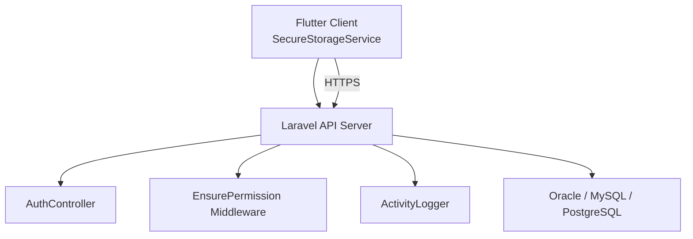
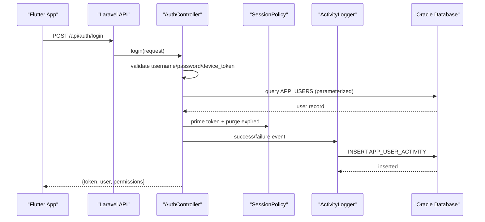
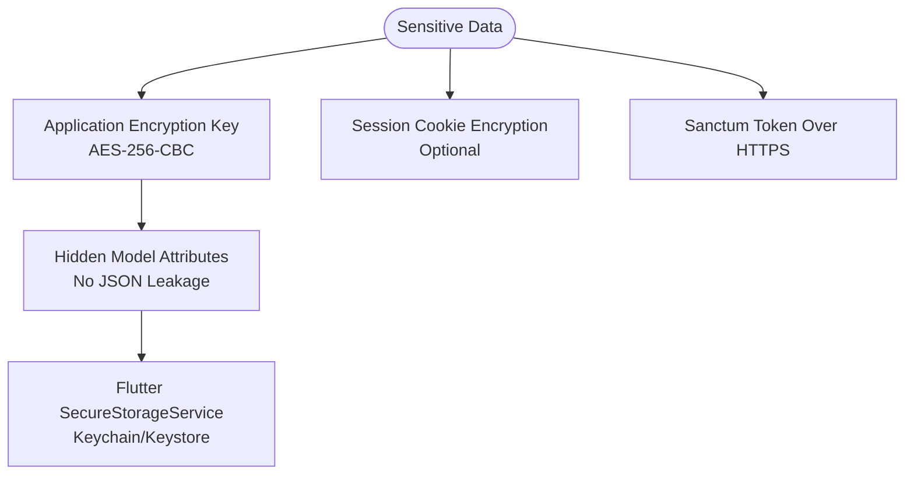
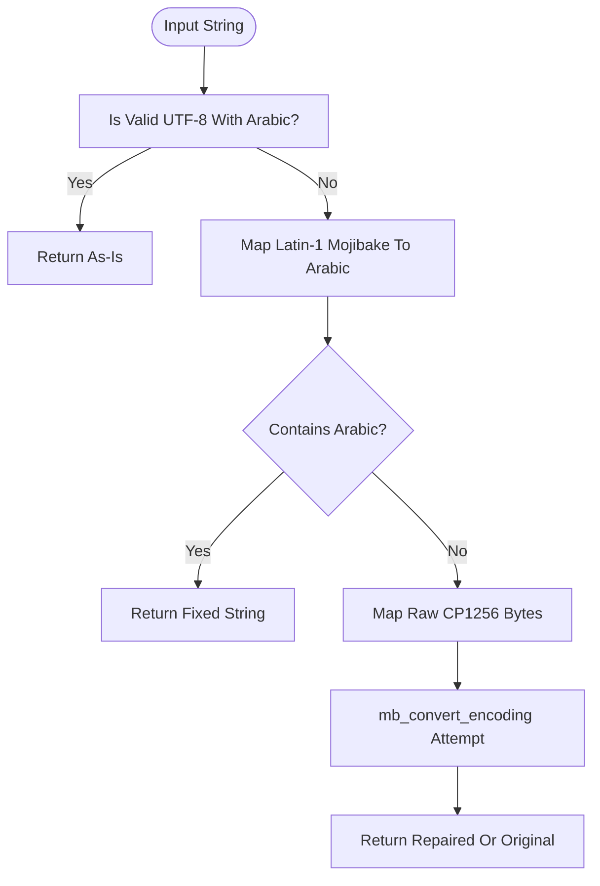
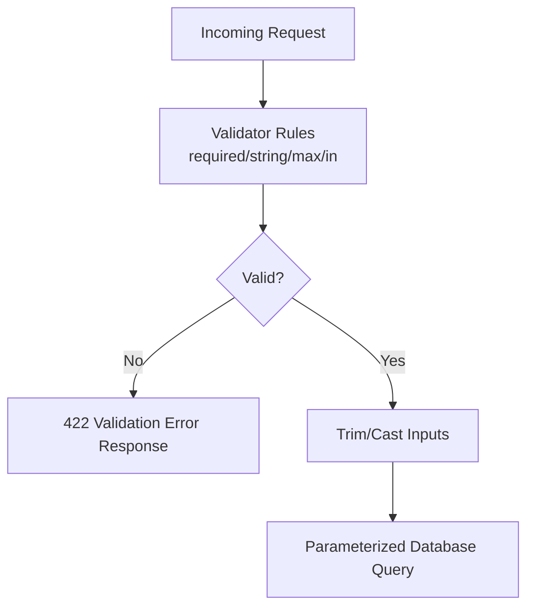
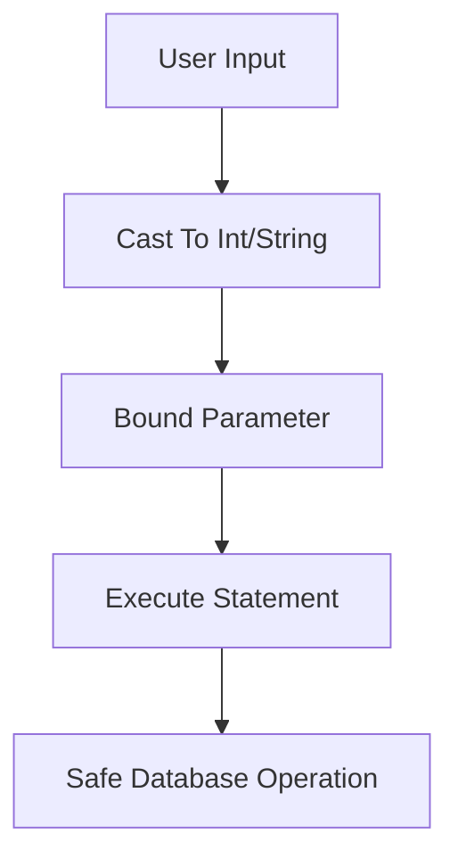
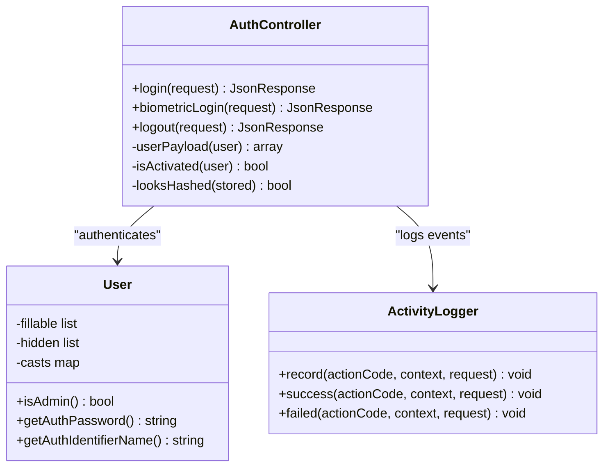
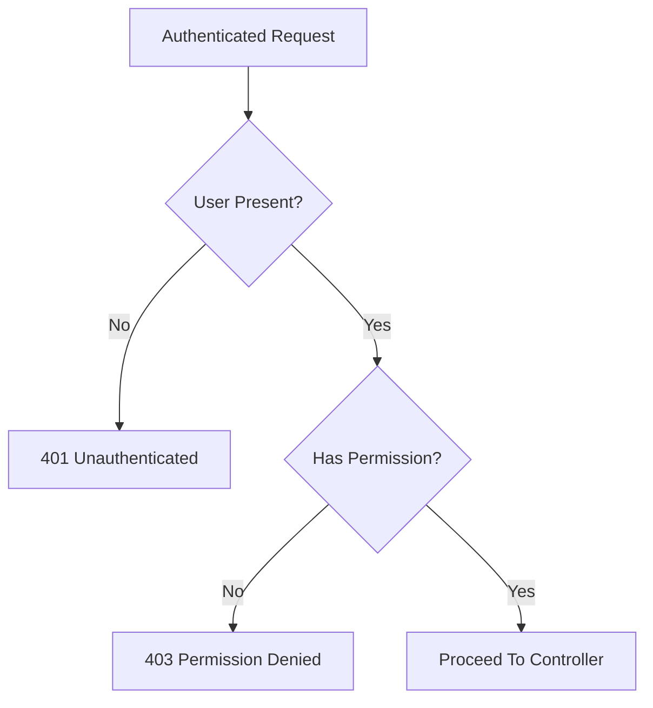
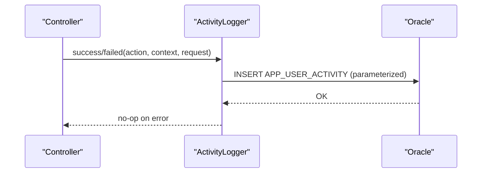
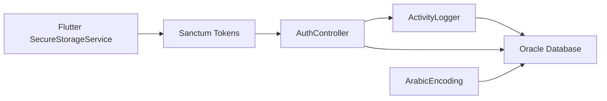

# Data Security & Protection

<cite>
**Referenced Files in This Document**   
- [AuthController.php](file://kyApp_API/app/Http/Controllers/AuthController.php)
- [User.php](file://kyApp_API/app/Models/User.php)
- [ActivityLogger.php](file://kyApp_API/app/Support/ActivityLogger.php)
- [ArabicEncoding.php](file://kyApp_API/app/Support/ArabicEncoding.php)
- [EnsurePermission.php](file://kyApp_API/app/Http/Middleware/EnsurePermission.php)
- [database.php](file://kyApp_API/config/database.php)
- [session.php](file://kyApp_API/config/session.php)
- [auth.php](file://kyApp_API/config/auth.php)
- [sanctum.php](file://kyApp_API/config/sanctum.php)
- [app.php](file://kyApp_API/config/app.php)
- [01_ibac_schema.sql](file://kyApp_API/database/oracle/01_ibac_schema.sql)
- [secure_storage_service.dart](file://lib/core/storage/secure_storage_service.dart)
- [api_constants.dart](file://lib/core/constants/api_constants.dart)
- [security.md](file://kyApp_API/.agents/skills/laravel-best-practices/rules/security.md)
- [validation.md](file://kyApp_API/.agents/skills/laravel-best-practices/rules/validation.md)
- [AGENTS.md](file://kyApp_API/AGENTS.md)
</cite>

## Table of Contents
1. [Introduction](#introduction)
2. [Project Structure](#project-structure)
3. [Core Components](#core-components)
4. [Architecture Overview](#architecture-overview)
5. [Detailed Component Analysis](#detailed-component-analysis)
6. [Dependency Analysis](#dependency-analysis)
7. [Performance Considerations](#performance-considerations)
8. [Troubleshooting Guide](#troubleshooting-guide)
9. [Conclusion](#conclusion)
10. [Appendices](#appendices)

## Introduction
This document explains how Ky Apps protects sensitive data across the Flutter client and Laravel backend. It covers encryption at rest and in transit, Arabic text encoding for Oracle, input validation, SQL injection prevention, XSS protection, CSRF mitigation, audit logging, database security configuration, session and token handling, privacy requirements, retention policies, and secure disposal practices. The goal is to make the security model clear for developers, reviewers, and operators without requiring them to read every source file first.

## Project Structure
Ky Apps has two main layers:
- Flutter client (`lib/...`) that stores tokens securely and calls protected API endpoints.
- Laravel backend (`kyApp_API/...`) that authenticates users, enforces permissions, validates inputs, logs security events, and persists data to Oracle and other databases.

**Diagram sources**
- [secure_storage_service.dart:1-45](file://lib/core/storage/secure_storage_service.dart#L1-L45)
- [AuthController.php:47-163](file://kyApp_API/app/Http/Controllers/AuthController.php#L47-L163)
- [EnsurePermission.php:25-52](file://kyApp_API/app/Http/Middleware/EnsurePermission.php#L25-L52)
- [ActivityLogger.php:37-73](file://kyApp_API/app/Support/ActivityLogger.php#L37-L73)
- [database.php:33-127](file://kyApp_API/config/database.php#L33-L127)

**Section sources**
- [secure_storage_service.dart:1-45](file://lib/core/storage/secure_storage_service.dart#L1-L45)
- [AuthController.php:47-163](file://kyApp_API/app/Http/Controllers/AuthController.php#L47-L163)
- [database.php:33-127](file://kyApp_API/config/database.php#L33-L127)

## Core Components
The security model relies on these core components:
- Secure token storage on the Flutter client.
- Sanctum-based authentication with explicit session policy.
- Deny-by-default permission middleware.
- Input validation using Laravel validators.
- Parameterized audit logging.
- Arabic encoding helper for Oracle compatibility.
- Database configuration for multiple drivers and optional SSL.
- Session cookie security settings.

Key responsibilities:
- **AuthController**: validates login/biometric requests, issues Sanctum tokens, applies session policy, and records audit events.
- **User model**: defines mass assignment allow-lists, hides secrets, casts numeric columns, and exposes admin status.
- **ActivityLogger**: writes parameterized audit rows without failing successful requests.
- **ArabicEncoding**: repairs mojibake and maps Arabic text for Oracle’s legacy encoding.
- **EnsurePermission**: blocks unauthenticated or unauthorized access before controllers run.
- **Session config**: controls lifetime, encryption, cookie flags, and SameSite behavior.
- **Database config**: defines connections, charset/collation, SSL options, Redis cache/session backends.

**Section sources**
- [AuthController.php:47-163](file://kyApp_API/app/Http/Controllers/AuthController.php#L47-L163)
- [User.php:53-88](file://kyApp_API/app/Models/User.php#L53-L88)
- [ActivityLogger.php:37-73](file://kyApp_API/app/Support/ActivityLogger.php#L37-L73)
- [ArabicEncoding.php:36-120](file://kyApp_API/app/Support/ArabicEncoding.php#L36-L120)
- [EnsurePermission.php:25-52](file://kyApp_API/app/Http/Middleware/EnsurePermission.php#L25-L52)
- [session.php:21-50](file://kyApp_API/config/session.php#L21-L50)
- [database.php:33-127](file://kyApp_API/config/database.php#L33-L127)

## Architecture Overview
The application uses a layered security architecture:
- Transport security via HTTPS between Flutter and Laravel.
- Authentication via Laravel Sanctum personal access tokens.
- Authorization via IBAC permission codes enforced by middleware.
- Audit logging through a dedicated table with parameterized queries.
- Sensitive data protection through hidden attributes, strict field lists, and platform-native secure storage.

**Diagram sources**
- [AuthController.php:47-163](file://kyApp_API/app/Http/Controllers/AuthController.php#L47-L163)
- [ActivityLogger.php:37-73](file://kyApp_API/app/Support/ActivityLogger.php#L37-L73)
- [01_ibac_schema.sql:152-184](file://kyApp_API/database/oracle/01_ibac_schema.sql#L152-L184)

## Detailed Component Analysis

### Encryption Strategies and Secure Storage
Encryption is applied at multiple layers:
- Application encryption key and cipher are configured centrally.
- Session cookies can be encrypted when enabled.
- Sanctum cookies can be encrypted through the encrypt cookies middleware.
- Flutter client stores tokens and credentials in platform-native secure storage.

Recommendations based on current configuration:
- Ensure `APP_KEY` is set and not committed to version control.
- Enable `SESSION_ENCRYPT=true` if sessions contain sensitive state.
- Keep Sanctum `expiration => null` so sliding session logic remains effective; absolute expiry is managed by `EXPIRES_AT`.
- Use HTTPS for all API calls; avoid hardcoding base URLs over HTTP in production.

**Diagram sources**
- [app.php:92-98](file://kyApp_API/config/app.php#L92-L98)
- [session.php:41-50](file://kyApp_API/config/session.php#L41-L50)
- [sanctum.php:107-107](file://kyApp_API/config/sanctum.php#L107-L107)
- [secure_storage_service.dart:1-45](file://lib/core/storage/secure_storage_service.dart#L1-L45)

**Section sources**
- [app.php:92-98](file://kyApp_API/config/app.php#L92-L98)
- [session.php:41-50](file://kyApp_API/config/session.php#L41-L50)
- [sanctum.php:63-77](file://kyApp_API/config/sanctum.php#L63-L77)
- [secure_storage_service.dart:1-45](file://lib/core/storage/secure_storage_service.dart#L1-L45)
- [api_constants.dart:1-28](file://lib/core/constants/api_constants.dart#L1-L28)

### Arabic Text Encoding and Data Integrity
Arabic text must survive round-trips between UTF-8 clients and an Oracle database configured with a legacy character set. The `ArabicEncoding` helper provides:
- Repair of mojibake from Oracle.
- Conversion of UTF-8 Arabic into Oracle-compatible search characters.
- Recursive cleaning of arrays and objects.

Security implications:
- Prevents data corruption that could bypass filters or break UI rendering.
- Ensures audit descriptions remain readable and consistent.
- Avoids double-repair loops that would corrupt already-correct Arabic.

**Diagram sources**
- [ArabicEncoding.php:36-120](file://kyApp_API/app/Support/ArabicEncoding.php#L36-L120)

**Section sources**
- [ArabicEncoding.php:36-120](file://kyApp_API/app/Support/ArabicEncoding.php#L36-L120)
- [ArabicEncoding.php:143-162](file://kyApp_API/app/Support/ArabicEncoding.php#L143-L162)
- [ActivityLogger.php:56-61](file://kyApp_API/app/Support/ActivityLogger.php#L56-L61)

### Input Validation Patterns
Validation is performed early in request handlers:
- Login and biometric endpoints use `Validator::make` with explicit rules.
- Responses return structured errors with 422 status for validation failures.
- Controllers trim and cast inputs before querying the database.

Best practices observed:
- Validate required fields and allowed enumerations.
- Limit string lengths to prevent oversized payloads.
- Use parameterized queries rather than concatenating user input.

**Diagram sources**
- [AuthController.php:47-84](file://kyApp_API/app/Http/Controllers/AuthController.php#L47-L84)
- [validation.md:1-48](file://kyApp_API/.agents/skills/laravel-best-practices/rules/validation.md#L1-L48)

**Section sources**
- [AuthController.php:47-84](file://kyApp_API/app/Http/Controllers/AuthController.php#L47-L84)
- [validation.md:1-48](file://kyApp_API/.agents/skills/laravel-best-practices/rules/validation.md#L1-L48)

### SQL Injection Prevention
SQL injection risks are mitigated by:
- Using parameterized queries in both Eloquent-style raw queries and direct PDO inserts.
- Casting numeric identifiers before use.
- Truncating strings to column limits.
- Avoiding dynamic SQL fragments built from user input.

Examples in this codebase:
- Login query uses `whereRaw` with bound parameters.
- Biometric login checks `DEVICE_TOKEN` with a bound parameter.
- Audit insert uses named placeholders.

**Diagram sources**
- [AuthController.php:75-84](file://kyApp_API/app/Http/Controllers/AuthController.php#L75-L84)
- [AuthController.php:354-358](file://kyApp_API/app/Http/Controllers/AuthController.php#L354-L358)
- [ActivityLogger.php:42-67](file://kyApp_API/app/Support/ActivityLogger.php#L42-L67)

**Section sources**
- [AuthController.php:75-84](file://kyApp_API/app/Http/Controllers/AuthController.php#L75-L84)
- [AuthController.php:354-358](file://kyApp_API/app/Http/Controllers/AuthController.php#L354-L358)
- [ActivityLogger.php:42-67](file://kyApp_API/app/Support/ActivityLogger.php#L42-L67)

### XSS Protection
XSS protection follows framework defaults and guidance:
- Blade templates escape output by default.
- Untrusted content should never be rendered with `{!! !!}` unless explicitly sanitized for the exact context.
- Tests should assert that dangerous characters are escaped in HTML and mail contexts.

Current implementation notes:
- Controllers return JSON responses rather than directly rendering HTML.
- Any future Blade views should use safe escaping syntax.

**Section sources**
- [security.md:63-77](file://kyApp_API/.agents/skills/laravel-best-practices/rules/security.md#L63-L77)

### CSRF Mitigation
CSRF protection applies to state-changing web forms handled by the `web` middleware:
- Include CSRF tokens in Blade forms.
- Third-party webhooks intentionally excluded from CSRF verification must implement their own authenticity checks.
- For API clients like Flutter using Sanctum, CSRF is typically not applicable because requests use bearer tokens.

**Section sources**
- [security.md:79-90](file://kyApp_API/.agents/skills/laravel-best-practices/rules/security.md#L79-L90)

### Authentication and Session Security
Authentication uses Laravel Sanctum:
- Personal access tokens are issued after successful login or biometric verification.
- Tokens carry names distinguishing password vs biometric flows.
- Session policy manages idle expiry, absolute caps, and sliding renewal.
- Disabled accounts lose access immediately regardless of token validity.

Session configuration includes:
- Driver selection (default database).
- Lifetime and expiration behavior.
- Optional session encryption.
- Cookie security flags including `secure`, `http_only`, and `same_site`.

**Diagram sources**
- [AuthController.php:34-41](file://kyApp_API/app/Http/Controllers/AuthController.php#L34-L41)
- [User.php:10-16](file://kyApp_API/app/Models/User.php#L10-L16)
- [ActivityLogger.php:18-37](file://kyApp_API/app/Support/ActivityLogger.php#L18-L37)

**Section sources**
- [AuthController.php:47-163](file://kyApp_API/app/Http/Controllers/AuthController.php#L47-L163)
- [AuthController.php:245-410](file://kyApp_API/app/Http/Controllers/AuthController.php#L245-L410)
- [User.php:53-117](file://kyApp_API/app/Models/User.php#L53-L117)
- [auth.php:18-45](file://kyApp_API/config/auth.php#L18-L45)
- [sanctum.php:63-77](file://kyApp_API/config/sanctum.php#L63-L77)
- [AGENTS.md:331-356](file://kyApp_API/AGENTS.md#L331-L356)

### Authorization and Permission Enforcement
Authorization is deny-by-default:
- Routes require `auth:sanctum`.
- Additional routes enforce specific permission codes via the `EnsurePermission` middleware.
- System administrators bypass grant checks through the `IS_ADMIN` flag.

**Diagram sources**
- [EnsurePermission.php:25-52](file://kyApp_API/app/Http/Middleware/EnsurePermission.php#L25-L52)

**Section sources**
- [EnsurePermission.php:25-52](file://kyApp_API/app/Http/Middleware/EnsurePermission.php#L25-L52)
- [BusinessRoutesSealedTest.php:46-70](file://kyApp_API/tests/Feature/BusinessRoutesSealedTest.php#L46-L70)

### Audit Logging and Security Events
Audit logging captures authentication and administrative actions:
- Success and failure events are recorded separately.
- Logs include action code, module, entity type/id, description, IP, user agent, platform, and timestamp.
- Logging failures do not break successful requests.
- Arabic descriptions are encoded for Oracle and repaired on read.

**Diagram sources**
- [ActivityLogger.php:37-73](file://kyApp_API/app/Support/ActivityLogger.php#L37-L73)
- [01_ibac_schema.sql:152-184](file://kyApp_API/database/oracle/01_ibac_schema.sql#L152-L184)

**Section sources**
- [ActivityLogger.php:37-73](file://kyApp_API/app/Support/ActivityLogger.php#L37-L73)
- [ActivityLogger.php:101-168](file://kyApp_API/app/Support/ActivityLogger.php#L101-L168)
- [01_ibac_schema.sql:152-184](file://kyApp_API/database/oracle/01_ibac_schema.sql#L152-L184)

### Database Security Configuration
Database configuration supports multiple drivers:
- SQLite, MySQL, MariaDB, PostgreSQL, SQL Server, and Oracle.
- MySQL/MariaDB support SSL CA configuration.
- PostgreSQL supports `sslmode`.
- Oracle connection uses AL32UTF8 client charset while the database may use a legacy server charset.

Connection pooling and security considerations:
- Use least-privilege database accounts.
- Prefer environment variables for credentials.
- Enable SSL where supported.
- Use parameterized queries consistently.

**Section sources**
- [database.php:33-127](file://kyApp_API/config/database.php#L33-L127)

### Data Privacy, Retention, and Secure Disposal
Privacy and retention are governed by configuration and operational policy:
- `activity_log_retention_days` controls how long audit activity is retained.
- Sessions are tracked via Sanctum tokens with `LAST_USED_AT`; termination marks expiry rather than deleting rows.
- Sensitive fields are hidden from serialization.
- Flutter secure storage isolates tokens from plain shared preferences.

Recommended practices:
- Implement automated purging of old audit records according to retention policy.
- Delete or anonymize PII when no longer needed.
- Ensure backups comply with retention and disposal policies.
- Revoke tokens on logout and account deactivation.

**Section sources**
- [db_commends.md:179-224](file://db_commends.md#L179-L224)
- [User.php:77-88](file://kyApp_API/app/Models/User.php#L77-L88)
- [secure_storage_service.dart:1-45](file://lib/core/storage/secure_storage_service.dart#L1-L45)

## Dependency Analysis
The security layer depends on several internal and external components:
- Flutter client depends on `flutter_secure_storage` for native secure storage.
- Laravel backend depends on Sanctum for token management.
- Audit logging depends on Oracle connectivity and parameterized queries.
- Arabic encoding depends on PHP multibyte functions and iconv.

**Diagram sources**
- [secure_storage_service.dart:1-45](file://lib/core/storage/secure_storage_service.dart#L1-L45)
- [AuthController.php:47-163](file://kyApp_API/app/Http/Controllers/AuthController.php#L47-L163)
- [ActivityLogger.php:37-73](file://kyApp_API/app/Support/ActivityLogger.php#L37-L73)
- [ArabicEncoding.php:36-120](file://kyApp_API/app/Support/ArabicEncoding.php#L36-L120)

**Section sources**
- [secure_storage_service.dart:1-45](file://lib/core/storage/secure_storage_service.dart#L1-L45)
- [AuthController.php:47-163](file://kyApp_API/app/Http/Controllers/AuthController.php#L47-L163)
- [ActivityLogger.php:37-73](file://kyApp_API/app/Support/ActivityLogger.php#L37-L73)
- [ArabicEncoding.php:36-120](file://kyApp_API/app/Support/ArabicEncoding.php#L36-L120)

## Performance Considerations
- Audit logging is wrapped in try/catch to avoid impacting request performance.
- Session policy throttles write operations during sliding renewal.
- Oracle Arabic conversion avoids unnecessary work when input is already valid UTF-8 with Arabic characters.
- Parameterized queries reduce parsing overhead and improve safety.

[No sources needed since this section provides general guidance]

## Troubleshooting Guide
Common security-related issues and resolutions:
- **Mojibake in Arabic fields**: Use `ArabicEncoding::fixMojibake()` on read paths and `toOracleSearchChars()` on write/search paths.
- **Unexpected 401/403 responses**: Verify Sanctum token validity, session policy, and permission middleware.
- **Validation errors**: Inspect validator messages and ensure input types match expected rules.
- **Audit log missing entries**: Check logger exceptions and Oracle connectivity; logging failures are reported but do not fail requests.
- **Session cookie leakage**: Ensure `SESSION_SECURE_COOKIE` and `SESSION_HTTP_ONLY` are enabled in production.

**Section sources**
- [ArabicEncoding.php:36-120](file://kyApp_API/app/Support/ArabicEncoding.php#L36-L120)
- [ActivityLogger.php:68-72](file://kyApp_API/app/Support/ActivityLogger.php#L68-L72)
- [session.php:172-202](file://kyApp_API/config/session.php#L172-L202)

## Conclusion
Ky Apps implements a layered security model combining transport encryption, token-based authentication, strict authorization, input validation, parameterized queries, audit logging, and platform-native secure storage. Arabic text handling ensures data integrity across Oracle’s legacy character set. Operators should enable session encryption, enforce HTTPS, configure retention policies, and regularly audit dependencies and configurations.

[No sources needed since this section summarizes without analyzing specific files]

## Appendices

### Example: Encrypting Sensitive Fields
- Use model `$hidden` to prevent secret leakage in JSON responses.
- Apply application encryption for recoverable sensitive values when necessary.
- Store tokens in Flutter secure storage instead of plain shared preferences.

**Section sources**
- [User.php:77-88](file://kyApp_API/app/Models/User.php#L77-L88)
- [secure_storage_service.dart:1-45](file://lib/core/storage/secure_storage_service.dart#L1-L45)
- [security.md:139-155](file://kyApp_API/.agents/skills/laravel-best-practices/rules/security.md#L139-L155)

### Example: Validating User Inputs
- Define explicit rules for required fields, types, and allowed values.
- Return structured validation errors with appropriate status codes.
- Use validated data only for intended operations.

**Section sources**
- [AuthController.php:47-84](file://kyApp_API/app/Http/Controllers/AuthController.php#L47-L84)
- [validation.md:1-48](file://kyApp_API/.agents/skills/laravel-best-practices/rules/validation.md#L1-L48)

### Example: Implementing Audit Logging
- Record success and failure events with contextual metadata.
- Use parameterized inserts and truncate inputs to column limits.
- Never let logging failures break successful requests.

**Section sources**
- [ActivityLogger.php:37-73](file://kyApp_API/app/Support/ActivityLogger.php#L37-L73)
- [01_ibac_schema.sql:152-184](file://kyApp_API/database/oracle/01_ibac_schema.sql#L152-L184)