# Permission System (IBAC)

<cite>
**Referenced Files in This Document**
- [01_ibac_schema.sql](file://kyApp_API/database/oracle/01_ibac_schema.sql)
- [02_ibac_seed.php](file://kyApp_API/database/oracle/02_ibac_seed.php)
- [03_ibac_bootstrap.php](file://kyApp_API/database/oracle/03_ibac_bootstrap.php)
- [PermissionCatalog.php](file://kyApp_API/app/Support/PermissionCatalog.php)
- [PermissionResolver.php](file://kyApp_API/app/Support/PermissionResolver.php)
- [PermissionGrantSync.php](file://kyApp_API/app/Support/PermissionGrantSync.php)
- [EnsurePermission.php](file://kyApp_API/app/Http/Middleware/EnsurePermission.php)
- [PermissionController.php](file://kyApp_API/app/Http/Controllers/PermissionController.php)
- [api.php](file://kyApp_API/routes/api.php)
- [permission_codes.dart](file://lib/core/constants/permission_codes.dart)
- [permission_repository.dart](file://lib/features/admin/data/repositories/permission_repository.dart)
- [auth_repository.php](file://lib/features/auth/data/repositories/auth_repository.dart)
- [BusinessRoutesSealedTest.php](file://kyApp_API/tests/Feature/BusinessRoutesSealedTest.php)
</cite>

## Table of Contents
1. [Introduction](#introduction)
2. [Project Structure](#project-structure)
3. [Core Components](#core-components)
4. [Architecture Overview](#architecture-overview)
5. [Detailed Component Analysis](#detailed-component-analysis)
6. [Dependency Analysis](#dependency-analysis)
7. [Performance Considerations](#performance-considerations)
8. [Troubleshooting Guide](#troubleshooting-guide)
9. [Conclusion](#conclusion)
10. [Appendices](#appendices)

## Introduction
This document explains the Identity-Based Access Control (IBAC) permission system implemented for the application. IBAC grants permissions directly to users rather than through roles, and it follows a deny-by-default security model: if a user does not hold an explicit grant, wildcard grant, or administrator override, access is denied.

The system consists of:
- A canonical PHP permission catalog that defines every allowed permission code.
- An Oracle schema storing permissions, direct user grants, security settings, and audit activity.
- A resolver that evaluates whether a user may perform an action.
- A middleware guard that enforces permissions on API routes.
- A controller and repository layer for managing the permission catalog and assigning permissions to users.
- A Flutter mirror of permission codes used by the UI to gate navigation and controls without calling the server for every decision.

## Project Structure
The IBAC implementation spans database scripts, PHP support classes, HTTP middleware, controllers, routes, tests, and a Flutter permission constant file plus repositories.

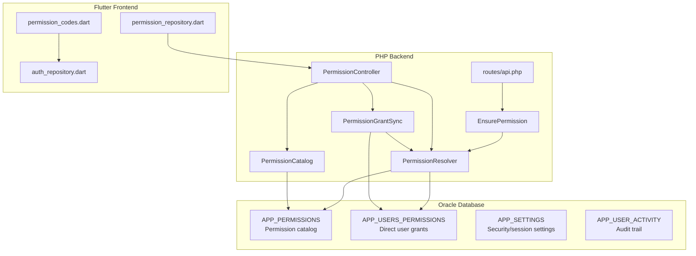

**Diagram sources**
- [01_ibac_schema.sql:38-168](file://kyApp_API/database/oracle/01_ibac_schema.sql#L38-L168)
- [PermissionCatalog.php:22-237](file://kyApp_API/app/Support/PermissionCatalog.php#L22-L237)
- [PermissionResolver.php:27-132](file://kyApp_API/app/Support/PermissionResolver.php#L27-L132)
- [PermissionGrantSync.php:20-163](file://kyApp_API/app/Support/PermissionGrantSync.php#L20-L163)
- [EnsurePermission.php:25-52](file://kyApp_API/app/Http/Middleware/EnsurePermission.php#L25-L52)
- [PermissionController.php:30-243](file://kyApp_API/app/Http/Controllers/PermissionController.php#L30-L243)
- [api.php:36-56](file://kyApp_API/routes/api.php#L36-L56)
- [permission_codes.dart:1-143](file://lib/core/constants/permission_codes.dart#L1-L143)
- [permission_repository.dart:70-95](file://lib/features/admin/data/repositories/permission_repository.dart#L70-L95)
- [auth_repository.php:238-272](file://lib/features/auth/data/repositories/auth_repository.dart#L238-L272)

**Section sources**
- [01_ibac_schema.sql:1-207](file://kyApp_API/database/oracle/01_ibac_schema.sql#L1-L207)
- [PermissionCatalog.php:1-480](file://kyApp_API/app/Support/PermissionCatalog.php#L1-L480)
- [PermissionResolver.php:1-275](file://kyApp_API/app/Support/PermissionResolver.php#L1-L275)
- [PermissionGrantSync.php:1-191](file://kyApp_API/app/Support/PermissionGrantSync.php#L1-L191)
- [EnsurePermission.php:1-54](file://kyApp_API/app/Http/Middleware/EnsurePermission.php#L1-L54)
- [PermissionController.php:1-379](file://kyApp_API/app/Http/Controllers/PermissionController.php#L1-L379)
- [api.php:36-56](file://kyApp_API/routes/api.php#L36-L56)
- [permission_codes.dart:1-143](file://lib/core/constants/permission_codes.dart#L1-L143)
- [permission_repository.dart:70-95](file://lib/features/admin/data/repositories/permission_repository.dart#L70-L95)
- [auth_repository.php:238-272](file://lib/features/auth/data/repositories/auth_repository.dart#L238-L272)

## Core Components
The IBAC system is built around five core components:

| Component | Responsibility | Key Behavior |
|---|---|---|
| `PermissionCatalog` | Defines all valid permission codes, modules, actions, wildcards, and labels. | Generates rows for seeding, grouped payloads for the UI, validation rules, and Arabic labels for denial messages. |
| `PermissionResolver` | Evaluates whether a user has a permission. | Implements deny-by-default, admin bypass, `system.*`, explicit code match, and module wildcard match; caches effective codes. |
| `PermissionGrantSync` | Writes direct user grants. | Resolves codes to IDs, validates unknown/inactive codes, atomically replaces grants, and invalidates cached permissions. |
| `EnsurePermission` | Route-level middleware guard. | Returns 401 for unauthenticated requests and 403 with an Arabic permission name when a required code is missing. |
| `PermissionController` | Exposes permission management endpoints. | Serves the catalog, reads a user’s grants, replaces grants with escalation guards, logs activity, and optionally terminates sessions. |

**Section sources**
- [PermissionCatalog.php:22-480](file://kyApp_API/app/Support/PermissionCatalog.php#L22-L480)
- [PermissionResolver.php:27-275](file://kyApp_API/app/Support/PermissionResolver.php#L27-L275)
- [PermissionGrantSync.php:20-191](file://kyApp_API/app/Support/PermissionGrantSync.php#L20-L191)
- [EnsurePermission.php:11-52](file://kyApp_API/app/Http/Middleware/EnsurePermission.php#L11-L52)
- [PermissionController.php:17-243](file://kyApp_API/app/Http/Controllers/PermissionController.php#L17-L243)

## Architecture Overview
IBAC resolves access at request time using three layers:

1. **Authentication layer**: Routes are protected by Sanctum so only authenticated users reach business logic.
2. **Middleware layer**: Each sensitive route requires a specific permission code via `->middleware('permission:<code>')`.
3. **Resolver layer**: The resolver checks administrator status, global wildcard grants, exact grants, and module wildcard grants against the active grant table.

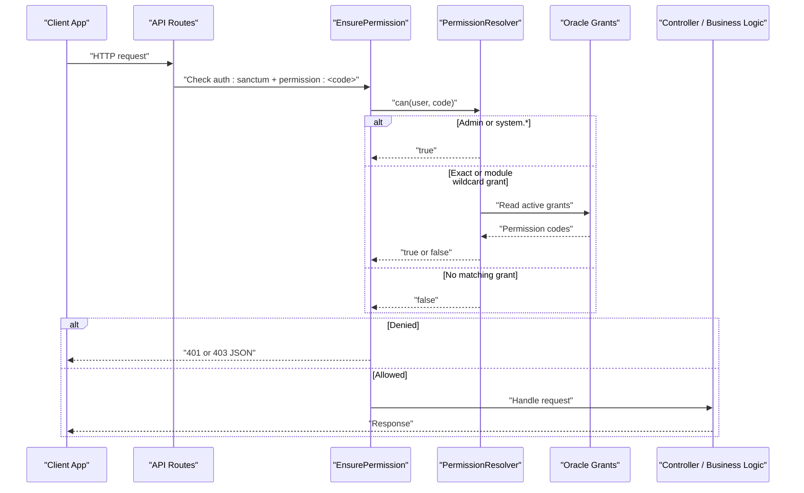

**Diagram sources**
- [api.php:36-56](file://kyApp_API/routes/api.php#L36-L56)
- [EnsurePermission.php:32-52](file://kyApp_API/app/Http/Middleware/EnsurePermission.php#L32-L52)
- [PermissionResolver.php:95-132](file://kyApp_API/app/Support/PermissionResolver.php#L95-L132)
- [01_ibac_schema.sql:81-100](file://kyApp_API/database/oracle/01_ibac_schema.sql#L81-L100)

## Detailed Component Analysis

### Permission Catalog Design
The permission catalog is the single source of truth for permission codes. It defines:
- Module names and display labels.
- Core actions (`view`, `create`, `update`, `delete`) per module.
- Extra actions such as `print`, `export`, `statement`, `toggle`, and administrative actions.
- Wildcard permissions in the form `<module>.*`.
- A reserved system-wide wildcard `system.*`.
- Validation rules ensuring codes use lowercase module/action identifiers separated by one dot.

The catalog generates:
- Rows for seeding `APP_PERMISSIONS`.
- Grouped data for the permission picker UI.
- Valid code lists for validation and testing.
- Arabic labels for user-facing denial messages.

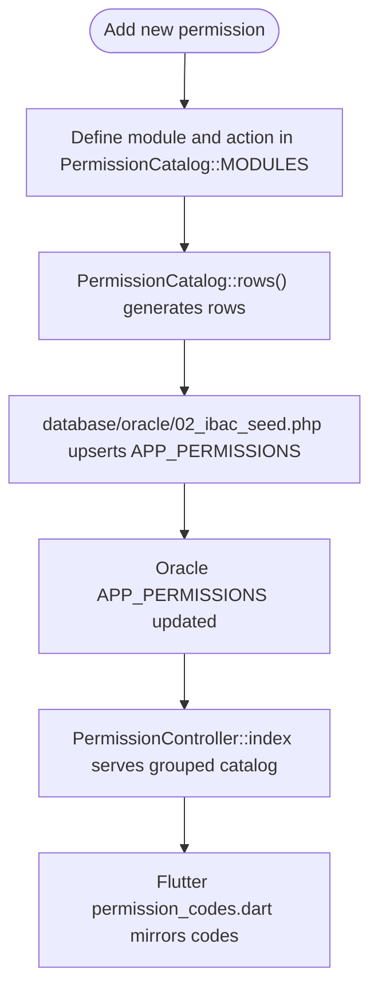

**Diagram sources**
- [PermissionCatalog.php:52-237](file://kyApp_API/app/Support/PermissionCatalog.php#L52-L237)
- [PermissionCatalog.php:271-316](file://kyApp_API/app/Support/PermissionCatalog.php#L271-L316)
- [02_ibac_seed.php:36-89](file://kyApp_API/database/oracle/02_ibac_seed.php#L36-L89)
- [PermissionController.php:51-93](file://kyApp_API/app/Http/Controllers/PermissionController.php#L51-L93)
- [permission_codes.dart:1-143](file://lib/core/constants/permission_codes.dart#L1-L143)

**Section sources**
- [PermissionCatalog.php:18-237](file://kyApp_API/app/Support/PermissionCatalog.php#L18-L237)
- [PermissionCatalog.php:271-480](file://kyApp_API/app/Support/PermissionCatalog.php#L271-L480)
- [02_ibac_seed.php:1-310](file://kyApp_API/database/oracle/02_ibac_seed.php#L1-L310)
- [PermissionController.php:51-93](file://kyApp_API/app/Http/Controllers/PermissionController.php#L51-L93)
- [permission_codes.dart:1-143](file://lib/core/constants/permission_codes.dart#L1-L143)

### Grant Management Workflows
Grant management is intentionally centralized in `PermissionGrantSync` and exposed through `PermissionController`. The workflow protects against privilege escalation and stale state:

1. The actor must be authenticated.
2. Non-administrators cannot edit their own grants.
3. Only known, active permission codes can be granted.
4. Non-administrators can only grant permissions they themselves hold.
5. Grants are replaced atomically: existing grants are deleted and new ones inserted inside a transaction.
6. After replacement, the target user’s cached permissions are invalidated.
7. Activity logging records who changed whose permissions.
8. Optionally, the target user’s sessions are terminated so the new permissions apply immediately.

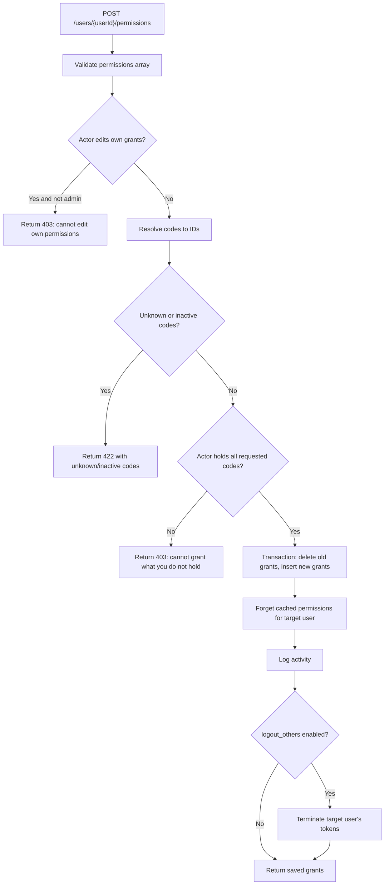

**Diagram sources**
- [PermissionController.php:137-243](file://kyApp_API/app/Http/Controllers/PermissionController.php#L137-L243)
- [PermissionGrantSync.php:77-163](file://kyApp_API/app/Support/PermissionGrantSync.php#L77-L163)

**Section sources**
- [PermissionController.php:130-243](file://kyApp_API/app/Http/Controllers/PermissionController.php#L130-L243)
- [PermissionGrantSync.php:65-163](file://kyApp_API/app/Support/PermissionGrantSync.php#L65-L163)

### Permission Resolution Mechanism
The resolver implements a strict evaluation order under a deny-by-default policy:

1. If the user is marked as system administrator (`IS_ADMIN = 1`), allow.
2. If the user holds `system.*`, allow.
3. If the user holds the exact permission code, allow.
4. If the user holds the module wildcard `<module>.*`, allow.
5. Otherwise, deny.

A grant counts only when:
- The grant row is active.
- The permission row is active.
- The grant has no expiration date, or its expiration date is after the current time.

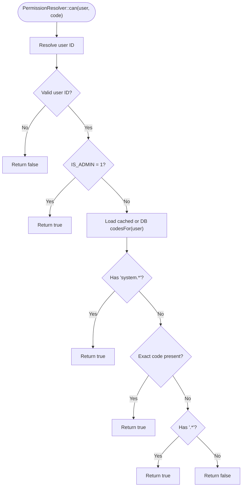

**Diagram sources**
- [PermissionResolver.php:95-132](file://kyApp_API/app/Support/PermissionResolver.php#L95-L132)
- [PermissionResolver.php:49-58](file://kyApp_API/app/Support/PermissionResolver.php#L49-L58)
- [PermissionResolver.php:206-218](file://kyApp_API/app/Support/PermissionResolver.php#L206-L218)

**Section sources**
- [PermissionResolver.php:9-27](file://kyApp_API/app/Support/PermissionResolver.php#L9-L27)
- [PermissionResolver.php:95-170](file://kyApp_API/app/Support/PermissionResolver.php#L95-L170)
- [PermissionResolver.php:206-227](file://kyApp_API/app/Support/PermissionResolver.php#L206-L227)

### Middleware Protection and Denial Handling
The `EnsurePermission` middleware is applied to routes requiring a specific permission. Its rejection ladder is:

- Unauthenticated user: returns 401 with a bilingual message.
- Missing permission: returns 403 with a JSON body including the Arabic permission name from the catalog.
- Granted permission: passes the request to the next handler.

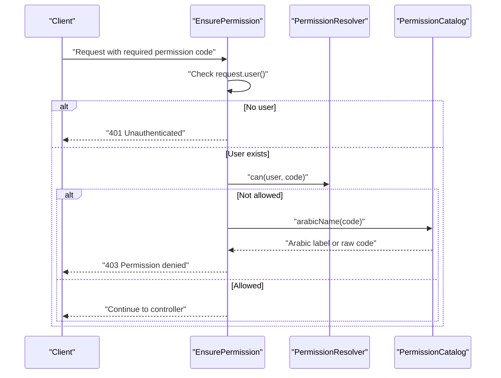

**Diagram sources**
- [EnsurePermission.php:32-52](file://kyApp_API/app/Http/Middleware/EnsurePermission.php#L32-L52)
- [PermissionCatalog.php:432-441](file://kyApp_API/app/Support/PermissionCatalog.php#L432-L441)

**Section sources**
- [EnsurePermission.php:11-52](file://kyApp_API/app/Http/Middleware/EnsurePermission.php#L11-L52)

### Database Schema for Permissions, User Permissions, and Grants
The Oracle schema defines four primary tables relevant to IBAC:

| Table | Purpose | Important Columns | Constraints and Notes |
|---|---|---|---|
| `APP_PERMISSIONS` | Permission catalog | `PERMISSION_ID`, `PERMISSION_CODE`, `MODULE_CODE`, `ACTION_CODE`, `NAME_AR`, `NAME_EN`, `IS_CORE`, `SORT_ORDER`, `IS_ACTIVE` | Unique `PERMISSION_CODE`; triggers auto-increment; indexes by module and sort order. |
| `APP_USERS_PERMISSIONS` | Direct user-to-permission grants | `ID`, `USER_ID`, `PERMISSION_ID`, `GRANTED_BY`, `GRANTED_ON`, `EXPIRES_ON`, `IS_ACTIVE`, `NOTE` | Unique `(USER_ID, PERMISSION_ID)`; foreign keys to users and permissions; indexes for lookup performance. |
| `APP_SETTINGS` | Security and session configuration | `SETTING_KEY`, `SETTING_VALUE`, `VALUE_TYPE`, `NAME_AR`, `MIN_VALUE`, `MAX_VALUE`, `IS_LOCKABLE` | Used by security settings screens; values are typed strings. |
| `APP_USER_ACTIVITY` | Audit trail | `USER_ID`, `TARGET_USER_ID`, `ACTION_CODE`, `MODULE_CODE`, `ENTITY_TYPE`, `ENTITY_ID`, `DESCRIPTION_AR`, `STATUS`, `CREATED_ON` | No foreign key on `USER_ID` so anonymous failures and deleted users remain auditable. |

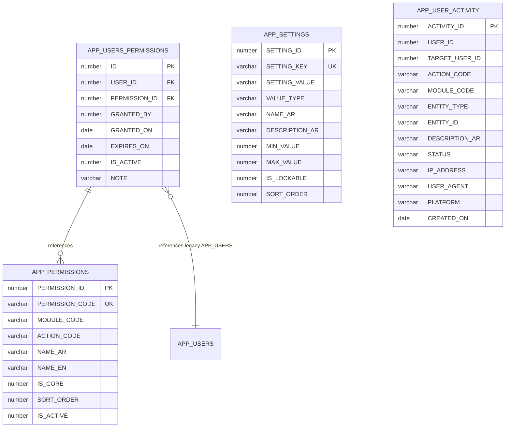

**Diagram sources**
- [01_ibac_schema.sql:38-100](file://kyApp_API/database/oracle/01_ibac_schema.sql#L38-L100)
- [01_ibac_schema.sql:118-168](file://kyApp_API/database/oracle/01_ibac_schema.sql#L118-L168)

**Section sources**
- [01_ibac_schema.sql:38-100](file://kyApp_API/database/oracle/01_ibac_schema.sql#L38-L100)
- [01_ibac_schema.sql:118-189](file://kyApp_API/database/oracle/01_ibac_schema.sql#L118-L189)

### How to Add New Permissions
To add a new permission:

1. Add the module and action to `PermissionCatalog::MODULES`.
2. Decide whether it is a core action or an extra action.
3. Run the seed script to upsert `APP_PERMISSIONS`.
4. Assign the permission to users through the permission management UI or API.
5. Mirror the permission code in the Flutter `Perm` constants if the UI needs to gate navigation or widgets.
6. Protect the corresponding backend route with `->middleware('permission:<code>')`.

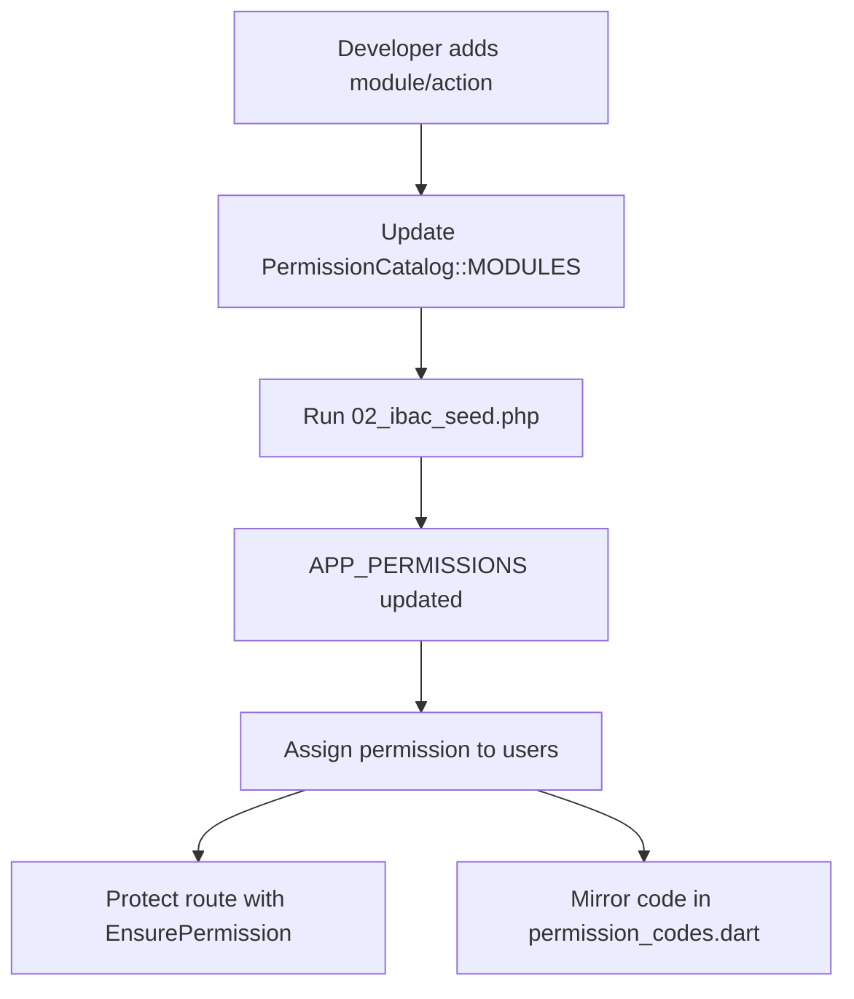

**Diagram sources**
- [PermissionCatalog.php:52-237](file://kyApp_API/app/Support/PermissionCatalog.php#L52-L237)
- [02_ibac_seed.php:283-291](file://kyApp_API/database/oracle/02_ibac_seed.php#L283-L291)
- [permission_codes.dart:1-143](file://lib/core/constants/permission_codes.dart#L1-L143)
- [api.php:50-56](file://kyApp_API/routes/api.php#L50-L56)

**Section sources**
- [PermissionCatalog.php:52-237](file://kyApp_API/app/Support/PermissionCatalog.php#L52-L237)
- [02_ibac_seed.php:281-310](file://kyApp_API/database/oracle/02_ibac_seed.php#L281-L310)
- [permission_codes.dart:1-143](file://lib/core/constants/permission_codes.dart#L1-L143)
- [api.php:50-56](file://kyApp_API/routes/api.php#L50-L56)

### How to Assign Permissions to Users
Permissions are assigned through:
- The `/permissions` catalog endpoint, which returns grouped permissions with database IDs.
- The `/users/{userId}/permissions` endpoint, which reads and replaces a user’s grants.
- The Flutter permission repository, which calls these endpoints and maps server responses into UI models.

Important behaviors:
- An empty permissions list revokes all explicit grants.
- Unknown or inactive codes are rejected.
- Non-administrators cannot grant permissions they do not hold.
- Administrators bypass grant checks but still benefit from explicit `system.*` semantics.

**Section sources**
- [PermissionController.php:51-243](file://kyApp_API/app/Http/Controllers/PermissionController.php#L51-L243)
- [PermissionGrantSync.php:40-163](file://kyApp_API/app/Support/PermissionGrantSync.php#L40-L163)
- [permission_repository.dart:70-95](file://lib/features/admin/data/repositories/permission_repository.dart#L70-L95)

### Implementing Permission Checks in Controllers and UI Components
Backend checks:
- Use `EnsurePermission` middleware on routes.
- Use `PermissionResolver::can`, `canAny`, or `canAll` inside controllers when programmatic checks are needed.
- Use `PermissionResolver::isAdmin` to determine administrator status.

Frontend checks:
- Use the mirrored `Perm` constants from `permission_codes.dart`.
- Derive available modules from the permission snapshot returned by the authentication repository.
- Gate navigation, buttons, and feature sections based on whether the client has the required code or module.

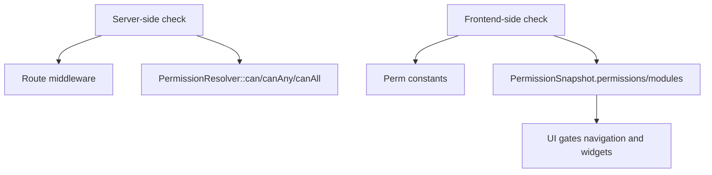

**Diagram sources**
- [EnsurePermission.php:32-52](file://kyApp_API/app/Http/Middleware/EnsurePermission.php#L32-L52)
- [PermissionResolver.php:95-170](file://kyApp_API/app/Support/PermissionResolver.php#L95-L170)
- [permission_codes.dart:1-143](file://lib/core/constants/permission_codes.dart#L1-L143)
- [auth_repository.php:238-272](file://lib/features/auth/data/repositories/auth_repository.dart#L238-L272)

**Section sources**
- [EnsurePermission.php:32-52](file://kyApp_API/app/Http/Middleware/EnsurePermission.php#L32-L52)
- [PermissionResolver.php:95-200](file://kyApp_API/app/Support/PermissionResolver.php#L95-L200)
- [permission_codes.dart:1-143](file://lib/core/constants/permission_codes.dart#L1-L143)
- [auth_repository.php:238-272](file://lib/features/auth/data/repositories/auth_repository.dart#L238-L272)

### Deny-by-Default Security Model
Deny-by-default means:
- If no matching grant exists, access is denied.
- If a user has no permissions, they cannot access protected resources.
- Tests assert that business routes require authentication and permission guards.
- The resolver explicitly returns false when none of the allowed conditions match.

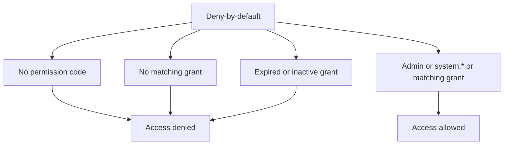

**Diagram sources**
- [PermissionResolver.php:9-27](file://kyApp_API/app/Support/PermissionResolver.php#L9-L27)
- [PermissionResolver.php:95-132](file://kyApp_API/app/Support/PermissionResolver.php#L95-L132)
- [BusinessRoutesSealedTest.php:46-73](file://kyApp_API/tests/Feature/BusinessRoutesSealedTest.php#L46-L73)

**Section sources**
- [PermissionResolver.php:9-27](file://kyApp_API/app/Support/PermissionResolver.php#L9-L27)
- [BusinessRoutesSealedTest.php:46-73](file://kyApp_API/tests/Feature/BusinessRoutesSealedTest.php#L46-L73)

### Wildcard Permissions and System-Wide Overrides
Wildcards work at two levels:

- Module wildcard: `<module>.*` covers all explicit actions under that module.
- System wildcard: `system.*` grants everything and is treated like administrator access by the resolver.

The catalog also creates a stored wildcard row for each module, allowing administrators to grant broad access without enumerating every action.

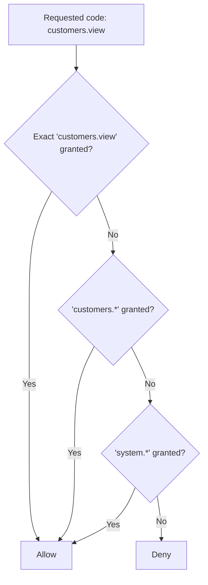

**Diagram sources**
- [PermissionCatalog.php:34-41](file://kyApp_API/app/Support/PermissionCatalog.php#L34-L41)
- [PermissionCatalog.php:282-293](file://kyApp_API/app/Support/PermissionCatalog.php#L282-L293)
- [PermissionResolver.php:111-129](file://kyApp_API/app/Support/PermissionResolver.php#L111-L129)

**Section sources**
- [PermissionCatalog.php:34-41](file://kyApp_API/app/Support/PermissionCatalog.php#L34-L41)
- [PermissionCatalog.php:282-293](file://kyApp_API/app/Support/PermissionCatalog.php#L282-L293)
- [PermissionResolver.php:111-129](file://kyApp_API/app/Support/PermissionResolver.php#L111-L129)

### Permission Auditing and Monitoring Access Patterns
Auditing is supported through:
- `APP_USER_ACTIVITY`, which records user actions, targets, modules, entities, status, IP address, user agent, platform, and timestamp.
- `PermissionController::syncUser`, which logs permission changes.
- Bootstrap scripts that record system initialization events.
- Activity logging designed so failures never break a request.

Recommended monitoring practices:
- Query `APP_USER_ACTIVITY` by `USER_ID`, `TARGET_USER_ID`, `MODULE_CODE`, and `CREATED_ON`.
- Monitor failed login attempts and permission denials.
- Review permission synchronization events to detect unusual grant changes.
- Retention is configurable through `activity_log_retention_days` in `APP_SETTINGS`.

**Section sources**
- [01_ibac_schema.sql:149-189](file://kyApp_API/database/oracle/01_ibac_schema.sql#L149-L189)
- [PermissionController.php:219-226](file://kyApp_API/app/Http/Controllers/PermissionController.php#L219-L226)
- [03_ibac_bootstrap.php:187-217](file://kyApp_API/database/oracle/03_ibac_bootstrap.php#L187-L217)
- [02_ibac_seed.php:188-198](file://kyApp_API/database/oracle/02_ibac_seed.php#L188-L198)

## Dependency Analysis
The following diagram shows how components depend on each other:

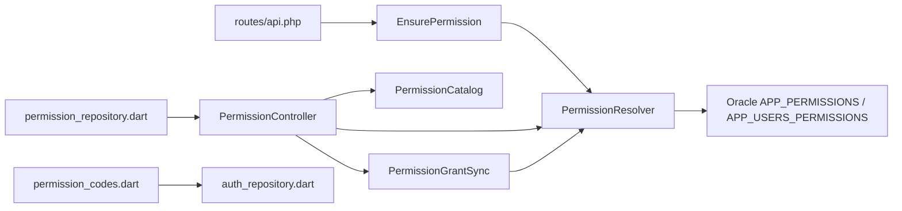

**Diagram sources**
- [api.php:36-56](file://kyApp_API/routes/api.php#L36-L56)
- [EnsurePermission.php:5-7](file://kyApp_API/app/Http/Middleware/EnsurePermission.php#L5-L7)
- [PermissionController.php:8-10](file://kyApp_API/app/Http/Controllers/PermissionController.php#L8-L10)
- [PermissionGrantSync.php:32](file://kyApp_API/app/Support/PermissionGrantSync.php#L32)
- [PermissionResolver.php:5-7](file://kyApp_API/app/Support/PermissionResolver.php#L5-L7)
- [permission_codes.dart:1-143](file://lib/core/constants/permission_codes.dart#L1-L143)
- [permission_repository.dart:70-95](file://lib/features/admin/data/repositories/permission_repository.dart#L70-L95)

**Section sources**
- [api.php:36-56](file://kyApp_API/routes/api.php#L36-L56)
- [PermissionController.php:8-10](file://kyApp_API/app/Http/Controllers/PermissionController.php#L8-L10)
- [PermissionGrantSync.php:32](file://kyApp_API/app/Support/PermissionGrantSync.php#L32)
- [PermissionResolver.php:5-7](file://kyApp_API/app/Support/PermissionResolver.php#L5-L7)
- [permission_codes.dart:1-143](file://lib/core/constants/permission_codes.dart#L1-L143)
- [permission_repository.dart:70-95](file://lib/features/admin/data/repositories/permission_repository.dart#L70-L95)

## Performance Considerations
- Permission resolution uses a cache keyed by user ID with a TTL of 300 seconds.
- Cache writes are skipped when serialized permission sets exceed approximately 3000 bytes to avoid Oracle bound-value limits.
- The resolver reads `IS_ADMIN` directly without caching because administrator status should reflect immediate changes.
- Grant queries join `APP_USERS_PERMISSIONS` with `APP_PERMISSIONS` and filter by active grants, active permissions, and expiration.
- Indexes exist on `USER_ID`, `PERMISSION_ID`, and module/sort columns to improve lookup performance.

Recommendations:
- Avoid granting every permission to ordinary users unless necessary; prefer module wildcards or specific codes.
- Keep permission catalogs small and focused per role-like groupings even though IBAC is identity-based.
- Monitor cache hit rates and grant query latency if the number of permissions grows significantly.
- Use `EXPIRES_ON` for temporary access instead of long-lived broad grants.

[No sources needed since this section provides general guidance]

## Troubleshooting Guide
Common issues and resolutions:

| Symptom | Likely Cause | Resolution |
|---|---|---|
| 401 Unauthenticated | Request reached a permission-gated route without a valid Sanctum session. | Authenticate first; ensure routes requiring permissions are behind `auth:sanctum`. |
| 403 Permission denied | User lacks the required permission code, wildcard, or administrator status. | Assign the permission via `/users/{userId}/permissions`, verify `IS_ADMIN`, or grant `system.*`. |
| Unknown permission codes error | Submitted code is not defined in `APP_PERMISSIONS`. | Add the code to `PermissionCatalog::MODULES` and run the seed script. |
| Inactive permissions cannot be granted | Permission row exists but `IS_ACTIVE = 0`. | Activate the permission or remove it from the requested list. |
| Cannot grant permissions you do not hold | Non-administrator tried to grant a permission they lack. | Use an administrator account or grant only permissions the actor holds. |
| Own permissions cannot be edited | Non-administrator attempted self-escalation. | Use another administrator account to change the user’s grants. |
| Permissions not reflected immediately after assignment | Client cached permission codes. | End the user’s sessions or refresh the permission snapshot. |
| Arabic text appears corrupted | Client encoding mismatch between UTF-8 and Oracle CP1256. | Use the provided Arabic encoding helpers and seed/bootstrap scripts. |

**Section sources**
- [EnsurePermission.php:36-48](file://kyApp_API/app/Http/Middleware/EnsurePermission.php#L36-L48)
- [PermissionController.php:162-209](file://kyApp_API/app/Http/Controllers/PermissionController.php#L162-L209)
- [PermissionGrantSync.php:77-120](file://kyApp_API/app/Support/PermissionGrantSync.php#L77-L120)
- [02_ibac_seed.php:10-23](file://kyApp_API/database/oracle/02_ibac_seed.php#L10-L23)
- [03_ibac_bootstrap.php:26-30](file://kyApp_API/database/oracle/03_ibac_bootstrap.php#L26-L30)

## Conclusion
The IBAC permission system centralizes permission definitions in a PHP catalog, stores permissions and direct user grants in Oracle, and enforces access through a deny-by-default resolver and middleware. Administrators manage permissions through a controlled API that prevents escalation, validates inputs, logs changes, and invalidates caches. The Flutter frontend mirrors permission codes to make UI decisions efficiently while relying on the server for authoritative authorization.

For secure operations:
- Always protect sensitive routes with both authentication and permission middleware.
- Define permissions explicitly in the catalog.
- Prefer narrow grants over wildcards.
- Use `system.*` sparingly.
- Monitor `APP_USER_ACTIVITY` for access patterns and anomalies.
- Test new permissions across backend routes and frontend gating logic together.

[No sources needed since this section summarizes without analyzing specific files]

## Appendices

### Example: Creating a Permission Code
- Add a module/action pair to `PermissionCatalog::MODULES`.
- Run `database/oracle/02_ibac_seed.php` to upsert `APP_PERMISSIONS`.
- Verify the code appears in `PermissionController::index`.
- Mirror the code in `lib/core/constants/permission_codes.dart`.
- Protect the route with `->middleware('permission:<code>')`.

**Section sources**
- [PermissionCatalog.php:52-237](file://kyApp_API/app/Support/PermissionCatalog.php#L52-L237)
- [02_ibac_seed.php:283-291](file://kyApp_API/database/oracle/02_ibac_seed.php#L283-L291)
- [PermissionController.php:51-93](file://kyApp_API/app/Http/Controllers/PermissionController.php#L51-L93)
- [permission_codes.dart:1-143](file://lib/core/constants/permission_codes.dart#L1-L143)
- [api.php:50-56](file://kyApp_API/routes/api.php#L50-L56)

### Example: Implementing Middleware Protection
- Register the `permission` middleware alias.
- Apply `->middleware('permission:<required_code>')` to routes inside `auth:sanctum`.
- Handle 401 and 403 responses in the client by prompting re-authentication or showing a permission-denied state.

**Section sources**
- [EnsurePermission.php:11-24](file://kyApp_API/app/Http/Middleware/EnsurePermission.php#L11-L24)
- [api.php:36-56](file://kyApp_API/routes/api.php#L36-L56)

### Example: Handling Permission Denials
- Backend returns structured JSON with `success`, `message`, and optional `errors`.
- Frontend should treat 401 as authentication failure and 403 as authorization failure.
- For permission management errors, inspect `unknown_codes`, `inactive_codes`, or `not_held`.

**Section sources**
- [EnsurePermission.php:36-48](file://kyApp_API/app/Http/Middleware/EnsurePermission.php#L36-L48)
- [PermissionController.php:178-209](file://kyApp_API/app/Http/Controllers/PermissionController.php#L178-L209)