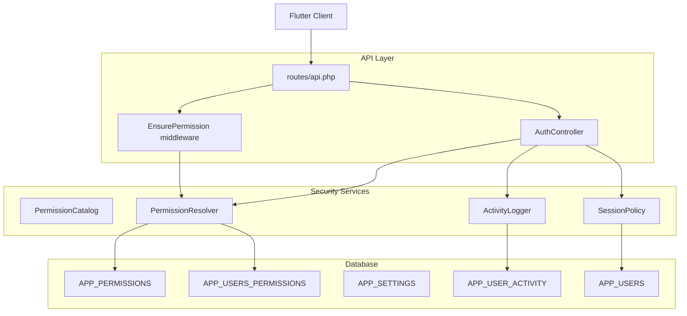
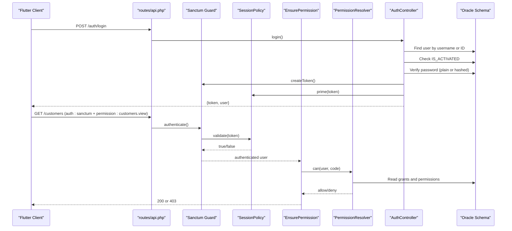
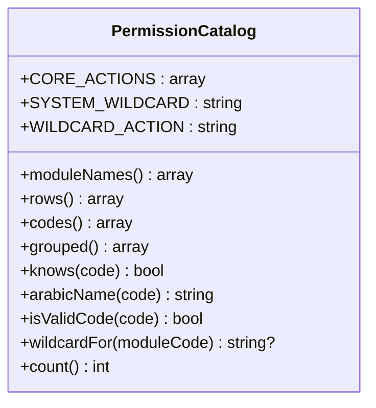
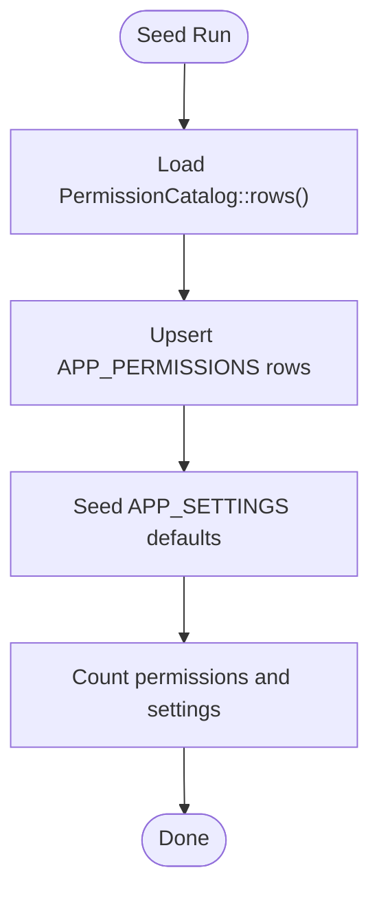
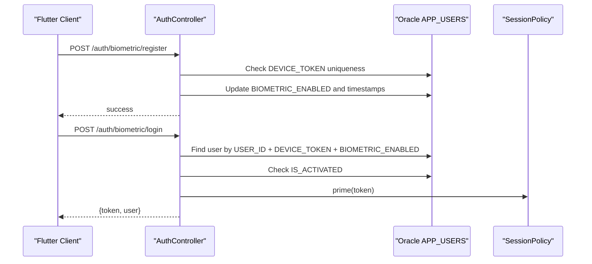
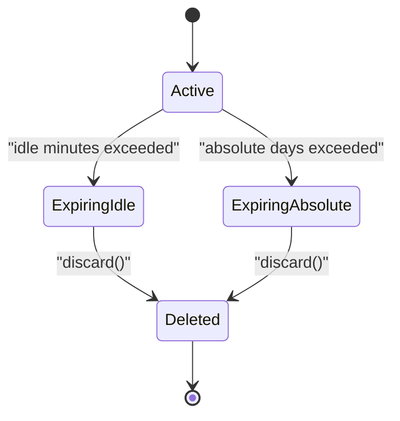
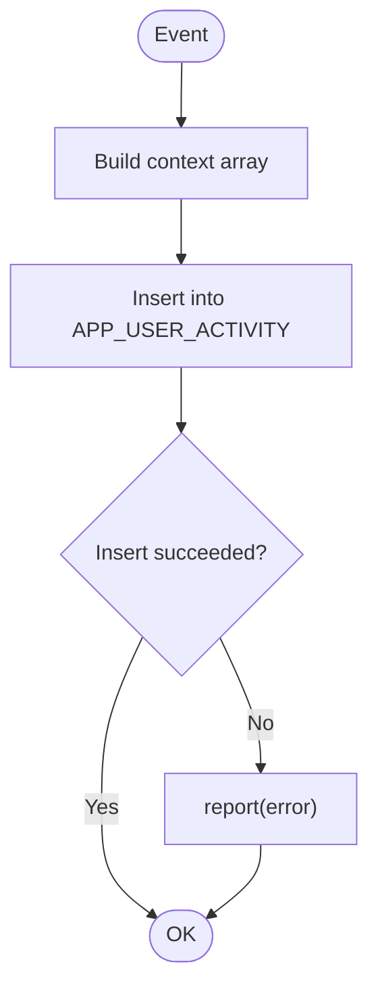
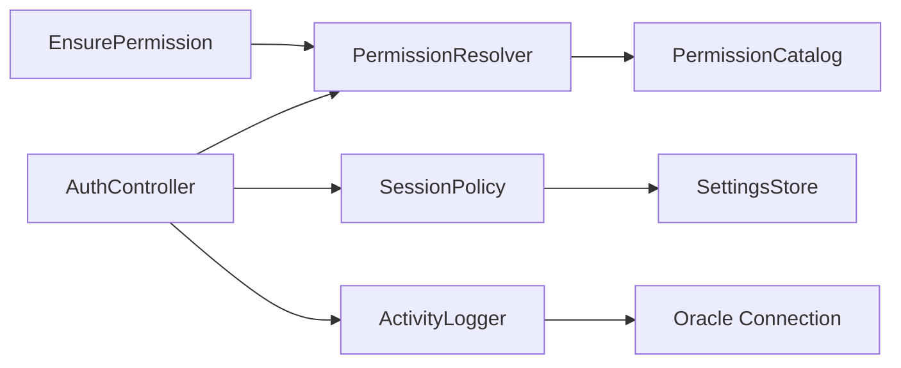

# Security System

<cite>
**Referenced Files in This Document**   
- [01_ibac_schema.sql](file://kyApp_API/database/oracle/01_ibac_schema.sql)
- [02_ibac_seed.php](file://kyApp_API/database/oracle/02_ibac_seed.php)
- [PermissionCatalog.php](file://kyApp_API/app/Support/PermissionCatalog.php)
- [PermissionResolver.php](file://kyApp_API/app/Support/PermissionResolver.php)
- [SessionPolicy.php](file://kyApp_API/app/Support/SessionPolicy.php)
- [ActivityLogger.php](file://kyApp_API/app/Support/ActivityLogger.php)
- [EnsurePermission.php](file://kyApp_API/app/Http/Middleware/EnsurePermission.php)
- [AuthController.php](file://kyApp_API/app/Http/Controllers/AuthController.php)
- [User.php](file://kyApp_API/app/Models/User.php)
- [api.php](file://kyApp_API/routes/api.php)
- [sanctum.php](file://kyApp_API/config/sanctum.php)
</cite>

## Table of Contents
1. [Introduction](#introduction)
2. [Project Structure](#project-structure)
3. [Core Components](#core-components)
4. [Architecture Overview](#architecture-overview)
5. [Detailed Component Analysis](#detailed-component-analysis)
6. [Dependency Analysis](#dependency-analysis)
7. [Performance Considerations](#performance-considerations)
8. [Troubleshooting Guide](#troubleshooting-guide)
9. [Conclusion](#conclusion)

## Introduction
This document explains the multi-layered security system implemented for Ky Apps. It covers Identity-Based Access Control (IBAC), multi-factor authentication combining password and biometric verification, token and session management, encryption and input validation patterns, protection against common vulnerabilities, audit logging, and security monitoring. The goal is to help developers understand how permissions are defined, granted, resolved, enforced, and audited, and how sessions are secured with sliding expiry and absolute lifetime limits.

## Project Structure
The security implementation spans database schema, support services, HTTP middleware, controllers, routes, and configuration:

- Database schema defines IBAC tables, settings, and activity logs.
- Support classes implement permission cataloging, resolution, session policy, and activity logging.
- Middleware enforces per-route permissions after Sanctum authentication.
- Controllers handle login, biometric enrollment/login, token issuance, and user profile endpoints.
- Routes bind Sanctum authentication and permission checks to API endpoints.
- Sanctum configuration disables hard expiration so session policy can drive idle and absolute lifetimes.



**Diagram sources**
- [api.php:17-116](file://kyApp_API/routes/api.php#L17-L116)
- [EnsurePermission.php:12-24](file://kyApp_API/app/Http/Middleware/EnsurePermission.php#L12-L24)
- [AuthController.php:17-41](file://kyApp_API/app/Http/Controllers/AuthController.php#L17-L41)
- [PermissionCatalog.php:5-21](file://kyApp_API/app/Support/PermissionCatalog.php#L5-L21)
- [PermissionResolver.php:9-26](file://kyApp_API/app/Support/PermissionResolver.php#L9-L26)
- [SessionPolicy.php:9-41](file://kyApp_API/app/Support/SessionPolicy.php#L9-L41)
- [ActivityLogger.php:9-17](file://kyApp_API/app/Support/ActivityLogger.php#L9-L17)
- [01_ibac_schema.sql:36-192](file://kyApp_API/database/oracle/01_ibac_schema.sql#L36-L192)

**Section sources**
- [api.php:17-116](file://kyApp_API/routes/api.php#L17-L116)
- [01_ibac_schema.sql:21-192](file://kyApp_API/database/oracle/01_ibac_schema.sql#L21-L192)

## Core Components
- **PermissionCatalog**: Canonical source of truth for permission codes, module names, core and extra actions, wildcard handling, and UI payloads.
- **PermissionResolver**: IBAC engine that resolves effective permissions using admin bypass, system wildcard, explicit grants, and module wildcards, with caching.
- **SessionPolicy**: Sanctum integration that validates tokens, applies idle expiry, absolute lifetime, sliding renewal, and cleanup of expired tokens.
- **ActivityLogger**: Safe audit trail writer that never breaks successful requests and uses bound queries.
- **EnsurePermission**: Route-level middleware enforcing deny-by-default access control.
- **AuthController**: Authentication controller supporting password login, biometric enrollment/login, logout, and permission payload delivery.
- **User model**: Sanctum-enabled model with Oracle compatibility, hidden sensitive fields, and admin flag helper.

**Section sources**
- [PermissionCatalog.php:5-21](file://kyApp_API/app/Support/PermissionCatalog.php#L5-L21)
- [PermissionResolver.php:9-26](file://kyApp_API/app/Support/PermissionResolver.php#L9-L26)
- [SessionPolicy.php:9-41](file://kyApp_API/app/Support/SessionPolicy.php#L9-L41)
- [ActivityLogger.php:9-17](file://kyApp_API/app/Support/ActivityLogger.php#L9-L17)
- [EnsurePermission.php:12-24](file://kyApp_API/app/Http/Middleware/EnsurePermission.php#L12-L24)
- [AuthController.php:17-41](file://kyApp_API/app/Http/Controllers/AuthController.php#L17-L41)
- [User.php:10-13](file://kyApp_API/app/Models/User.php#L10-L13)

## Architecture Overview
Ky Apps implements a layered security architecture:

1. **Authentication layer**: Sanctum issues personal access tokens; `AuthController` handles login flows and returns tokens plus user profiles.
2. **Session policy layer**: `SessionPolicy::validate` runs on every authenticated request to enforce idle expiry, absolute lifetime, and account activation status.
3. **Authorization layer**: `EnsurePermission` middleware enforces per-route IBAC checks via `PermissionResolver`.
4. **Data layer**: Oracle schema stores permissions, grants, settings, and activity logs; seeding script populates canonical catalogs and defaults.
5. **Audit layer**: `ActivityLogger` records success/failure events without failing business operations.



**Diagram sources**
- [api.php:17-34](file://kyApp_API/routes/api.php#L17-L34)
- [api.php:138-179](file://kyApp_API/routes/api.php#L138-L179)
- [AuthController.php:47-164](file://kyApp_API/app/Http/Controllers/AuthController.php#L47-L164)
- [SessionPolicy.php:70-108](file://kyApp_API/app/Support/SessionPolicy.php#L70-L108)
- [EnsurePermission.php:32-52](file://kyApp_API/app/Http/Middleware/EnsurePermission.php#L32-L52)
- [PermissionResolver.php:95-132](file://kyApp_API/app/Support/PermissionResolver.php#L95-L132)
- [01_ibac_schema.sql:36-100](file://kyApp_API/database/oracle/01_ibac_schema.sql#L36-L100)

## Detailed Component Analysis

### IBAC Permission Catalog Design
The permission catalog is the single authoritative definition of all supported permissions. It enumerates modules, core actions (`view`, `create`, `update`, `delete`), extra actions, and wildcard forms such as `<module>.*` and `system.*`. It provides:

- Module display names for UI.
- Rows ready for insertion into `APP_PERMISSIONS`.
- Valid code validation and Arabic labels for error messages.
- Grouped structure for permission picker UIs.

Key design points:
- Wildcard permissions are restricted to exact forms.
- Sorting ensures core actions appear before extras.
- Catalog size is used for post-seed verification.



**Diagram sources**
- [PermissionCatalog.php:22-468](file://kyApp_API/app/Support/PermissionCatalog.php#L22-L468)

**Section sources**
- [PermissionCatalog.php:5-21](file://kyApp_API/app/Support/PermissionCatalog.php#L5-L21)
- [PermissionCatalog.php:235-468](file://kyApp_API/app/Support/PermissionCatalog.php#L235-L468)

### Grant Management and Seeding
Grants are direct user-to-permission assignments stored in `APP_USERS_PERMISSIONS`. The seed script populates `APP_PERMISSIONS` from `PermissionCatalog::rows()` and seeds default security settings into `APP_SETTINGS`. It is idempotent, uses bound statements, and preserves operator-edited setting values while refreshing metadata.

Important aspects:
- Permissions are upserted by `PERMISSION_CODE`.
- Settings include keys like `session_idle_minutes`, `biometric_login_enabled`, and retention policies.
- Arabic text is written through encoding helpers to preserve legacy byte semantics.



**Diagram sources**
- [02_ibac_seed.php:32-89](file://kyApp_API/database/oracle/02_ibac_seed.php#L32-L89)
- [02_ibac_seed.php:99-210](file://kyApp_API/database/oracle/02_ibac_seed.php#L99-L210)
- [02_ibac_seed.php:212-279](file://kyApp_API/database/oracle/02_ibac_seed.php#L212-L279)
- [02_ibac_seed.php:281-310](file://kyApp_API/database/oracle/02_ibac_seed.php#L281-L310)

**Section sources**
- [01_ibac_schema.sql:77-100](file://kyApp_API/database/oracle/01_ibac_schema.sql#L77-L100)
- [01_ibac_schema.sql:114-146](file://kyApp_API/database/oracle/01_ibac_schema.sql#L114-L146)
- [02_ibac_seed.php:32-89](file://kyApp_API/database/oracle/02_ibac_seed.php#L32-L89)
- [02_ibac_seed.php:99-210](file://kyApp_API/database/oracle/02_ibac_seed.php#L99-L210)

### Permission Resolution Mechanism
`PermissionResolver` implements deny-by-default authorization:

1. Admin bypass: if `IS_ADMIN = 1`, all permissions are allowed.
2. System wildcard: if `system.*` is granted, all permissions are allowed.
3. Explicit grant: if the exact code is granted, allow.
4. Module wildcard: if `<module>.*` is granted, allow any action under that module.
5. Otherwise, deny.

It caches effective permission codes per user with a safe byte-size limit to avoid Oracle cache store constraints.

```mermaid
flowchart TD
Enter([can(user, code)]) --> UserId["Resolve user id"]
UserId --> Invalid{"user_id <= 0?"}
Invalid --> |Yes| Deny([Return false])
Invalid --> |No| AdminCheck["isAdmin(user)?"]
AdminCheck --> |Yes| Allow([Return true])
AdminCheck --> |No| Codes["Fetch cached or DB codes"]
Codes --> SystemWildcard{"'system.*' in codes?"}
SystemWildcard --> |Yes| Allow
SystemWildcard --> |No| Exact{"code in codes?"}
Exact --> |Yes| Allow
Exact --> |No| ModuleWildcard{"'<module>.*' in codes?"}
ModuleWildcard --> |Yes| Allow
ModuleWildcard --> |No| Deny
```

**Diagram sources**
- [PermissionResolver.php:95-132](file://kyApp_API/app/Support/PermissionResolver.php#L95-L132)
- [PermissionResolver.php:206-218](file://kyApp_API/app/Support/PermissionResolver.php#L206-L218)
- [PermissionResolver.php:235-251](file://kyApp_API/app/Support/PermissionResolver.php#L235-L251)

**Section sources**
- [PermissionResolver.php:9-26](file://kyApp_API/app/Support/PermissionResolver.php#L9-L26)
- [PermissionResolver.php:66-89](file://kyApp_API/app/Support/PermissionResolver.php#L66-L89)
- [PermissionResolver.php:95-170](file://kyApp_API/app/Support/PermissionResolver.php#L95-L170)
- [PermissionResolver.php:206-273](file://kyApp_API/app/Support/PermissionResolver.php#L206-L273)

### Multi-Factor Authentication: Password and Biometric Verification
Ky Apps supports two-factor-like flows:

- **Password login**: Validates username (Arabic or English) or numeric ID, checks account activation, verifies password (supports legacy plain-text and hashed formats), issues a Sanctum token, primes session expiry, purges expired tokens, and logs the event.
- **Biometric enrollment**: Registers device token, name, platform, and enables biometrics for the current user; rejects reuse of a device token already bound to another user.
- **Biometric login**: Requires a registered device token matching the user, enforces kill-switch setting, checks activation, updates last-used timestamp, issues a token with the same session policy, and logs the event.



**Diagram sources**
- [AuthController.php:245-310](file://kyApp_API/app/Http/Controllers/AuthController.php#L245-L310)
- [AuthController.php:316-411](file://kyApp_API/app/Http/Controllers/AuthController.php#L316-L411)
- [AuthController.php:487-492](file://kyApp_API/app/Http/Controllers/AuthController.php#L487-L492)

**Section sources**
- [AuthController.php:47-164](file://kyApp_API/app/Http/Controllers/AuthController.php#L47-L164)
- [AuthController.php:245-310](file://kyApp_API/app/Http/Controllers/AuthController.php#L245-L310)
- [AuthController.php:316-411](file://kyApp_API/app/Http/Controllers/AuthController.php#L316-L411)

### Token Management and Session Security
Sanctum personal access tokens are used for API authentication. Session behavior is controlled by `SessionPolicy`:

- `expiration` in Sanctum config is intentionally `null` to avoid hard absolute age based on `created_at`.
- Idle expiry: configurable via `session_idle_minutes`; sliding renewal writes only when needed.
- Absolute lifetime: configurable via `session_absolute_days`; old tokens are discarded.
- Account deactivation immediately invalidates tokens.
- Expired tokens are deleted on rejection; periodic purge cleans leftovers.



**Diagram sources**
- [sanctum.php:47-63](file://kyApp_API/config/sanctum.php#L47-L63)
- [SessionPolicy.php:70-108](file://kyApp_API/app/Support/SessionPolicy.php#L70-L108)
- [SessionPolicy.php:130-155](file://kyApp_API/app/Support/SessionPolicy.php#L130-L155)
- [SessionPolicy.php:166-183](file://kyApp_API/app/Support/SessionPolicy.php#L166-L183)

**Section sources**
- [sanctum.php:47-63](file://kyApp_API/config/sanctum.php#L47-L63)
- [SessionPolicy.php:9-41](file://kyApp_API/app/Support/SessionPolicy.php#L9-L41)
- [SessionPolicy.php:70-108](file://kyApp_API/app/Support/SessionPolicy.php#L70-L108)
- [SessionPolicy.php:130-183](file://kyApp_API/app/Support/SessionPolicy.php#L130-L183)

### Encryption Strategies and Input Validation
- **Password storage**: Supports legacy plain-text passwords and modern hashed formats; login attempts try both paths safely.
- **Sensitive fields**: User model hides password and device token attributes during serialization.
- **Input validation**: Controllers use Laravel validators with strict rules (required, string length, enum values).
- **Encoding safety**: Arabic text is handled via encoding helpers to preserve legacy byte semantics and avoid mojibake.

Practical examples:
- Adding new permissions: extend `PermissionCatalog::MODULES`, then run the seed script to populate `APP_PERMISSIONS`.
- Implementing biometric authentication: register device token via `/auth/biometric/register`, then authenticate via `/auth/biometric/login`.
- Securing API endpoints: wrap routes with `auth:sanctum` and `permission:<code>` middleware.

**Section sources**
- [AuthController.php:115-127](file://kyApp_API/app/Http/Controllers/AuthController.php#L115-L127)
- [User.php:53-88](file://kyApp_API/app/Models/User.php#L53-L88)
- [AuthController.php:51-66](file://kyApp_API/app/Http/Controllers/AuthController.php#L51-L66)
- [02_ibac_seed.php:11-19](file://kyApp_API/database/oracle/02_ibac_seed.php#L11-L19)

### Protection Against Common Vulnerabilities
- **SQL injection**: All database interactions use bound parameters; no string interpolation in SQL.
- **XSS**: Server-side responses are JSON; client rendering should escape outputs. Sensitive fields are hidden at the model level.
- **Privilege escalation**: Deny-by-default middleware requires explicit permission codes; admin bypass is isolated to `IS_ADMIN` check.
- **Replay and stale sessions**: Sliding expiry and absolute lifetime prevent long-lived misuse; expired tokens are deleted.
- **Brute force and enumeration**: Login failures return generic messages; account deactivation blocks access even with valid credentials.

**Section sources**
- [02_ibac_seed.php:20-23](file://kyApp_API/database/oracle/02_ibac_seed.php#L20-L23)
- [ActivityLogger.php:13-17](file://kyApp_API/app/Support/ActivityLogger.php#L13-L17)
- [EnsurePermission.php:18-24](file://kyApp_API/app/Http/Middleware/EnsurePermission.php#L18-L24)
- [AuthController.php:86-98](file://kyApp_API/app/Http/Controllers/AuthController.php#L86-L98)

### Audit Logging and Activity Tracking
`ActivityLogger` writes to `APP_USER_ACTIVITY` with best-effort error handling so logging failures do not break successful requests. It captures:

- Action codes and module codes.
- Entity type and identifier.
- Arabic descriptions with safe truncation.
- IP address and user agent from trusted sources.
- Platform information.



**Diagram sources**
- [ActivityLogger.php:37-73](file://kyApp_API/app/Support/ActivityLogger.php#L37-L73)
- [ActivityLogger.php:101-125](file://kyApp_API/app/Support/ActivityLogger.php#L101-L125)
- [ActivityLogger.php:131-168](file://kyApp_API/app/Support/ActivityLogger.php#L131-L168)

**Section sources**
- [ActivityLogger.php:9-17](file://kyApp_API/app/Support/ActivityLogger.php#L9-L17)
- [ActivityLogger.php:37-73](file://kyApp_API/app/Support/ActivityLogger.php#L37-L73)
- [01_ibac_schema.sql:148-184](file://kyApp_API/database/oracle/01_ibac_schema.sql#L148-L184)

## Dependency Analysis
The security components have clear dependencies:

- `AuthController` depends on `PermissionResolver`, `SessionPolicy`, `ActivityLogger`, and `SettingsStore`.
- `EnsurePermission` depends on `PermissionResolver` and `PermissionCatalog`.
- `PermissionResolver` depends on `PermissionCatalog` and database connections.
- `SessionPolicy` depends on `SettingsStore` and Sanctum tokens.
- `ActivityLogger` depends on database connection and encoding utilities.



**Diagram sources**
- [AuthController.php:36-41](file://kyApp_API/app/Http/Controllers/AuthController.php#L36-L41)
- [EnsurePermission.php:5-7](file://kyApp_API/app/Http/Middleware/EnsurePermission.php#L5-L7)
- [PermissionResolver.php:5-8](file://kyApp_API/app/Support/PermissionResolver.php#L5-L8)
- [SessionPolicy.php:44-44](file://kyApp_API/app/Support/SessionPolicy.php#L44-L44)
- [ActivityLogger.php:5-7](file://kyApp_API/app/Support/ActivityLogger.php#L5-L7)

**Section sources**
- [AuthController.php:36-41](file://kyApp_API/app/Http/Controllers/AuthController.php#L36-L41)
- [EnsurePermission.php:5-7](file://kyApp_API/app/Http/Middleware/EnsurePermission.php#L5-L7)
- [PermissionResolver.php:5-8](file://kyApp_API/app/Support/PermissionResolver.php#L5-L8)
- [SessionPolicy.php:44-44](file://kyApp_API/app/Support/SessionPolicy.php#L44-L44)
- [ActivityLogger.php:5-7](file://kyApp_API/app/Support/ActivityLogger.php#L5-L7)

## Performance Considerations
- **Permission caching**: Effective permission codes are cached per user with a maximum serialized size to avoid Oracle cache store limitations.
- **Sliding session renewal**: Writes are throttled by a threshold window to reduce database load.
- **Best-effort logging**: Audit writes are wrapped in try/catch to avoid impacting request latency or success.
- **Minimal queries**: Admin bypass and wildcard checks reduce unnecessary lookups.

Recommendations:
- Monitor cache hit rates for permission resolution.
- Tune `session_touch_threshold_minutes` to balance freshness and write volume.
- Periodically purge expired tokens and archive activity logs according to retention settings.

[No sources needed since this section provides general guidance]

## Troubleshooting Guide
Common issues and resolutions:

- **401 Unauthenticated**: No Sanctum token or token rejected by `SessionPolicy`. Check token presence, activation status, idle expiry, and absolute lifetime.
- **403 Permission denied**: Missing explicit or wildcard permission. Verify `PermissionCatalog` includes the code and grants exist in `APP_USERS_PERMISSIONS`.
- **Biometric login disabled**: Kill-switch `biometric_login_enabled` is off. Enable it via security settings.
- **Device token conflict**: Device token already bound to another user. Re-enroll on the correct account.
- **Oracle date handling**: Empty dates may be returned as non-null values; always normalize via `SessionPolicy::toDate`.

Operational tips:
- Use `/auth/permissions` to refresh client-side permission cache after grant changes.
- Review `APP_USER_ACTIVITY` for failed logins and denied permissions.
- Purge expired sessions via `SessionPolicy::purgeExpired` on login and session listing screens.

**Section sources**
- [EnsurePermission.php:32-52](file://kyApp_API/app/Http/Middleware/EnsurePermission.php#L32-L52)
- [AuthController.php:334-347](file://kyApp_API/app/Http/Controllers/AuthController.php#L334-L347)
- [AuthController.php:268-286](file://kyApp_API/app/Http/Controllers/AuthController.php#L268-L286)
- [SessionPolicy.php:29-32](file://kyApp_API/app/Support/SessionPolicy.php#L29-L32)
- [SessionPolicy.php:130-141](file://kyApp_API/app/Support/SessionPolicy.php#L130-L141)

## Conclusion
Ky Apps implements a robust, multi-layered security system centered on IBAC, Sanctum-based token authentication, and a custom session policy. The permission catalog provides a single source of truth for permissions, while the resolver enforces deny-by-default authorization with admin and wildcard shortcuts. Sessions combine idle expiry and absolute lifetime with sliding renewal, and audit logging ensures visibility without compromising availability. Developers can extend permissions, add biometric flows, and secure endpoints by following the established patterns and relying on the documented components.

[No sources needed since this section summarizes without analyzing specific files]