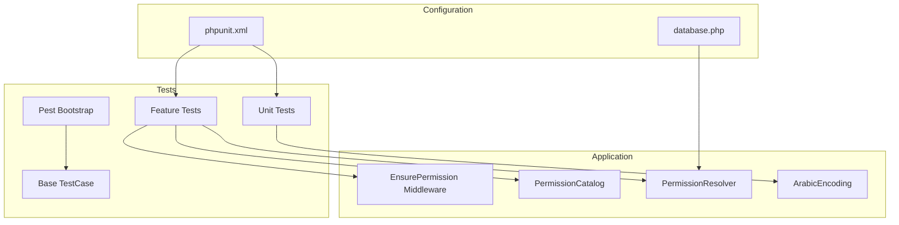
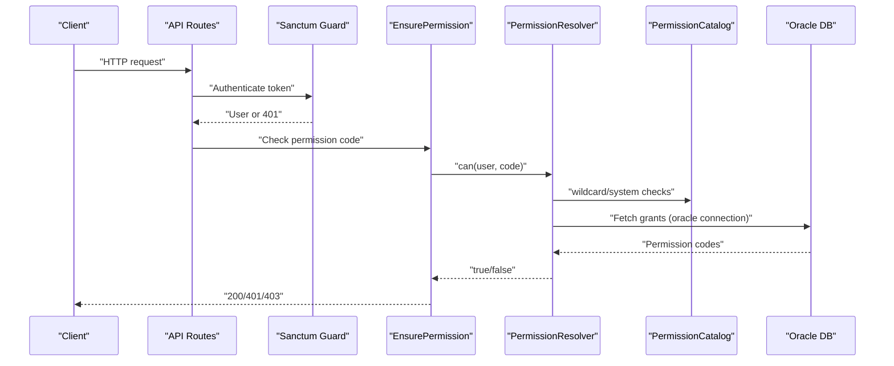
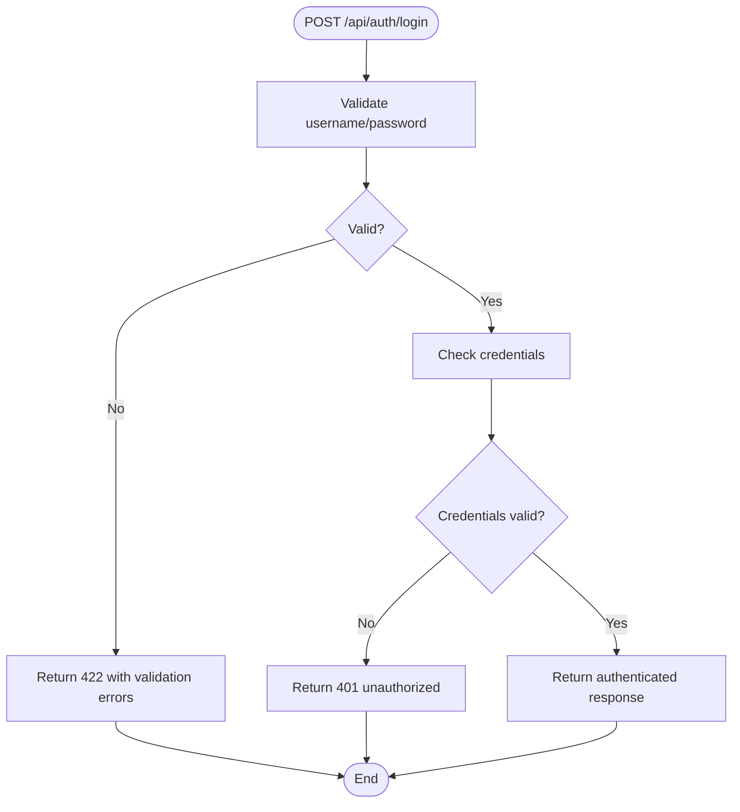
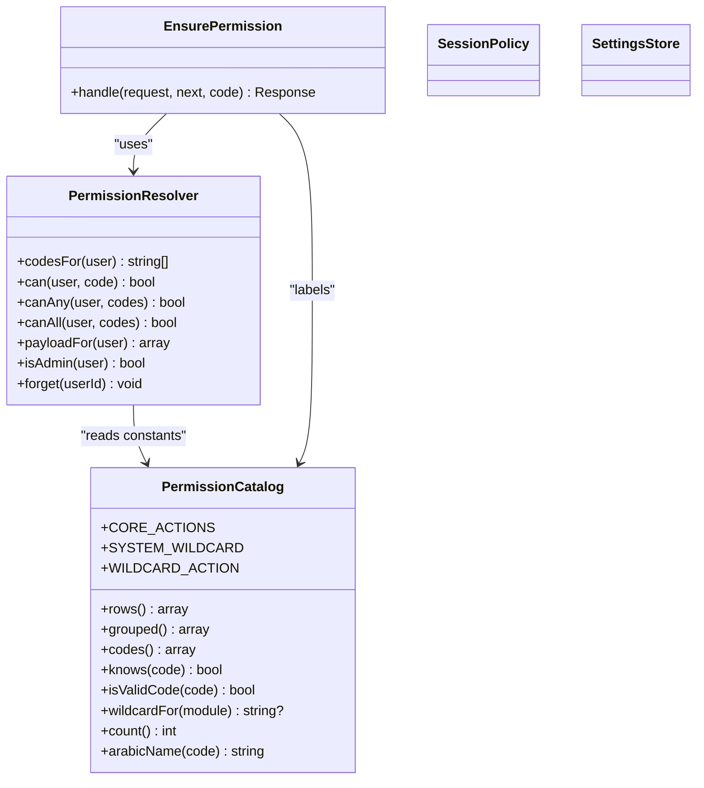
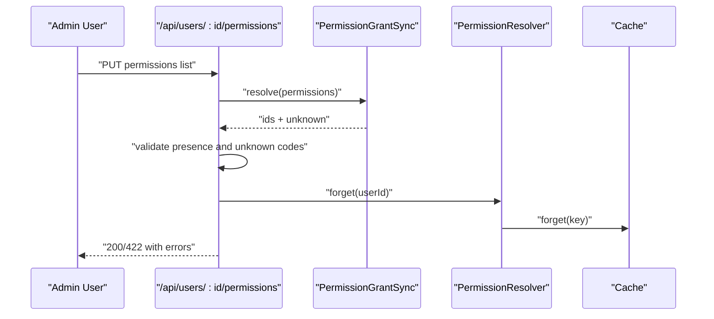
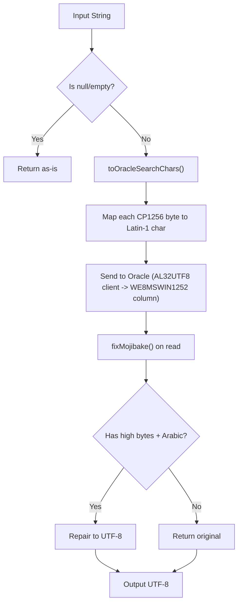
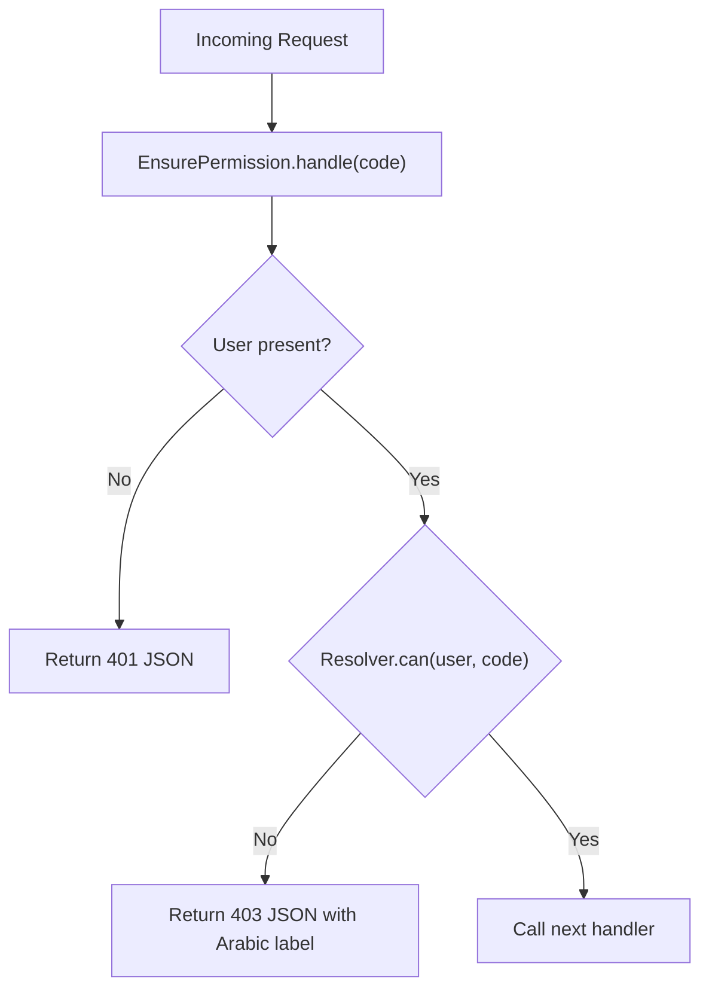
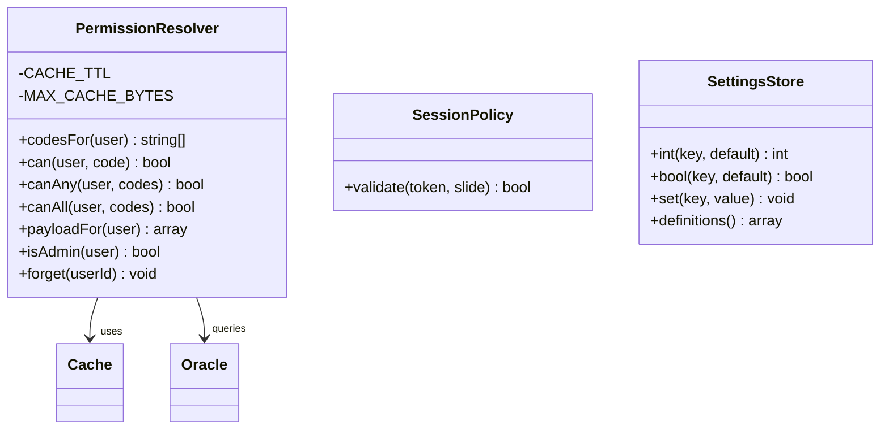
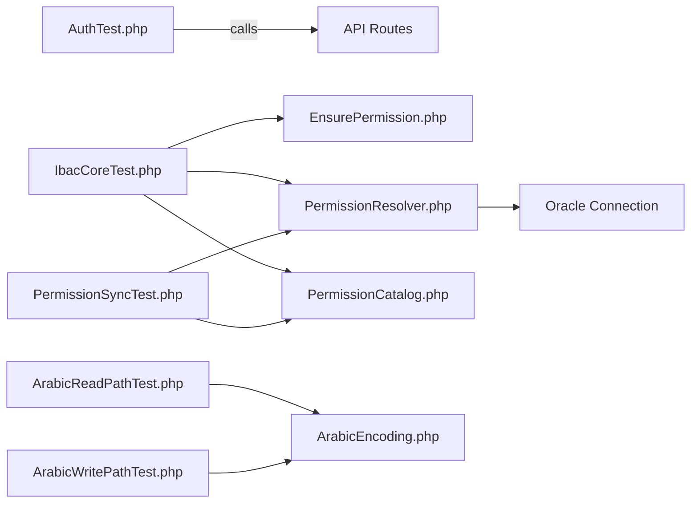

# Backend Testing

<cite>
**Referenced Files in This Document**
- [composer.json](file://kyApp_API/composer.json)
- [phpunit.xml](file://kyApp_API/phpunit.xml)
- [tests/Pest.php](file://kyApp_API/tests/Pest.php)
- [tests/TestCase.php](file://kyApp_API/tests/TestCase.php)
- [tests/Feature/AuthTest.php](file://kyApp_API/tests/Feature/AuthTest.php)
- [tests/Feature/IbacCoreTest.php](file://kyApp_API/tests/Feature/IbacCoreTest.php)
- [tests/Feature/PermissionSyncTest.php](file://kyApp_API/tests/Feature/PermissionSyncTest.php)
- [tests/Unit/ArabicReadPathTest.php](file://kyApp_API/tests/Unit/ArabicReadPathTest.php)
- [tests/Unit/ArabicWritePathTest.php](file://kyApp_API/tests/Unit/ArabicWritePathTest.php)
- [app/Http/Middleware/EnsurePermission.php](file://kyApp_API/app/Http/Middleware/EnsurePermission.php)
- [app/Support/ArabicEncoding.php](file://kyApp_API/app/Support/ArabicEncoding.php)
- [app/Support/PermissionCatalog.php](file://kyApp_API/app/Support/PermissionCatalog.php)
- [app/Support/PermissionResolver.php](file://kyApp_API/app/Support/PermissionResolver.php)
- [config/database.php](file://kyApp_API/config/database.php)
</cite>

## Table of Contents
1. [Introduction](#introduction)
2. [Project Structure](#project-structure)
3. [Core Components](#core-components)
4. [Architecture Overview](#architecture-overview)
5. [Detailed Component Analysis](#detailed-component-analysis)
6. [Dependency Analysis](#dependency-analysis)
7. [Performance Considerations](#performance-considerations)
8. [Troubleshooting Guide](#troubleshooting-guide)
9. [Conclusion](#conclusion)

## Introduction
This document explains how the Laravel backend is tested with Pest and PHPUnit, focusing on feature tests for API endpoints, authentication flows, permission validation, IBAC logic, Arabic text handling, database connectivity to Oracle, and unit testing strategies. It also covers test data management, transactional testing patterns, performance considerations, and continuous integration setup guidance.

## Project Structure
The backend test suite lives under `kyApp_API/tests` and is split into:
- Feature tests for HTTP routes, middleware, and service-layer behavior.
- Unit tests for encoding helpers and isolated business logic.
- Test configuration via `phpunit.xml` and Pest bootstrap in `tests/Pest.php`.

**Diagram sources**
- [tests/Pest.php:16-18](file://kyApp_API/tests/Pest.php#L16-L18)
- [tests/TestCase.php:7-10](file://kyApp_API/tests/TestCase.php#L7-L10)
- [app/Http/Middleware/EnsurePermission.php:25-53](file://kyApp_API/app/Http/Middleware/EnsurePermission.php#L25-L53)
- [app/Support/PermissionCatalog.php:22-28](file://kyApp_API/app/Support/PermissionCatalog.php#L22-L28)
- [app/Support/PermissionResolver.php:27-43](file://kyApp_API/app/Support/PermissionResolver.php#L27-L43)
- [app/Support/ArabicEncoding.php:9-31](file://kyApp_API/app/Support/ArabicEncoding.php#L9-L31)
- [config/database.php:116-127](file://kyApp_API/config/database.php#L116-L127)
- [phpunit.xml:7-14](file://kyApp_API/phpunit.xml#L7-L14)

**Section sources**
- [composer.json:19-29](file://kyApp_API/composer.json#L19-L29)
- [phpunit.xml:7-14](file://kyApp_API/phpunit.xml#L7-L14)
- [tests/Pest.php:16-18](file://kyApp_API/tests/Pest.php#L16-L18)
- [tests/TestCase.php:7-10](file://kyApp_API/tests/TestCase.php#L7-L10)

## Core Components
- Pest configuration extends the base test case for Feature tests and exposes custom expectations and helpers.
- phpunit.xml defines Unit and Feature suites, sets testing environment variables (SQLite in-memory), and includes source coverage for `app`.
- Base TestCase provides a shared foundation for all tests.

Key responsibilities:
- Test discovery and execution via PHPUnit/Pest.
- Environment isolation for fast, deterministic tests.
- Optional extension points for common assertions and helpers.

**Section sources**
- [tests/Pest.php:16-33](file://kyApp_API/tests/Pest.php#L16-L33)
- [phpunit.xml:7-35](file://kyApp_API/phpunit.xml#L7-L35)
- [tests/TestCase.php:7-10](file://kyApp_API/tests/TestCase.php#L7-L10)

## Architecture Overview
The backend uses Sanctum for token-based authentication and an IBAC (Identity-Based Access Control) system enforced by middleware and resolved through a permission resolver backed by Oracle. Arabic text compatibility between UTF-8 application code and legacy Oracle encodings is handled by a dedicated helper.

**Diagram sources**
- [app/Http/Middleware/EnsurePermission.php:32-52](file://kyApp_API/app/Http/Middleware/EnsurePermission.php#L32-L52)
- [app/Support/PermissionResolver.php:95-132](file://kyApp_API/app/Support/PermissionResolver.php#L95-L132)
- [app/Support/PermissionCatalog.php:447-469](file://kyApp_API/app/Support/PermissionCatalog.php#L447-L469)
- [config/database.php:116-127](file://kyApp_API/config/database.php#L116-L127)

## Detailed Component Analysis

### Authentication Flow Tests
The authentication feature tests validate:
- Validation errors when required fields are missing.
- Rejection of invalid credentials.
- Protection of sensitive endpoints against unauthenticated requests.

**Diagram sources**
- [tests/Feature/AuthTest.php:3-11](file://kyApp_API/tests/Feature/AuthTest.php#L3-L11)
- [tests/Feature/AuthTest.php:13-23](file://kyApp_API/tests/Feature/AuthTest.php#L13-L23)
- [tests/Feature/AuthTest.php:25-31](file://kyApp_API/tests/Feature/AuthTest.php#L25-L31)

**Section sources**
- [tests/Feature/AuthTest.php:3-31](file://kyApp_API/tests/Feature/AuthTest.php#L3-L31)

### IBAC Permission System Tests
IBAC core tests cover:
- Permission catalog structure and ordering.
- Code validation rules and Arabic labels.
- Default deny behavior and admin bypass.
- Settings store type safety and bounds.
- Middleware responses for anonymous, denied, and admin users.
- Session policy validation for live tokens, expired tokens, ancient tokens, disabled users, and null tokens.

**Diagram sources**
- [app/Http/Middleware/EnsurePermission.php:25-53](file://kyApp_API/app/Http/Middleware/EnsurePermission.php#L25-L53)
- [app/Support/PermissionResolver.php:27-43](file://kyApp_API/app/Support/PermissionResolver.php#L27-L43)
- [app/Support/PermissionCatalog.php:22-41](file://kyApp_API/app/Support/PermissionCatalog.php#L22-L41)
- [tests/Feature/IbacCoreTest.php:129-153](file://kyApp_API/tests/Feature/IbacCoreTest.php#L129-L153)
- [tests/Feature/IbacCoreTest.php:155-195](file://kyApp_API/tests/Feature/IbacCoreTest.php#L155-L195)

**Section sources**
- [tests/Feature/IbacCoreTest.php:45-127](file://kyApp_API/tests/Feature/IbacCoreTest.php#L45-L127)
- [tests/Feature/IbacCoreTest.php:129-195](file://kyApp_API/tests/Feature/IbacCoreTest.php#L129-L195)
- [app/Support/PermissionCatalog.php:22-41](file://kyApp_API/app/Support/PermissionCatalog.php#L22-L41)
- [app/Support/PermissionResolver.php:95-132](file://kyApp_API/app/Support/PermissionResolver.php#L95-L132)
- [app/Http/Middleware/EnsurePermission.php:32-52](file://kyApp_API/app/Http/Middleware/EnsurePermission.php#L32-L52)

### Permission Sync and Catalog Endpoint Tests
These tests verify:
- Mapping known permission codes to database IDs.
- Reporting unknown codes without writing changes.
- Ignoring blanks and duplicates.
- Reading current grants without mutation.
- Cache invalidation after forgetting user permissions.
- Catalog endpoint serving module metadata and correct ordering.
- Authorization enforcement on catalog and per-user permission endpoints.
- Validation that syncing grants requires an explicit list and rejects unknown codes before any writes.

**Diagram sources**
- [tests/Feature/PermissionSyncTest.php:38-57](file://kyApp_API/tests/Feature/PermissionSyncTest.php#L38-L57)
- [tests/Feature/PermissionSyncTest.php:71-81](file://kyApp_API/tests/Feature/PermissionSyncTest.php#L71-L81)
- [tests/Feature/PermissionSyncTest.php:129-153](file://kyApp_API/tests/Feature/PermissionSyncTest.php#L129-L153)

**Section sources**
- [tests/Feature/PermissionSyncTest.php:38-153](file://kyApp_API/tests/Feature/PermissionSyncTest.php#L38-L153)

### Arabic Text Handling Tests
Two complementary test suites ensure safe round-trips for Arabic text across the Oracle boundary:

- Read path: idempotent repair of mojibake, mixed content handling, and preservation of ASCII/null/empty values.
- Write path: binding CP1256 bytes safely via Latin-1 surrogate characters, ensuring no raw high-byte writes, and verifying read-back correctness.

**Diagram sources**
- [app/Support/ArabicEncoding.php:143-162](file://kyApp_API/app/Support/ArabicEncoding.php#L143-L162)
- [app/Support/ArabicEncoding.php:36-120](file://kyApp_API/app/Support/ArabicEncoding.php#L36-L120)
- [tests/Unit/ArabicWritePathTest.php:20-36](file://kyApp_API/tests/Unit/ArabicWritePathTest.php#L20-L36)
- [tests/Unit/ArabicReadPathTest.php:28-40](file://kyApp_API/tests/Unit/ArabicReadPathTest.php#L28-L40)

**Section sources**
- [tests/Unit/ArabicReadPathTest.php:19-70](file://kyApp_API/tests/Unit/ArabicReadPathTest.php#L19-L70)
- [tests/Unit/ArabicWritePathTest.php:17-68](file://kyApp_API/tests/Unit/ArabicWritePathTest.php#L17-L68)
- [app/Support/ArabicEncoding.php:36-120](file://kyApp_API/app/Support/ArabicEncoding.php#L36-L120)
- [app/Support/ArabicEncoding.php:143-162](file://kyApp_API/app/Support/ArabicEncoding.php#L143-L162)

### Middleware and Controller Patterns
- Middleware enforces deny-by-default access control, returning 401 for unauthenticated requests and 403 with Arabic permission names for unauthorized users. Administrators bypass grant checks.
- Controllers should rely on middleware for authorization and use the permission catalog for consistent labels and validation.

**Diagram sources**
- [app/Http/Middleware/EnsurePermission.php:32-52](file://kyApp_API/app/Http/Middleware/EnsurePermission.php#L32-L52)

**Section sources**
- [app/Http/Middleware/EnsurePermission.php:11-24](file://kyApp_API/app/Http/Middleware/EnsurePermission.php#L11-L24)
- [app/Http/Middleware/EnsurePermission.php:32-52](file://kyApp_API/app/Http/Middleware/EnsurePermission.php#L32-L52)

### Service Layer and External Services
- PermissionResolver reads effective permissions from Oracle using a dedicated connection and caches results with size-aware TTL.
- SessionPolicy validates Sanctum tokens against expiration, age, and user activation state.
- SettingsStore enforces typed values and maximum bounds.

**Diagram sources**
- [app/Support/PermissionResolver.php:29-43](file://kyApp_API/app/Support/PermissionResolver.php#L29-L43)
- [app/Support/PermissionResolver.php:66-89](file://kyApp_API/app/Support/PermissionResolver.php#L66-L89)
- [app/Support/PermissionResolver.php:235-251](file://kyApp_API/app/Support/PermissionResolver.php#L235-L251)
- [tests/Feature/IbacCoreTest.php:155-195](file://kyApp_API/tests/Feature/IbacCoreTest.php#L155-L195)
- [tests/Feature/IbacCoreTest.php:101-127](file://kyApp_API/tests/Feature/IbacCoreTest.php#L101-L127)

**Section sources**
- [app/Support/PermissionResolver.php:27-43](file://kyApp_API/app/Support/PermissionResolver.php#L27-L43)
- [app/Support/PermissionResolver.php:66-132](file://kyApp_API/app/Support/PermissionResolver.php#L66-L132)
- [app/Support/PermissionResolver.php:235-251](file://kyApp_API/app/Support/PermissionResolver.php#L235-L251)
- [tests/Feature/IbacCoreTest.php:101-127](file://kyApp_API/tests/Feature/IbacCoreTest.php#L101-L127)
- [tests/Feature/IbacCoreTest.php:155-195](file://kyApp_API/tests/Feature/IbacCoreTest.php#L155-L195)

## Dependency Analysis
The following diagram shows key dependencies among test files and application components.

**Diagram sources**
- [tests/Feature/AuthTest.php:3-31](file://kyApp_API/tests/Feature/AuthTest.php#L3-L31)
- [tests/Feature/IbacCoreTest.php:129-195](file://kyApp_API/tests/Feature/IbacCoreTest.php#L129-L195)
- [tests/Feature/PermissionSyncTest.php:38-153](file://kyApp_API/tests/Feature/PermissionSyncTest.php#L38-L153)
- [tests/Unit/ArabicReadPathTest.php:19-70](file://kyApp_API/tests/Unit/ArabicReadPathTest.php#L19-L70)
- [tests/Unit/ArabicWritePathTest.php:17-68](file://kyApp_API/tests/Unit/ArabicWritePathTest.php#L17-L68)
- [app/Support/PermissionResolver.php:235-251](file://kyApp_API/app/Support/PermissionResolver.php#L235-L251)
- [config/database.php:116-127](file://kyApp_API/config/database.php#L116-L127)

**Section sources**
- [tests/Feature/AuthTest.php:3-31](file://kyApp_API/tests/Feature/AuthTest.php#L3-L31)
- [tests/Feature/IbacCoreTest.php:129-195](file://kyApp_API/tests/Feature/IbacCoreTest.php#L129-L195)
- [tests/Feature/PermissionSyncTest.php:38-153](file://kyApp_API/tests/Feature/PermissionSyncTest.php#L38-L153)
- [tests/Unit/ArabicReadPathTest.php:19-70](file://kyApp_API/tests/Unit/ArabicReadPathTest.php#L19-L70)
- [tests/Unit/ArabicWritePathTest.php:17-68](file://kyApp_API/tests/Unit/ArabicWritePathTest.php#L17-L68)
- [config/database.php:116-127](file://kyApp_API/config/database.php#L116-L127)

## Performance Considerations
- Use SQLite in-memory for fast, isolated tests where possible; this is already configured for general tests.
- For Oracle-dependent tests, avoid unnecessary writes and prefer read-only scenarios or graceful skips when the database is unavailable.
- Respect cache size limits in PermissionResolver to prevent oversized payloads from failing due to database constraints.
- Prefer targeted assertions over full-page rendering to keep tests fast.
- When testing session policies, construct tokens with time boundaries that avoid triggering expensive persistence operations.

[No sources needed since this section provides general guidance]

## Troubleshooting Guide
Common issues and resolutions:
- Missing Oracle connection during IBAC tests: tests gracefully skip if no admin user exists; ensure a live Oracle instance is available or mark tests accordingly.
- Unexpected 401/403 responses: verify Sanctum authentication and middleware registration; check that the requested permission code is defined in the catalog.
- Arabic mojibake symptoms: confirm usage of `ArabicEncoding::toOracleSearchChars()` for writes and `ArabicEncoding::fixMojibake()` for reads; avoid direct raw CP1256 byte writes.
- Cache inconsistencies after permission updates: call `PermissionResolver::forget(userId)` to clear cached codes.

**Section sources**
- [tests/Feature/IbacCoreTest.php:28-43](file://kyApp_API/tests/Feature/IbacCoreTest.php#L28-L43)
- [tests/Feature/PermissionSyncTest.php:71-81](file://kyApp_API/tests/Feature/PermissionSyncTest.php#L71-L81)
- [app/Support/ArabicEncoding.php:36-120](file://kyApp_API/app/Support/ArabicEncoding.php#L36-L120)
- [app/Support/ArabicEncoding.php:143-162](file://kyApp_API/app/Support/ArabicEncoding.php#L143-L162)

## Conclusion
The test suite combines Pest-driven feature tests and focused unit tests to validate authentication, IBAC authorization, Arabic encoding integrity, and Oracle connectivity. By adhering to the patterns described here—deny-by-default middleware, canonical permission catalogs, safe encoding helpers, and careful cache management—you can maintain reliable, secure, and performant backend behavior.

[No sources needed since this section summarizes without analyzing specific files]