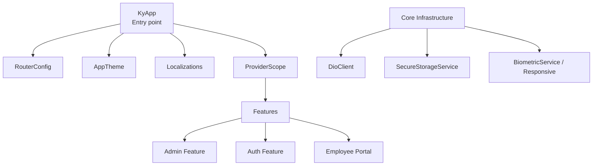
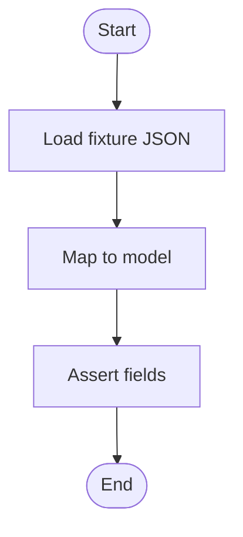
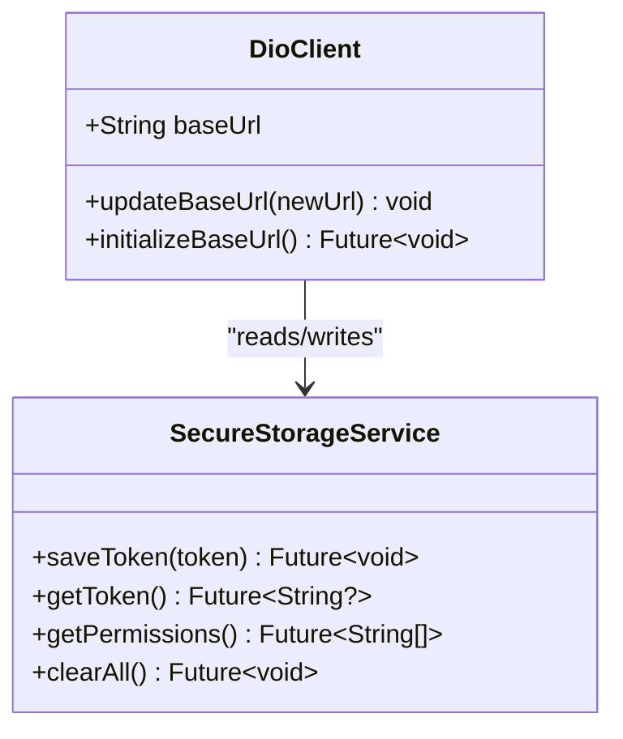
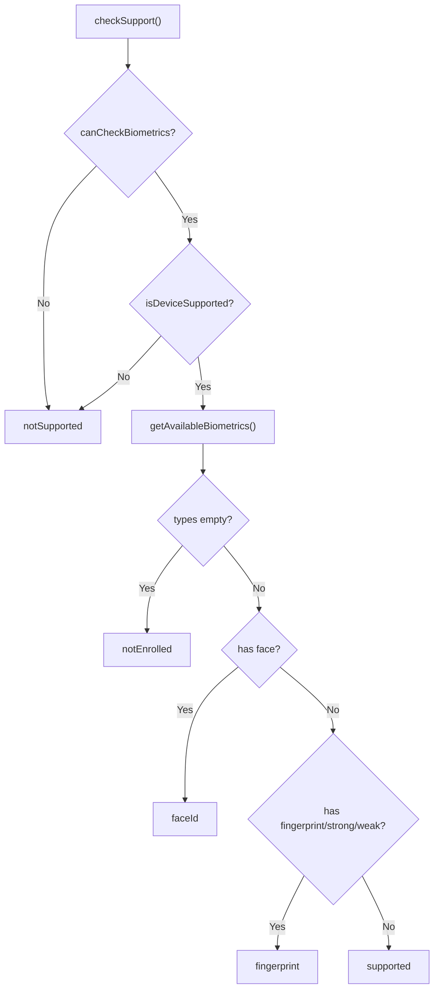
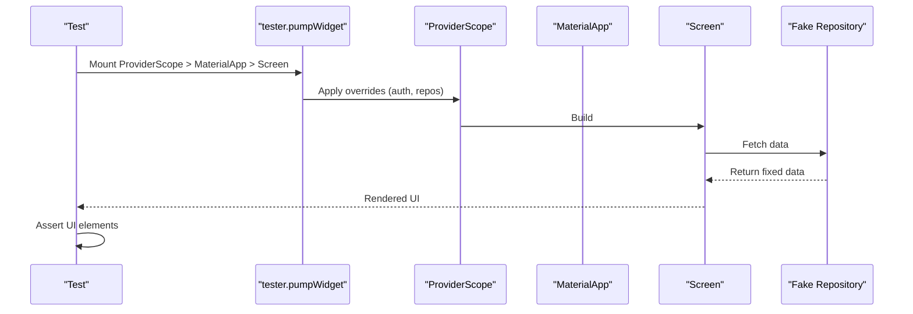
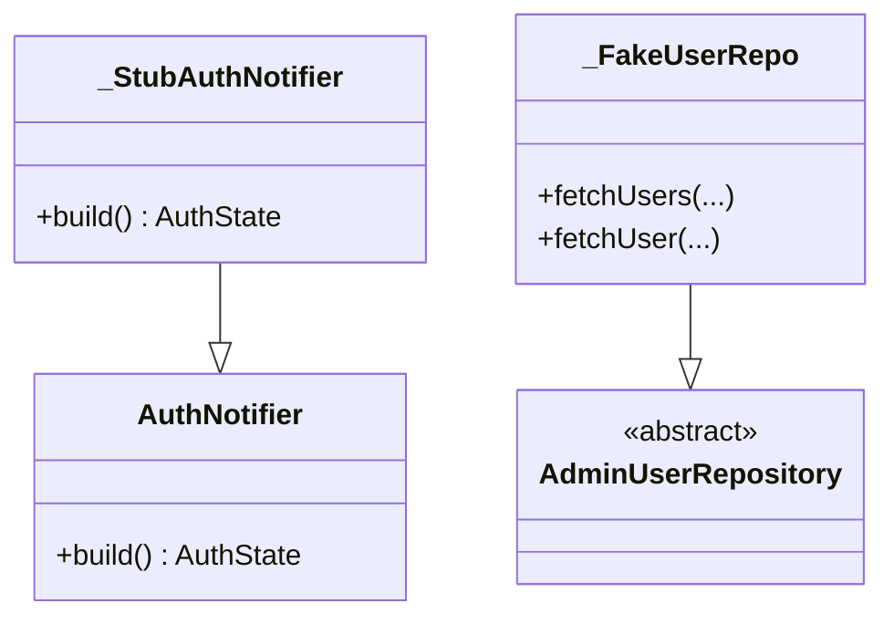
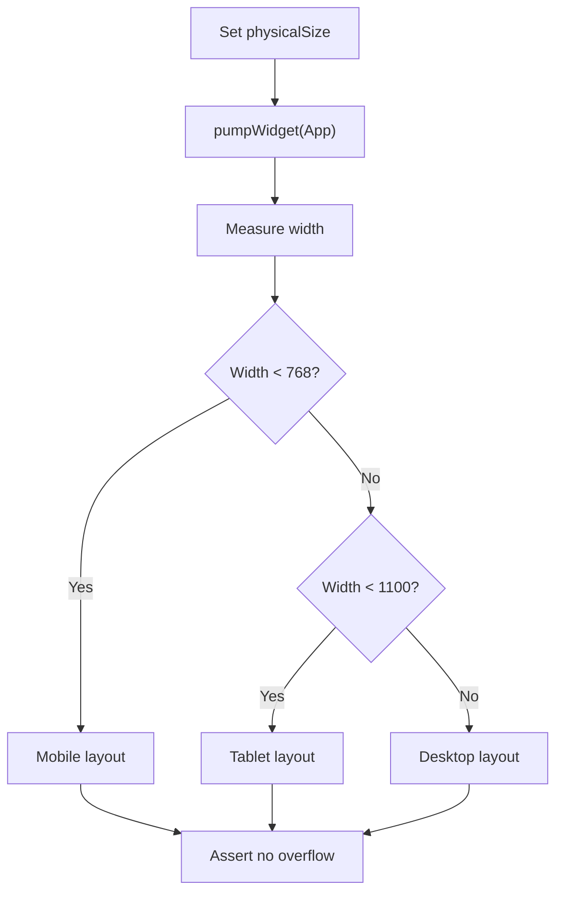
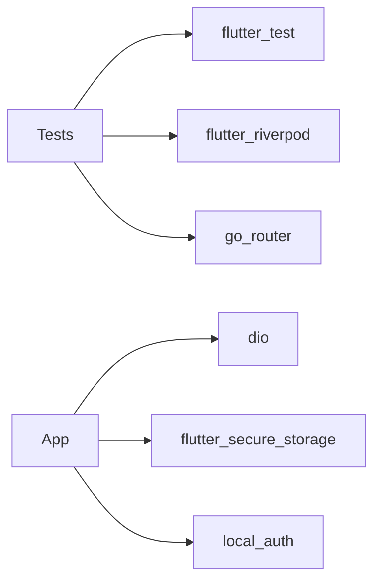

# Frontend Testing

<cite>
**Referenced Files in This Document**
- [pubspec.yaml](file://pubspec.yaml)
- [main.dart](file://lib/main.dart)
- [dio_client.dart](file://lib/core/network/dio_client.dart)
- [secure_storage_service.dart](file://lib/core/storage/secure_storage_service.dart)
- [biometric_service.dart](file://lib/core/utils/biometric_service.dart)
- [responsive.dart](file://lib/core/utils/responsive.dart)
- [widget_test.dart](file://test/widget_test.dart)
- [api_config_test.dart](file://test/api_config_test.dart)
- [responsive_layout_test.dart](file://test/responsive_layout_test.dart)
</cite>

## Table of Contents
1. [Introduction](#introduction)
2. [Project Structure](#project-structure)
3. [Core Components](#core-components)
4. [Architecture Overview](#architecture-overview)
5. [Detailed Component Analysis](#detailed-component-analysis)
6. [Dependency Analysis](#dependency-analysis)
7. [Performance Considerations](#performance-considerations)
8. [Troubleshooting Guide](#troubleshooting-guide)
9. [Conclusion](#conclusion)

## Introduction
This document provides comprehensive frontend testing guidance for the Flutter application, focusing on unit tests for widgets and business logic, service tests for network and storage operations, and integration-style tests for user flows. It explains how to structure tests, mock external dependencies (API calls, secure storage, biometrics), test asynchronous behavior, work with Riverpod state, and validate responsive layouts across screen sizes. The guidance is grounded in the existing codebase and test files.

## Project Structure
The project uses a feature-based layout under lib/features, shared infrastructure under lib/core, and tests under test. The app entry point initializes Riverpod’s ProviderScope and configures localization and routing. Dependencies include Dio for networking, flutter_secure_storage for secure persistence, local_auth for biometrics, go_router for navigation, and flutter_riverpod for state management.



**Diagram sources**
- [main.dart:7-46](file://lib/main.dart#L7-L46)
- [dio_client.dart:9-59](file://lib/core/network/dio_client.dart#L9-L59)
- [secure_storage_service.dart:7-204](file://lib/core/storage/secure_storage_service.dart#L7-L204)
- [biometric_service.dart:14-84](file://lib/core/utils/biometric_service.dart#L14-L84)
- [responsive.dart:5-50](file://lib/core/utils/responsive.dart#L5-L50)

**Section sources**
- [pubspec.yaml:30-47](file://pubspec.yaml#L30-L47)
- [main.dart:7-46](file://lib/main.dart#L7-L46)

## Core Components
This section outlines the core components relevant to testing and their responsibilities.

- DioClient: Central HTTP client configured with base URL, timeouts, headers, and interceptors for auth and error handling. Supports runtime base URL updates and initialization from secure storage.
- SecureStorageService: Encrypted key-value store wrapper for tokens, user data, API base URL, IBAC permissions, session expiry, and biometric flags. Provides safe defaults and robust parsing.
- BiometricService: Wrapper around local_auth to detect device capability, check enrollment, and perform biometric authentication.
- Responsive: Breakpoint helpers and a widget that selects mobile/tablet/desktop layouts based on constraints.

These components are frequently tested or mocked in the test suite.

**Section sources**
- [dio_client.dart:9-59](file://lib/core/network/dio_client.dart#L9-L59)
- [secure_storage_service.dart:7-204](file://lib/core/storage/secure_storage_service.dart#L7-L204)
- [biometric_service.dart:14-84](file://lib/core/utils/biometric_service.dart#L14-L84)
- [responsive.dart:5-50](file://lib/core/utils/responsive.dart#L5-L50)

## Architecture Overview
The testing architecture isolates UI, state, and external dependencies:

- Widget tests render screens inside MaterialApp and ProviderScope, overriding providers where needed.
- Service tests target pure functions and repositories using fakes or stubs.
- Integration-style tests pump full screens with fake repositories and a stubbed auth notifier to avoid real network calls.

```mermaid
sequenceDiagram
participant Test as "Test"
participant Pump as "tester.pumpWidget"
participant Scope as "ProviderScope"
participant Screen as "Screen Widget"
participant Repo as "Repository (Fake)"
participant Client as "DioClient"
participant Storage as "SecureStorageService"
Test->>Pump : Mount screen with overrides
Pump->>Scope : Apply provider overrides
Scope->>Screen : Build UI
Screen->>Repo : Fetch data
Repo-->>Screen : Return fake data
Note over Repo,Client : Repositories use DioClient but never call network in tests
Note over Scope,Storage : Storage may be initialized; tests avoid side effects via fakes/stubs
```

**Diagram sources**
- [responsive_layout_test.dart:422-450](file://test/responsive_layout_test.dart#L422-L450)
- [dio_client.dart:9-59](file://lib/core/network/dio_client.dart#L9-L59)
- [secure_storage_service.dart:7-204](file://lib/core/storage/secure_storage_service.dart#L7-L204)

## Detailed Component Analysis

### Unit Testing Models and Pure Logic
Use simple unit tests to verify JSON mapping and pure utility functions. The existing tests demonstrate:

- Mapping UserModel and AuthResponse from JSON payloads.
- Validating URL normalization and default constants.

Best practices:
- Group related tests with group().
- Use descriptive test names.
- Assert exact values for deterministic mappings.



**Section sources**
- [widget_test.dart:5-44](file://test/widget_test.dart#L5-L44)
- [api_config_test.dart:5-24](file://test/api_config_test.dart#L5-L24)

### Service Tests: DioClient and SecureStorageService
When testing services that depend on external SDKs:

- DioClient:
  - Verify base URL configuration and updateBaseUrl behavior.
  - Ensure interceptors are attached.
  - For initializeBaseUrl, mock SecureStorageService to return known values.
- SecureStorageService:
  - Test save/get/delete pairs for tokens, user data, API base URL.
  - Validate getPermissions handles corrupt or missing data safely.
  - Confirm clearAll removes session-related keys while preserving API URL if required by design.

Mocking strategies:
- Inject a test double for FlutterSecureStorage when possible.
- For DioClient, override baseUrl during tests to avoid real requests.



**Diagram sources**
- [dio_client.dart:9-59](file://lib/core/network/dio_client.dart#L9-L59)
- [secure_storage_service.dart:7-204](file://lib/core/storage/secure_storage_service.dart#L7-L204)

**Section sources**
- [dio_client.dart:9-59](file://lib/core/network/dio_client.dart#L9-L59)
- [secure_storage_service.dart:7-204](file://lib/core/storage/secure_storage_service.dart#L7-L204)

### Biometric Authentication Testing
To test BiometricService without invoking platform APIs:

- Wrap LocalAuthentication in an interface and inject it into BiometricService for testability.
- In tests, provide a fake LocalAuthentication that returns controlled capabilities and authentication results.
- Validate that unsupported or not-enrolled devices yield appropriate states.



**Diagram sources**
- [biometric_service.dart:18-47](file://lib/core/utils/biometric_service.dart#L18-L47)

**Section sources**
- [biometric_service.dart:14-84](file://lib/core/utils/biometric_service.dart#L14-L84)

### Widget Testing Strategies
Effective widget tests should:

- Render the widget under test inside MaterialApp and ProviderScope.
- Provide minimal context (e.g., MediaQuery, theme).
- Interact with inputs and assert visible outputs.
- Avoid hitting the network by overriding providers with fakes.

Example patterns in this repository:
- Rendering admin screens at multiple breakpoints with fake repositories and a stubbed auth notifier.
- Verifying text presence and absence to confirm permission gating.



**Diagram sources**
- [responsive_layout_test.dart:422-450](file://test/responsive_layout_test.dart#L422-L450)

**Section sources**
- [responsive_layout_test.dart:422-450](file://test/responsive_layout_test.dart#L422-L450)

### State Management with Riverpod
Testing Riverpod:

- Use ProviderScope with overrides to replace providers with test doubles.
- Create stubs for notifiers that return fixed state without triggering side effects.
- Combine ProviderScope overrides with fake repositories to isolate UI logic.

In the repository:
- A stubbed AuthNotifier bypasses network calls and returns a predefined AuthState.
- Fake repositories implement repository interfaces to return deterministic data.



**Diagram sources**
- [responsive_layout_test.dart:44-51](file://test/responsive_layout_test.dart#L44-L51)
- [responsive_layout_test.dart:211-317](file://test/responsive_layout_test.dart#L211-L317)

**Section sources**
- [responsive_layout_test.dart:44-51](file://test/responsive_layout_test.dart#L44-L51)
- [responsive_layout_test.dart:211-317](file://test/responsive_layout_test.dart#L211-L317)

### Navigation Flows
For navigation testing:

- Use go_router’s testing utilities to navigate programmatically.
- Assert route transitions and arguments passed between routes.
- Mock any data dependencies so navigation does not trigger network calls.

Although specific navigation tests are not present here, the recommended approach is to:

- Initialize go_router with a test configuration.
- Call router.go or router.push to simulate user actions.
- Assert the current location and rendered content.

[No sources needed since this section provides general guidance]

### Asynchronous Operations
Common patterns:

- Use await tester.pumpAndSettle() to wait for async tasks and animations.
- For timers and periodic updates, ensure they are torn down properly to avoid lingering tickers.
- In service tests, wrap async calls with expectLater or test futures directly.

Examples in the repository:
- Using pumpAndSettle after mounting screens.
- Explicitly pumping a SizedBox to tear down a screen with a timer.

**Section sources**
- [responsive_layout_test.dart:449-450](file://test/responsive_layout_test.dart#L449-L450)
- [responsive_layout_test.dart:720-723](file://test/responsive_layout_test.dart#L720-L723)

### Responsive Layout Testing
The repository includes dedicated tests for responsive behavior:

- Verify breakpoint detection for mobile, tablet, and desktop.
- Render EmployeeMainLayout at different screen sizes and assert no overflow exceptions.
- Confirm portal sections follow granted permissions and adapt to screen size.



**Diagram sources**
- [responsive.dart:17-29](file://lib/core/utils/responsive.dart#L17-L29)
- [responsive_layout_test.dart:453-529](file://test/responsive_layout_test.dart#L453-L529)

**Section sources**
- [responsive.dart:5-50](file://lib/core/utils/responsive.dart#L5-L50)
- [responsive_layout_test.dart:453-529](file://test/responsive_layout_test.dart#L453-L529)

## Dependency Analysis
Key dependencies and their roles in testing:

- flutter_test: Built-in framework for unit and widget tests.
- dio: Networking library; intercepted by DioClient.
- flutter_secure_storage: Encrypted storage; wrapped by SecureStorageService.
- local_auth: Biometric authentication; wrapped by BiometricService.
- flutter_riverpod: State container; used with ProviderScope and overrides.
- go_router: Navigation; can be tested with programmatic navigation.



**Diagram sources**
- [pubspec.yaml:30-47](file://pubspec.yaml#L30-L47)

**Section sources**
- [pubspec.yaml:30-47](file://pubspec.yaml#L30-L47)

## Performance Considerations
- Prefer unit tests for pure logic and models; they run fastest.
- Keep widget tests focused on small surfaces; avoid rendering entire apps unless necessary.
- Use fake repositories to eliminate network latency and flakiness.
- Minimize pumpAndSettle usage; only settle when async work must complete before assertions.
- Tear down timers and periodic tasks explicitly to prevent background work affecting subsequent tests.
- Run tests in parallel where possible; isolate stateful resources like storage and network.

[No sources needed since this section provides general guidance]

## Troubleshooting Guide
Common issues and resolutions:

- Overflow errors in responsive layouts:
  - Render screens at both mobile and desktop sizes and assert no exceptions.
  - Ensure navigation bars have at least two destinations or handle single-section cases gracefully.
- Timers left running after screen teardown:
  - Pump a placeholder widget to dispose timers.
- Provider state not updating:
  - Use ProviderScope with overrides to inject test doubles.
- Network calls in tests:
  - Replace repositories with fakes; ensure DioClient is not invoked.

**Section sources**
- [responsive_layout_test.dart:646-737](file://test/responsive_layout_test.dart#L646-L737)
- [responsive_layout_test.dart:720-723](file://test/responsive_layout_test.dart#L720-L723)

## Conclusion
This guide consolidates testing strategies aligned with the project’s architecture. By leveraging ProviderScope overrides, fake repositories, and stubbed notifiers, you can write fast, reliable tests for widgets, services, and user flows. Focus on isolating external dependencies, validating responsive behavior across breakpoints, and ensuring asynchronous operations are properly settled and torn down. This approach yields a maintainable and efficient test suite that scales with the application.

[No sources needed since this section summarizes without analyzing specific files]