# Testing Guide

<cite>
**Referenced Files in This Document**
- [pubspec.yaml](file://pubspec.yaml)
- [widget_test.dart](file://test/widget_test.dart)
- [api_config_test.dart](file://test/api_config_test.dart)
- [app_config_model_test.dart](file://test/app_config_model_test.dart)
- [ibac_test.dart](file://test/ibac_test.dart)
- [app_config_model.dart](file://lib/features/app_config/data/models/app_config_model.dart)
- [app_palette.dart](file://lib/core/theme/app_palette.dart)
- [composer.json](file://kyApp_API/composer.json)
- [Pest.php](file://kyApp_API/tests/Pest.php)
- [TestCase.php](file://kyApp_API/tests/TestCase.php)
</cite>

## Update Summary
**Changes Made**
- Added comprehensive documentation for configuration model testing covering JSON serialization, color parsing, default value handling, and edge cases
- Updated Flutter unit tests section with new AppConfigModel test coverage
- Enhanced test organization examples with configuration model patterns
- Added new diagram showing configuration model testing workflow

## Table of Contents
1. [Introduction](#introduction)
2. [Project Structure](#project-structure)
3. [Core Components](#core-components)
4. [Architecture Overview](#architecture-overview)
5. [Detailed Component Analysis](#detailed-component-analysis)
6. [Configuration Model Testing](#configuration-model-testing)
7. [Dependency Analysis](#dependency-analysis)
8. [Performance Considerations](#performance-considerations)
9. [Troubleshooting Guide](#troubleshooting-guide)
10. [Conclusion](#conclusion)
11. [Appendices](#appendices)

## Introduction
This Testing Guide documents the testing strategy for a Flutter frontend and a Laravel backend (KyApp API). It covers:
- Frontend unit tests for models, services, and business logic using Flutter's built-in testing framework.
- Backend integration tests for API endpoints using Pest, including database testing strategies and mocking patterns.
- Patterns for authentication flows, permission validation, and biometric authentication scenarios.
- Test organization, naming conventions, asynchronous testing, mocking external dependencies, CI practices, performance considerations, and test data management.

## Project Structure
The repository contains two testing surfaces:
- Flutter frontend tests under test/.
- Laravel backend tests under kyApp_API/tests/.

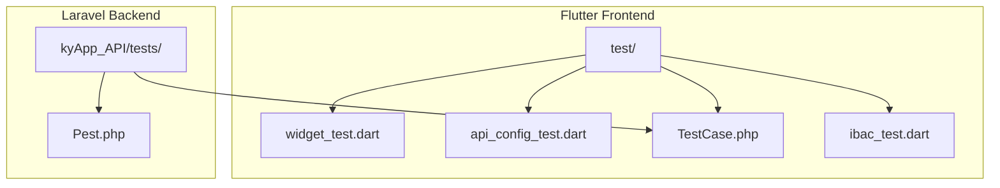

**Diagram sources**
- [pubspec.yaml:48-50](file://pubspec.yaml#L48-L50)
- [composer.json:19-29](file://kyApp_API/composer.json#L19-L29)
- [Pest.php:16-18](file://kyApp_API/tests/Pest.php#L16-L18)

**Section sources**
- [pubspec.yaml:48-50](file://pubspec.yaml#L48-L50)
- [composer.json:19-29](file://kyApp_API/composer.json#L19-L29)
- [Pest.php:16-18](file://kyApp_API/tests/Pest.php#L16-L18)

## Core Components
- Flutter testing setup uses flutter_test as a dev dependency.
- Existing Flutter tests cover:
  - Model parsing and mapping (UserModel, AuthResponse).
  - API configuration utilities (base URL normalization and constants).
  - **New**: Comprehensive configuration model testing (AppConfigModel) covering JSON serialization, color parsing, default value handling, and edge cases.
  - Permission system decision rules and UI interactions (IBAC).
- Laravel testing setup uses Pest with Laravel integration. The base TestCase is provided; RefreshDatabase is available but not enabled by default.

Key responsibilities:
- widget_test.dart: Unit tests for auth-related models.
- api_config_test.dart: Unit tests for API configuration helpers and constants.
- **app_config_model_test.dart**: Comprehensive tests for configuration model JSON serialization, color parsing, default values, copyWith operations, and palette integration.
- ibac_test.dart: Comprehensive tests for permission resolution, catalog consistency, user model parsing, and permissions picker widget behavior.

**Section sources**
- [pubspec.yaml:48-50](file://pubspec.yaml#L48-L50)
- [widget_test.dart:1-45](file://test/widget_test.dart#L1-L45)
- [api_config_test.dart:1-25](file://test/api_config_test.dart#L1-L25)
- [app_config_model_test.dart:1-107](file://test/app_config_model_test.dart#L1-L107)
- [ibac_test.dart:1-421](file://test/ibac_test.dart#L1-L421)
- [composer.json:19-29](file://kyApp_API/composer.json#L19-L29)
- [Pest.php:16-18](file://kyApp_API/tests/Pest.php#L16-L18)

## Architecture Overview
Testing architecture spans both layers:
- Flutter layer: Unit and widget tests validate domain models, permission logic, and UI components.
- Laravel layer: Pest-based integration tests exercise HTTP routes, middleware, and database-backed features.

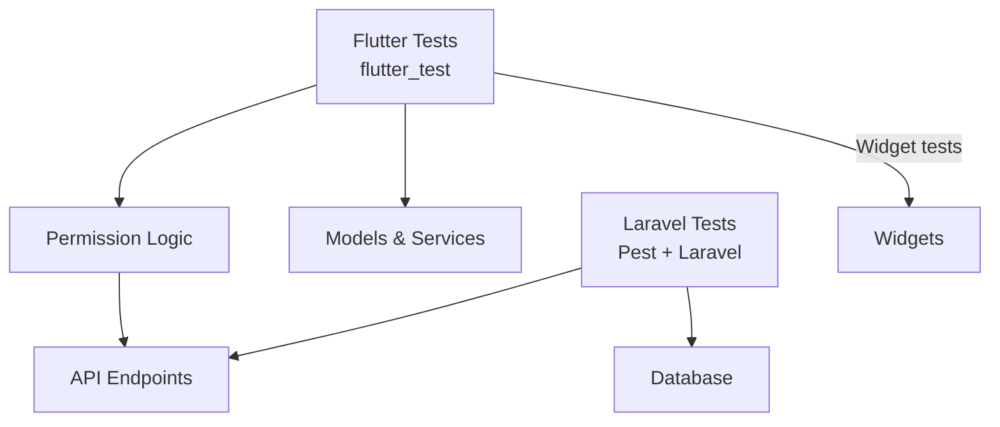

[No sources needed since this diagram shows conceptual workflow, not actual code structure]

## Detailed Component Analysis

### Flutter Unit Tests: Auth Models
Focus: Validate JSON-to-model mapping for authentication payloads.

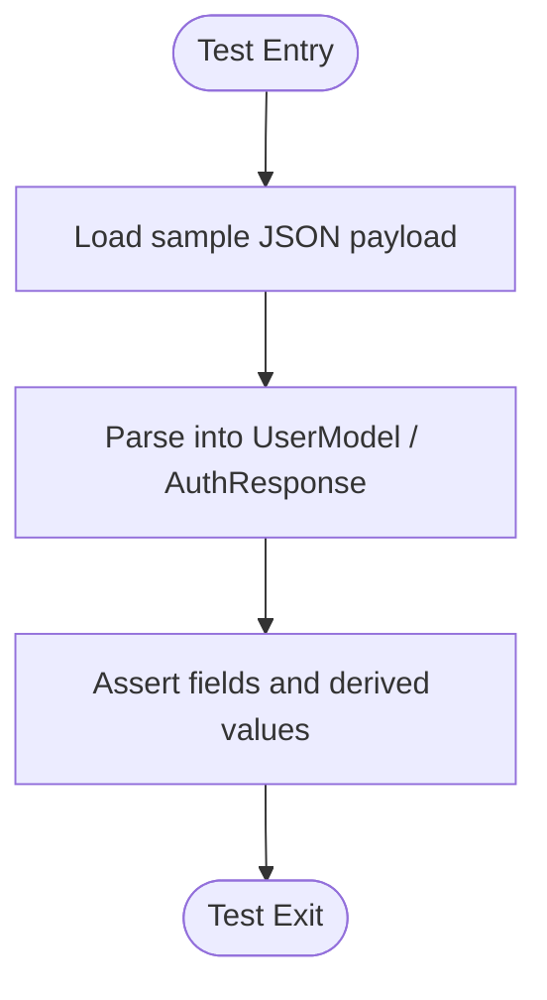

**Diagram sources**
- [widget_test.dart:5-43](file://test/widget_test.dart#L5-L43)

Practices demonstrated:
- Grouping related tests.
- Using realistic JSON shapes to verify parsing correctness.
- Asserting both direct fields and computed properties.

**Section sources**
- [widget_test.dart:5-43](file://test/widget_test.dart#L5-L43)

### Flutter Unit Tests: API Configuration
Focus: Ensure URL normalization and constant defaults are correct.

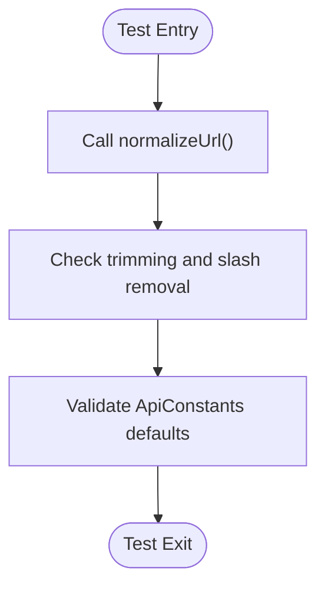

**Diagram sources**
- [api_config_test.dart:5-23](file://test/api_config_test.dart#L5-L23)

Best practices:
- Deterministic assertions on pure functions.
- Verifying that runtime defaults match expected baseline values.

**Section sources**
- [api_config_test.dart:5-23](file://test/api_config_test.dart#L5-L23)

### Flutter Widget Tests: IBAC Permission System
Focus: Validate permission decision rules, catalog integrity, user model parsing, and permissions picker interactions.

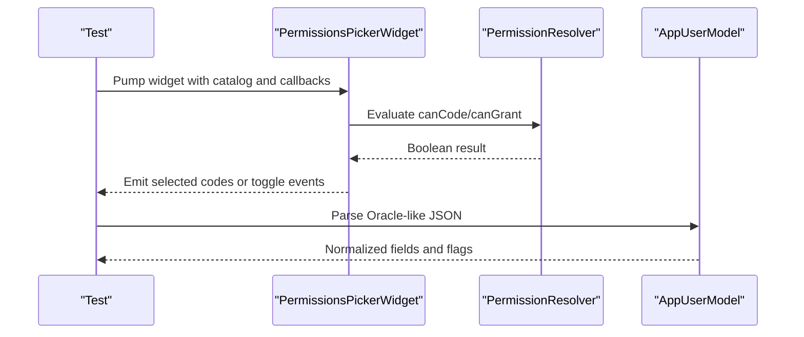

**Diagram sources**
- [ibac_test.dart:85-164](file://test/ibac_test.dart#L85-L164)
- [ibac_test.dart:203-259](file://test/ibac_test.dart#L203-L259)
- [ibac_test.dart:291-419](file://test/ibac_test.dart#L291-L419)

Highlights:
- Decision rule coverage for admin bypass, wildcards, exact matches, deny-by-default, and compound actions.
- Catalog consistency checks ensuring unique codes, module labels, and valid visibility rules.
- Widget interaction tests verifying batch selection, search filtering, escalation prevention, and locked states for system admins.

**Section sources**
- [ibac_test.dart:85-164](file://test/ibac_test.dart#L85-L164)
- [ibac_test.dart:166-201](file://test/ibac_test.dart#L166-L201)
- [ibac_test.dart:203-259](file://test/ibac_test.dart#L203-L259)
- [ibac_test.dart:291-419](file://test/ibac_test.dart#L291-L419)

### Backend Integration Tests: Pest Setup and Strategy
Focus: Configure Pest for feature tests and establish a reusable base case.

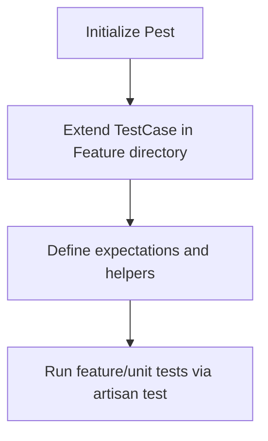

**Diagram sources**
- [Pest.php:16-33](file://kyApp_API/tests/Pest.php#L16-L33)
- [composer.json:55-58](file://kyApp_API/composer.json#L55-L58)

Recommendations:
- Enable RefreshDatabase for transactional isolation in feature tests.
- Use factories and seeders to create deterministic test data.
- Mock third-party services (e.g., SMS, email, payment gateways) where appropriate.

**Section sources**
- [Pest.php:16-33](file://kyApp_API/tests/Pest.php#L16-L33)
- [composer.json:55-58](file://kyApp_API/composer.json#L55-L58)
- [TestCase.php:1-11](file://kyApp_API/tests/TestCase.php#L1-L11)

### Authentication Flow Testing Patterns
Frontend:
- Validate login response parsing and token storage.
- Simulate network success/failure paths using mock interceptors or service overrides.
- Verify navigation guards based on authentication state.

Backend:
- POST /auth/login returns tokens and user context.
- Protected routes enforce Sanctum/session policies.
- Middleware validates permissions before allowing access.

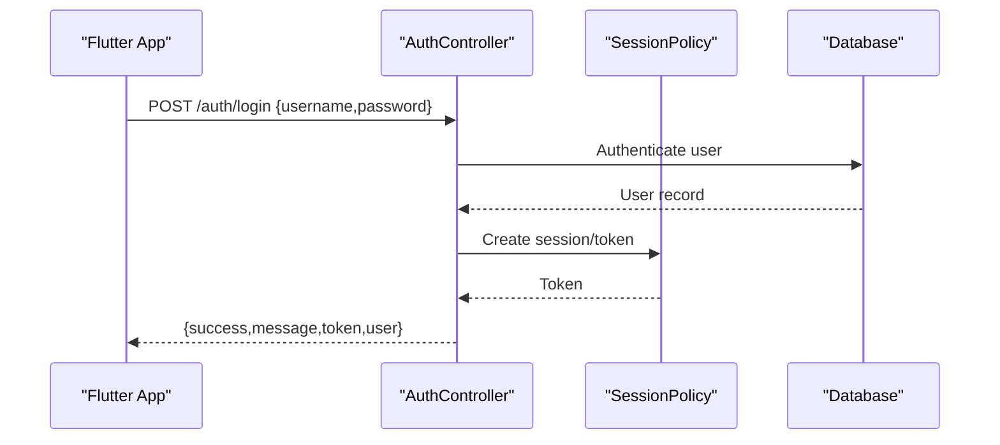

[No sources needed since this diagram shows conceptual workflow, not actual code structure]

### Permission Validation and Biometric Scenarios
Frontend:
- Use permission resolver functions to gate UI elements and route access.
- For biometric prompts, wrap local_auth calls with clear error handling and fallbacks.

Backend:
- Enforce permission checks at controller/middleware level.
- Return explicit errors for insufficient permissions.

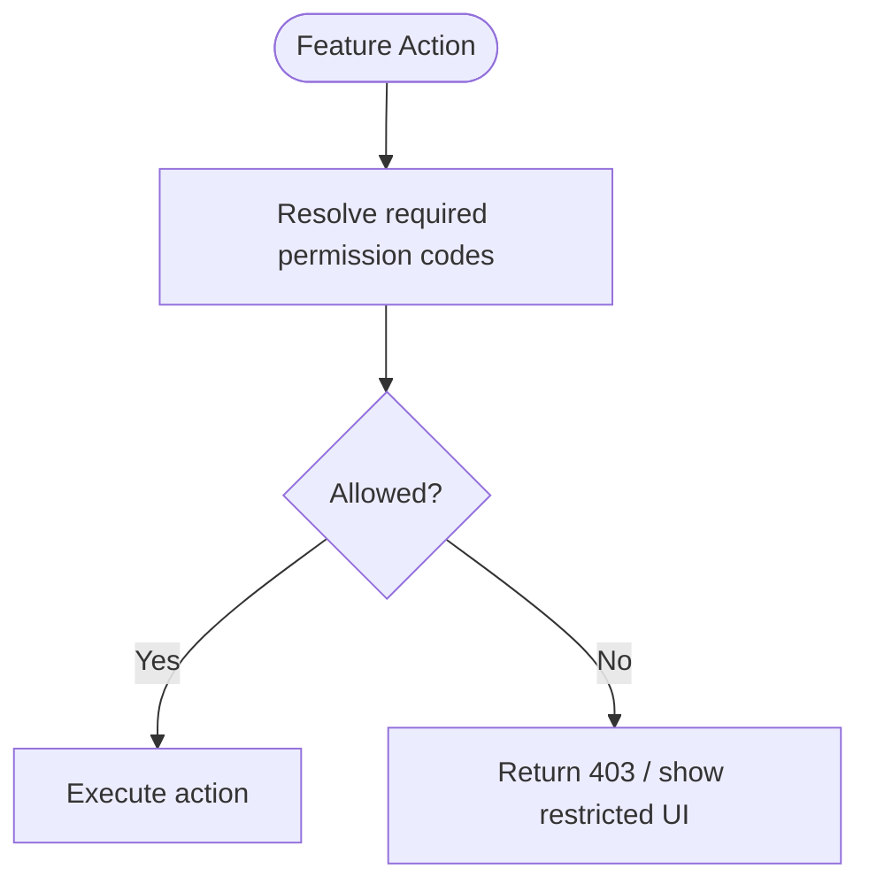

[No sources needed since this diagram shows conceptual workflow, not actual code structure]

### Writing Effective Tests for Business Logic
Guidelines:
- Isolate pure logic in unit tests; use minimal fixtures.
- For async operations, await futures and handle timeouts explicitly.
- Prefer deterministic inputs and assert on outputs rather than implementation details.
- Mock external dependencies (network, storage, biometrics) to keep tests fast and reliable.

Asynchronous testing pattern:
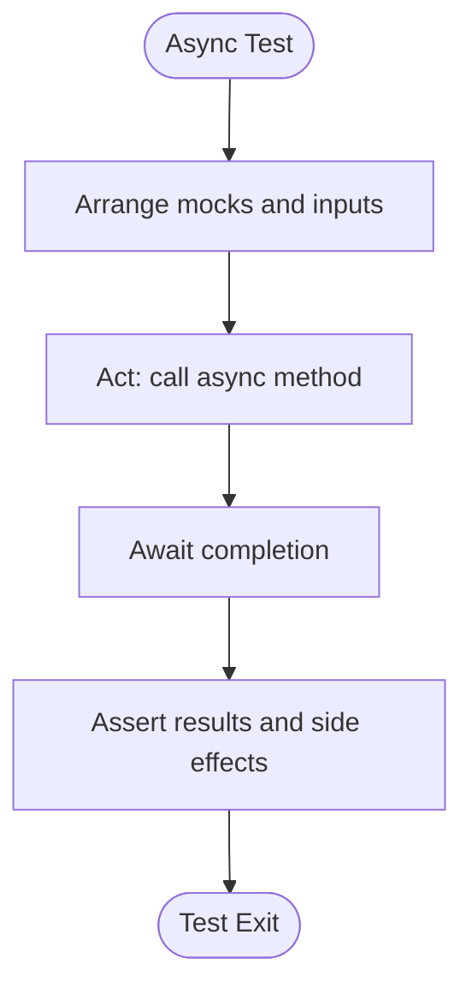

[No sources needed since this diagram shows conceptual workflow, not actual code structure]

### Test Organization and Naming Conventions
- Flutter:
  - Place tests under test/ mirroring lib/ structure when applicable.
  - Use descriptive group names and test titles that read like specifications.
  - Keep each test focused on one behavior.
- Laravel:
  - Organize tests under tests/Feature and tests/Unit.
  - Name files after the feature or class under test.
  - Use Pest's expressive syntax for readable specs.

**Section sources**
- [widget_test.dart:5-43](file://test/widget_test.dart#L5-L43)
- [api_config_test.dart:5-23](file://test/api_config_test.dart#L5-L23)
- [app_config_model_test.dart:10-106](file://test/app_config_model_test.dart#L10-L106)
- [ibac_test.dart:85-164](file://test/ibac_test.dart#L85-L164)
- [Pest.php:16-33](file://kyApp_API/tests/Pest.php#L16-L33)

### Continuous Integration Practices
- Flutter:
  - Run flutter test in CI to execute all unit and widget tests.
  - Cache pub dependencies to speed up builds.
- Laravel:
  - Use composer test script to run Pest tests.
  - Prepare environment variables and database migrations before running tests.

**Section sources**
- [pubspec.yaml:48-50](file://pubspec.yaml#L48-L50)
- [composer.json:55-58](file://kyApp_API/composer.json#L55-L58)

### Performance Testing Considerations
- Flutter:
  - Avoid heavy computations inside build methods; move to providers/services.
  - Use const constructors and avoid unnecessary rebuilds.
  - Profile widget tests sparingly; prefer unit tests for logic-heavy paths.
- Laravel:
  - Use in-memory SQLite for fast tests when possible.
  - Keep database transactions small; avoid N+1 queries in tested code paths.
  - Benchmark critical endpoints separately from functional tests.

[No sources needed since this section provides general guidance]

### Test Data Management Strategies
- Flutter:
  - Define small, stable JSON fixtures inline for model tests.
  - Use Provider overrides to inject test catalogs and repositories.
- Laravel:
  - Use factories to generate users, permissions, and related entities.
  - Seed minimal datasets for feature tests; reset between tests using RefreshDatabase.

**Section sources**
- [widget_test.dart:7-42](file://test/widget_test.dart#L7-L42)
- [app_config_model_test.dart:12-57](file://test/app_config_model_test.dart#L12-L57)
- [ibac_test.dart:19-52](file://test/ibac_test.dart#L19-L52)
- [Pest.php:16-18](file://kyApp_API/tests/Pest.php#L16-L18)

## Configuration Model Testing

### AppConfigModel Comprehensive Test Suite
The new configuration model test suite provides comprehensive coverage for the AppConfigModel class, ensuring robustness of the configuration system data handling.

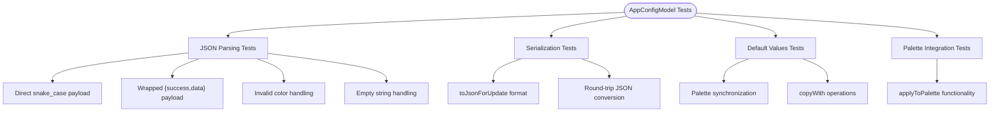

**Diagram sources**
- [app_config_model_test.dart:10-106](file://test/app_config_model_test.dart#L10-L106)
- [app_config_model.dart:67-166](file://lib/features/app_config/data/models/app_config_model.dart#L67-L166)

#### JSON Parsing and Deserialization
The test suite validates multiple JSON input formats and error handling scenarios:

- **Direct snake_case payload parsing**: Ensures proper parsing of server-provided configuration data with snake_case keys.
- **Wrapped payload handling**: Validates support for `{success, data}` wrapper format commonly used by APIs.
- **Color parsing robustness**: Tests invalid color formats (non-hex strings, malformed hex codes, null values) to ensure graceful fallback to default colors.
- **String field validation**: Verifies empty string handling and whitespace trimming with proper fallback to default values.

#### Serialization and Update Operations
Comprehensive coverage of the `toJsonForUpdate()` method ensures proper serialization for API updates:

- **Hex color formatting**: Validates conversion of Color objects to uppercase `#RRGGBB` format.
- **Snake_case key generation**: Ensures proper key naming convention for API compatibility.
- **Security validation**: Confirms sensitive fields (like API passwords) are excluded from update payloads.
- **Round-trip consistency**: Verifies that JSON → Model → JSON conversions maintain color value integrity.

#### Default Value Handling and Immutability
Tests ensure the configuration system maintains consistent defaults and immutability patterns:

- **Default factory verification**: Confirms `AppConfigModel.defaults()` produces values matching `AppPalette` defaults.
- **copyWith functionality**: Validates partial object updates while preserving unchanged fields.
- **Immutability enforcement**: Ensures original objects remain unchanged after copy operations.

#### Palette Integration Testing
Tests verify seamless integration with the application's theme system:

- **Dynamic palette updates**: Validates that `applyToPalette()` correctly updates runtime theme colors.
- **Theme synchronization**: Ensures palette changes propagate throughout the application.
- **State cleanup**: Confirms proper reset mechanisms to prevent test interference.

**Section sources**
- [app_config_model_test.dart:10-106](file://test/app_config_model_test.dart#L10-L106)
- [app_config_model.dart:67-166](file://lib/features/app_config/data/models/app_config_model.dart#L67-L166)
- [app_palette.dart:56-98](file://lib/core/theme/app_palette.dart#L56-L98)

## Dependency Analysis
Flutter testing dependencies:
- flutter_test for unit and widget tests.
- flutter_riverpod used in widget tests to override providers.

Laravel testing dependencies:
- pestphp/pest and pestphp/pest-plugin-laravel for expressive tests.
- mockery/mockery for mocking.
- fakerphp/faker for generating test data.

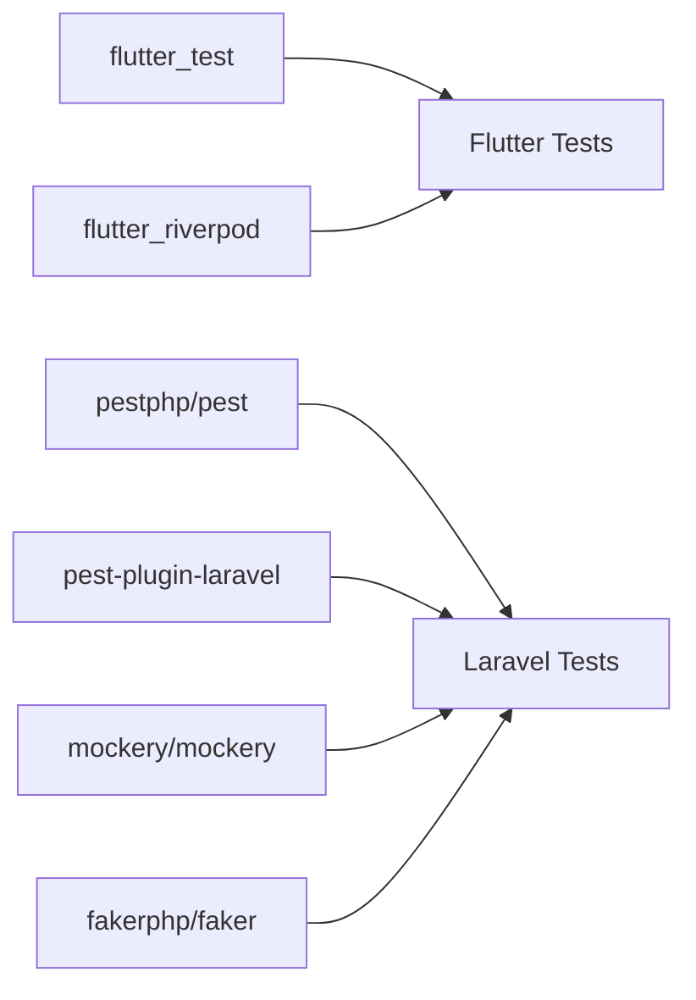

**Diagram sources**
- [pubspec.yaml:48-50](file://pubspec.yaml#L48-L50)
- [composer.json:19-29](file://kyApp_API/composer.json#L19-L29)

**Section sources**
- [pubspec.yaml:48-50](file://pubspec.yaml#L48-L50)
- [composer.json:19-29](file://kyApp_API/composer.json#L19-L29)

## Performance Considerations
- Keep tests fast and deterministic.
- Prefer unit tests over widget tests for complex logic.
- Use in-memory databases and mocks to reduce I/O.
- Batch independent tests and parallelize where supported by CI runners.

[No sources needed since this section provides general guidance]

## Troubleshooting Guide
Common issues and resolutions:
- Flutter:
  - Widget tests failing due to provider state: ensure ProviderScope and overrides are correctly set.
  - Async timing issues: use pumpAndSettle and explicit awaits.
  - Configuration model tests failing: verify AppPalette state is properly reset between tests.
- Laravel:
  - Database state leakage: enable RefreshDatabase trait in TestCase.
  - Missing environment variables: configure .env.testing and secrets appropriately.

**Section sources**
- [ibac_test.dart:54-83](file://test/ibac_test.dart#L54-L83)
- [app_config_model_test.dart:98-105](file://test/app_config_model_test.dart#L98-L105)
- [Pest.php:16-18](file://kyApp_API/tests/Pest.php#L16-L18)

## Conclusion
This guide outlines a robust testing strategy across Flutter and Laravel:
- Flutter tests validate models, configuration, permission logic, and UI interactions.
- **Enhanced**: Comprehensive configuration model testing ensures robust data handling, color parsing, and theme synchronization.
- Laravel tests leverage Pest for expressive integration testing with database and mocking support.
- Following the patterns here ensures reliability, clarity, and maintainability across the application's critical paths.

[No sources needed since this section summarizes without analyzing specific files]

## Appendices
- Running Flutter tests: flutter test
- Running Laravel tests: composer test

**Section sources**
- [pubspec.yaml:48-50](file://pubspec.yaml#L48-L50)
- [composer.json:55-58](file://kyApp_API/composer.json#L55-L58)