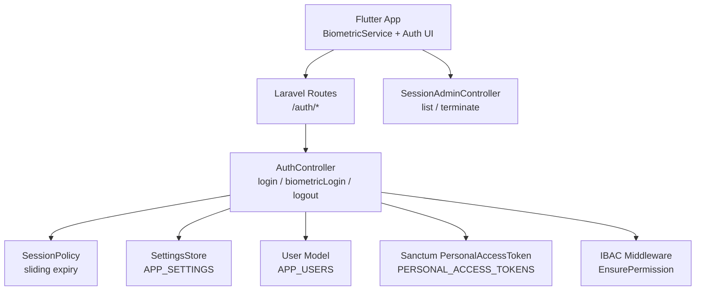
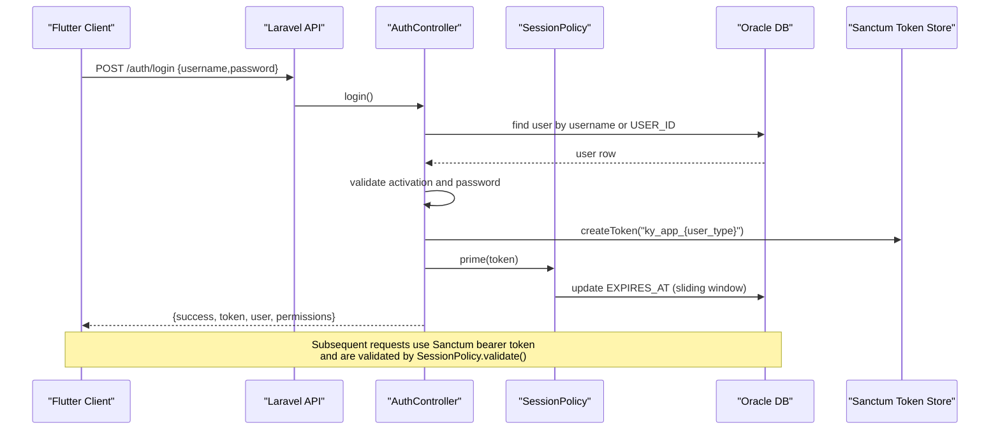
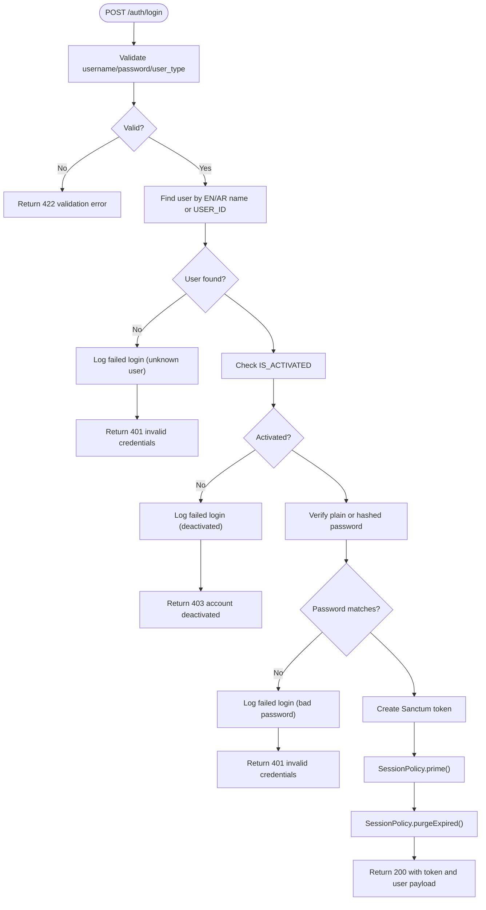
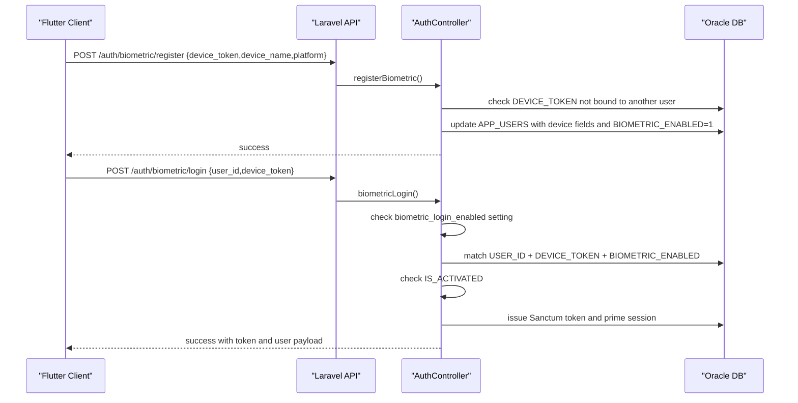
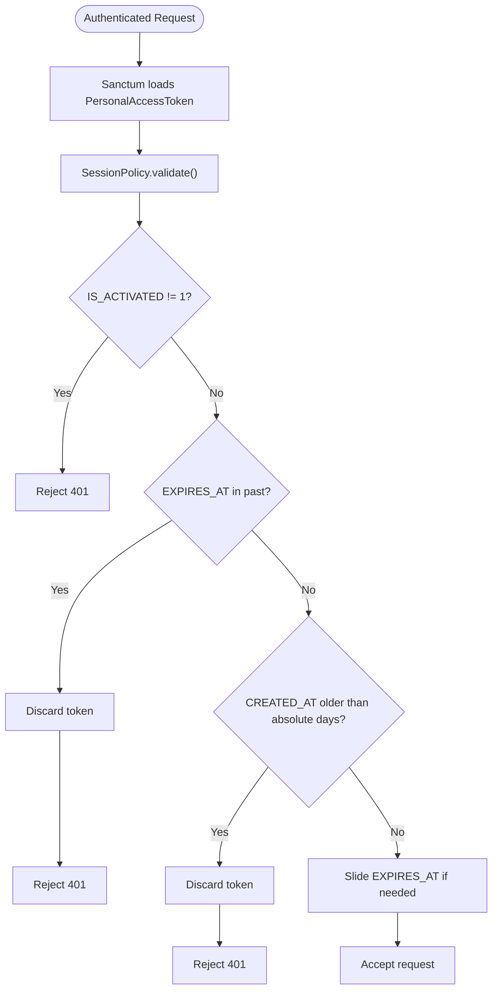
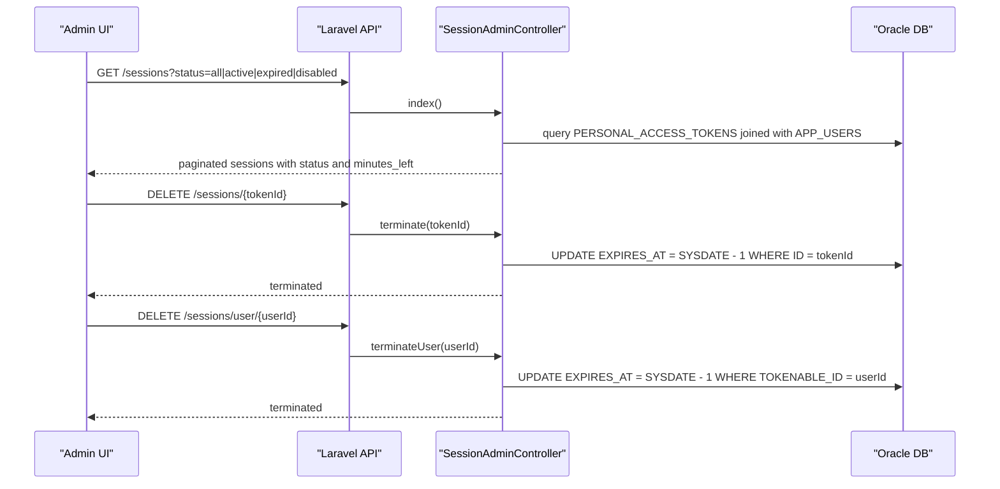
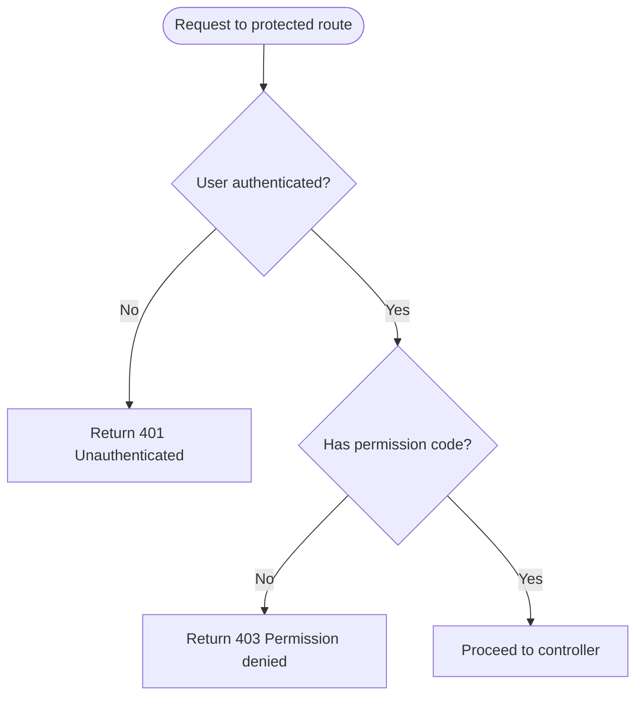
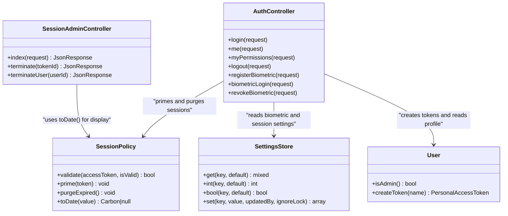

# Authentication Issues

<cite>
**Referenced Files in This Document**
- [AuthController.php](file://kyApp_API/app/Http/Controllers/AuthController.php)
- [SessionPolicy.php](file://kyApp_API/app/Support/SessionPolicy.php)
- [sanctum.php](file://kyApp_API/config/sanctum.php)
- [auth.php](file://kyApp_API/config/auth.php)
- [database.php](file://kyApp_API/config/database.php)
- [api.php](file://kyApp_API/routes/api.php)
- [User.php](file://kyApp_API/app/Models/User.php)
- [EnsurePermission.php](file://kyApp_API/app/Http/Middleware/EnsurePermission.php)
- [SessionAdminController.php](file://kyApp_API/app/Http/Controllers/SessionAdminController.php)
- [SettingsStore.php](file://kyApp_API/app/Support/SettingsStore.php)
- [01_ibac_schema.sql](file://kyApp_API/database/oracle/01_ibac_schema.sql)
- [biometric_service.dart](file://lib/core/utils/biometric_service.dart)
- [biometric_settings_notifier.dart](file://lib/features/settings/presentation/providers/biometric_settings_notifier.dart)
</cite>

## Table of Contents
1. [Introduction](#introduction)
2. [Project Structure](#project-structure)
3. [Core Components](#core-components)
4. [Architecture Overview](#architecture-overview)
5. [Detailed Component Analysis](#detailed-component-analysis)
6. [Dependency Analysis](#dependency-analysis)
7. [Performance Considerations](#performance-considerations)
8. [Troubleshooting Guide](#troubleshooting-guide)
9. [Conclusion](#conclusion)

## Introduction
This document provides a complete troubleshooting guide for authentication-related issues in Ky Apps. It covers:
- Login failures such as invalid credentials, deactivated accounts, and session expiration.
- Biometric authentication problems including device compatibility, enrollment failures, permission denials, and server-side biometric login restrictions.
- Session management issues including token refresh behavior, concurrent session conflicts, and remote session termination.
- Step-by-step diagnostics, log analysis techniques, and configuration checks for Sanctum, Oracle database connectivity, and IBAC permissions.
- Concrete error message examples mapped to their root causes and solutions.

The backend is Laravel-based with Sanctum tokens, an Oracle-backed user store, and a custom `SessionPolicy` that manages sliding idle expiry through the `EXPIRES_AT` column. The Flutter frontend uses local biometrics and calls protected API routes guarded by Sanctum and IBAC permissions.

## Project Structure
Authentication flows cross several layers:
- Flutter client: biometric capability checks, device registration, and authenticated API calls.
- Laravel API: route definitions, controllers, Sanctum middleware, and IBAC permission enforcement.
- Oracle database: user accounts, personal access tokens, permissions, settings, and activity logs.

**Diagram sources**
- [api.php:17-34](file://kyApp_API/routes/api.php#L17-L34)
- [AuthController.php:47-163](file://kyApp_API/app/Http/Controllers/AuthController.php#L47-L163)
- [SessionPolicy.php:70-107](file://kyApp_API/app/Support/SessionPolicy.php#L70-L107)
- [SessionAdminController.php:93-141](file://kyApp_API/app/Http/Controllers/SessionAdminController.php#L93-L141)

**Section sources**
- [api.php:17-34](file://kyApp_API/routes/api.php#L17-L34)
- [AuthController.php:47-163](file://kyApp_API/app/Http/Controllers/AuthController.php#L47-L163)
- [SessionPolicy.php:70-107](file://kyApp_API/app/Support/SessionPolicy.php#L70-L107)

## Core Components
- Authentication controller: validates inputs, authenticates users, issues Sanctum tokens, handles biometric enrollment and login, and returns unified user payloads with IBAC state.
- Session policy: enforces account activation, idle expiry via `EXPIRES_AT`, absolute age via `CREATED_AT`, and sliding renewal with write throttling.
- Sanctum configuration: keeps `expiration` null so the custom policy controls expiry; enables last-used tracking.
- Database configuration: defines Oracle connection used by the `User` model and admin session queries.
- IBAC permission middleware: deny-by-default authorization returning 401 or 403 depending on authentication and grant status.
- Session administration: lists sessions from `PERSONAL_ACCESS_TOKENS` and terminates them by pushing `EXPIRES_AT` into the past.
- Settings store: reads/writes security/session settings from `APP_SETTINGS` with short-lived caching.
- Flutter biometric service: checks device support, enrolled biometrics, and performs local authentication.

**Section sources**
- [AuthController.php:47-163](file://kyApp_API/app/Http/Controllers/AuthController.php#L47-L163)
- [SessionPolicy.php:70-107](file://kyApp_API/app/Support/SessionPolicy.php#L70-L107)
- [sanctum.php:40-77](file://kyApp_API/config/sanctum.php#L40-L77)
- [database.php:116-127](file://kyApp_API/config/database.php#L116-L127)
- [EnsurePermission.php:32-51](file://kyApp_API/app/Http/Middleware/EnsurePermission.php#L32-L51)
- [SessionAdminController.php:343-355](file://kyApp_API/app/Http/Controllers/SessionAdminController.php#L343-L355)
- [SettingsStore.php:107-142](file://kyApp_API/app/Support/SettingsStore.php#L107-L142)
- [biometric_service.dart:18-71](file://lib/core/utils/biometric_service.dart#L18-L71)

## Architecture Overview
The authentication architecture combines password-based and biometric flows with a shared session policy.

**Diagram sources**
- [api.php:17-24](file://kyApp_API/routes/api.php#L17-L24)
- [AuthController.php:47-163](file://kyApp_API/app/Http/Controllers/AuthController.php#L47-L163)
- [SessionPolicy.php:114-117](file://kyApp_API/app/Support/SessionPolicy.php#L114-L117)

## Detailed Component Analysis

### Password Login Flow
Password login validates input, resolves the user by English name, Arabic name, or numeric USER_ID, checks activation, verifies password (plain or hashed), creates a Sanctum token, primes the session, purges expired tokens, and logs the event.

**Diagram sources**
- [AuthController.php:47-163](file://kyApp_API/app/Http/Controllers/AuthController.php#L47-L163)

**Section sources**
- [AuthController.php:47-163](file://kyApp_API/app/Http/Controllers/AuthController.php#L47-L163)

### Biometric Registration and Login
Biometric registration requires an authenticated user and stores device metadata in `APP_USERS`. Biometric login bypasses password verification but still enforces activation and system kill-switch settings.

**Diagram sources**
- [api.php:21-34](file://kyApp_API/routes/api.php#L21-L34)
- [AuthController.php:245-310](file://kyApp_API/app/Http/Controllers/AuthController.php#L245-L310)
- [AuthController.php:316-411](file://kyApp_API/app/Http/Controllers/AuthController.php#L316-L411)

**Section sources**
- [AuthController.php:245-310](file://kyApp_API/app/Http/Controllers/AuthController.php#L245-L310)
- [AuthController.php:316-411](file://kyApp_API/app/Http/Controllers/AuthController.php#L316-L411)

### Session Expiration and Sliding Renewal
SessionPolicy validates each request after Sanctum loads the token. It rejects disabled accounts, expired idle windows, and absolute ages beyond configured days. Successful requests slide the expiry within a write threshold.

**Diagram sources**
- [SessionPolicy.php:70-107](file://kyApp_API/app/Support/SessionPolicy.php#L70-L107)
- [SessionPolicy.php:166-183](file://kyApp_API/app/Support/SessionPolicy.php#L166-L183)

**Section sources**
- [SessionPolicy.php:70-107](file://kyApp_API/app/Support/SessionPolicy.php#L70-L107)
- [SessionPolicy.php:166-183](file://kyApp_API/app/Support/SessionPolicy.php#L166-L183)

### Remote Session Termination
Admins can list sessions and terminate individual sessions or all sessions for a user. Termination does not delete rows; it pushes `EXPIRES_AT` into the past so the next request fails with 401.

**Diagram sources**
- [api.php:99-116](file://kyApp_API/routes/api.php#L99-L116)
- [SessionAdminController.php:93-141](file://kyApp_API/app/Http/Controllers/SessionAdminController.php#L93-L141)
- [SessionAdminController.php:343-355](file://kyApp_API/app/Http/Controllers/SessionAdminController.php#L343-L355)

**Section sources**
- [SessionAdminController.php:93-141](file://kyApp_API/app/Http/Controllers/SessionAdminController.php#L93-L141)
- [SessionAdminController.php:343-355](file://kyApp_API/app/Http/Controllers/SessionAdminController.php#L343-L355)

### IBAC Permission Denial
Routes under `auth:sanctum` may also require specific permission codes. If no user is authenticated, the middleware returns 401. If the user lacks the required permission, it returns 403 with the permission code and Arabic label.

**Diagram sources**
- [EnsurePermission.php:32-51](file://kyApp_API/app/Http/Middleware/EnsurePermission.php#L32-L51)

**Section sources**
- [EnsurePermission.php:32-51](file://kyApp_API/app/Http/Middleware/EnsurePermission.php#L32-L51)

## Dependency Analysis
Key dependencies and relationships:
- `AuthController` depends on `User`, `SessionPolicy`, `SettingsStore`, and Sanctum tokens.
- `SessionPolicy` depends on `SettingsStore` for `session_idle_minutes`, `session_absolute_days`, and `session_touch_threshold_minutes`.
- `SessionAdminController` queries `PERSONAL_ACCESS_TOKENS` and `APP_USERS` directly using the Oracle connection.
- Flutter `BiometricService` wraps platform biometrics and feeds results into the app’s auth flow.

**Diagram sources**
- [AuthController.php:36-41](file://kyApp_API/app/Http/Controllers/AuthController.php#L36-L41)
- [SessionPolicy.php:44-44](file://kyApp_API/app/Support/SessionPolicy.php#L44-L44)
- [SettingsStore.php:107-142](file://kyApp_API/app/Support/SettingsStore.php#L107-L142)
- [User.php:10-16](file://kyApp_API/app/Models/User.php#L10-L16)
- [SessionAdminController.php:93-141](file://kyApp_API/app/Http/Controllers/SessionAdminController.php#L93-L141)

**Section sources**
- [AuthController.php:36-41](file://kyApp_API/app/Http/Controllers/AuthController.php#L36-L41)
- [SessionPolicy.php:44-44](file://kyApp_API/app/Support/SessionPolicy.php#L44-L44)
- [SettingsStore.php:107-142](file://kyApp_API/app/Support/SettingsStore.php#L107-L142)
- [User.php:10-16](file://kyApp_API/app/Models/User.php#L10-L16)
- [SessionAdminController.php:93-141](file://kyApp_API/app/Http/Controllers/SessionAdminController.php#L93-L141)

## Performance Considerations
- Sliding renewal writes are throttled by `session_touch_threshold_minutes` to reduce database load.
- Settings are cached for 300 seconds; heavy Arabic labels are read directly only when needed.
- Session listing avoids OFFSET/FETCH on Oracle 11g and uses row numbering for pagination.
- Token deletion during rejection is best-effort to avoid blocking authentication.

[No sources needed since this section provides general guidance]

## Troubleshooting Guide

### Common Login Failures

#### Invalid Credentials
Symptoms:
- 401 response with a generic invalid credentials message.
- Activity log shows failed login attempts.

Root causes:
- Unknown username.
- Wrong password.
- Legacy plain-text passwords vs hashed passwords.

Diagnostic steps:
1. Confirm the username exists in `APP_USERS` by English name, Arabic name, or numeric `USER_ID`.
2. Check whether the stored password is plain text or hashed.
3. Review activity logs for failed login entries.

Configuration checks:
- Ensure the Oracle connection is active and the `User` model uses the correct table and primary key.
- Verify that the API route `/auth/login` is reachable.

Example error mapping:
- 401 invalid credentials → unknown user or wrong password.
- 422 validation error → missing username or password.

**Section sources**
- [AuthController.php:47-163](file://kyApp_API/app/Http/Controllers/AuthController.php#L47-L163)
- [User.php:19-39](file://kyApp_API/app/Models/User.php#L19-L39)
- [database.php:116-127](file://kyApp_API/config/database.php#L116-L127)
- [api.php:17-19](file://kyApp_API/routes/api.php#L17-L19)

#### Account Lockouts and Deactivation
Symptoms:
- 403 response indicating the account is deactivated.
- Biometric login also blocked for deactivated accounts.

Root causes:
- `IS_ACTIVATED` is not set to 1.
- System-level deactivation affects both password and biometric paths.

Diagnostic steps:
1. Query `APP_USERS.IS_ACTIVATED` for the affected user.
2. Check activity logs for failed login due to deactivated account.
3. Re-enable the account if appropriate.

Configuration checks:
- Ensure the schema includes `IS_ACTIVATED` and that migrations/bootstrap have run.

Example error mapping:
- 403 account deactivated → `IS_ACTIVATED != 1`.

**Section sources**
- [AuthController.php:100-113](file://kyApp_API/app/Http/Controllers/AuthController.php#L100-L113)
- [AuthController.php:373-386](file://kyApp_API/app/Http/Controllers/AuthController.php#L373-L386)
- [01_ibac_schema.sql:26-30](file://kyApp_API/database/oracle/01_ibac_schema.sql#L26-L30)

#### Session Expiration Problems
Symptoms:
- Sudden 401 responses while actively using the app.
- “Minutes left” showing zero even though the user is active.
- Sessions appearing expired in the admin screen.

Root causes:
- `EXPIRES_AT` passed its idle window.
- Absolute age exceeded `session_absolute_days`.
- Server time skew causing mismatch between device time and Oracle time.
- Stale cache values for session settings.

Diagnostic steps:
1. Inspect `PERSONAL_ACCESS_TOKENS.EXPIRES_AT` and `CREATED_AT`.
2. Compare device time with Oracle server time.
3. Check `APP_SETTINGS.session_idle_minutes`, `session_absolute_days`, and `session_touch_threshold_minutes`.
4. Clear settings cache after changing values.

Configuration checks:
- Keep `sanctum.expiration` null; rely on `SessionPolicy`.
- Ensure `last_used_at` is enabled for accurate activity tracking.

Example error mapping:
- 401 during usage → idle expiry or absolute age enforced by `SessionPolicy.validate()`.
- Admin session list shows expired → `EXPIRES_AT <= SYSDATE`.

**Section sources**
- [SessionPolicy.php:70-107](file://kyApp_API/app/Support/SessionPolicy.php#L70-L107)
- [SessionPolicy.php:166-183](file://kyApp_API/app/Support/SessionPolicy.php#L166-L183)
- [sanctum.php:40-77](file://kyApp_API/config/sanctum.php#L40-L77)
- [SessionAdminController.php:343-355](file://kyApp_API/app/Http/Controllers/SessionAdminController.php#L343-L355)

### Biometric Authentication Issues

#### Device Compatibility and Enrollment Failures
Symptoms:
- Flutter shows “device not supported” or “no biometrics enrolled”.
- Registration fails before calling the server.

Root causes:
- Platform does not support biometrics.
- No fingerprint or face ID enrolled in OS settings.
- Local authentication canceled or failed.

Diagnostic steps:
1. Run `BiometricService.checkSupport()` and inspect capability.
2. If `notEnrolled`, instruct the user to enroll biometrics in device settings.
3. If `notSupported`, disable biometric login option in the app.
4. Retry local authentication and confirm result before sending device token.

Configuration checks:
- Ensure Flutter plugins and platform permissions are correctly configured.

Example error mapping:
- Capability `notSupported` → hardware or OS limitation.
- Capability `notEnrolled` → user must enroll biometrics first.

**Section sources**
- [biometric_service.dart:18-71](file://lib/core/utils/biometric_service.dart#L18-L71)
- [biometric_settings_notifier.dart:92-127](file://lib/features/settings/presentation/providers/biometric_settings_notifier.dart#L92-L127)

#### Permission Denials During Biometric Setup
Symptoms:
- Registration endpoint returns 422 or 409.
- 409 indicates device token already bound to another user.

Root causes:
- Missing or invalid request fields.
- Device token conflict across users.

Diagnostic steps:
1. Validate `device_token`, `device_name`, and `platform`.
2. Check `APP_USERS.DEVICE_TOKEN` for conflicts.
3. Re-register with a unique device token if necessary.

Example error mapping:
- 422 incomplete data → validation failure.
- 409 device bound to another user → conflict resolved by re-enrollment.

**Section sources**
- [AuthController.php:245-310](file://kyApp_API/app/Http/Controllers/AuthController.php#L245-L310)

#### Biometric Login Blocked by System Settings
Symptoms:
- Biometric login returns 403 with a message that biometric login is disabled.

Root causes:
- `biometric_login_enabled` setting is false.

Diagnostic steps:
1. Read `APP_SETTINGS.biometric_login_enabled`.
2. Enable it through the security settings screen or direct update.
3. Retry biometric login.

Example error mapping:
- 403 biometric login disabled → system kill-switch turned off.

**Section sources**
- [AuthController.php:334-347](file://kyApp_API/app/Http/Controllers/AuthController.php#L334-L347)
- [SettingsStore.php:133-142](file://kyApp_API/app/Support/SettingsStore.php#L133-L142)

### Session Management Problems

#### Token Refresh Failures
Symptoms:
- Requests fail with 401 despite being inside an active workflow.
- “Minutes left” drops to zero unexpectedly.

Root causes:
- `EXPIRES_AT` expired due to idle inactivity.
- Absolute age exceeded.
- Timezone or clock skew between device and Oracle.
- Sliding renewal did not write because threshold was not crossed.

Diagnostic steps:
1. Check `EXPIRES_AT` and `CREATED_AT` in `PERSONAL_ACCESS_TOKENS`.
2. Compare device time with Oracle time.
3. Verify `session_idle_minutes` and `session_absolute_days`.
4. Trigger an action to force sliding renewal and observe `EXPIRES_AT` update.

Configuration checks:
- Keep `sanctum.expiration` null.
- Ensure `last_used_at` is true.

Example error mapping:
- 401 mid-session → `SessionPolicy.validate()` rejected due to idle or absolute expiry.

**Section sources**
- [SessionPolicy.php:70-107](file://kyApp_API/app/Support/SessionPolicy.php#L70-L107)
- [sanctum.php:40-77](file://kyApp_API/config/sanctum.php#L40-L77)

#### Concurrent Session Conflicts
Symptoms:
- One device logs out while another remains active.
- Admin sees multiple sessions for the same user.

Root causes:
- Multiple devices registered and authenticated independently.
- Each device holds its own Sanctum token with independent `EXPIRES_AT`.

Diagnostic steps:
1. List sessions via `/sessions` and filter by user.
2. Identify which token is current and which are stale.
3. Terminate unwanted sessions remotely.

Configuration checks:
- Use token names like `ky_app_{user_type}` or `ky_biometric_login` to distinguish sessions.

Example error mapping:
- Admin session list shows multiple rows per user → expected multi-device behavior.

**Section sources**
- [AuthController.php:142-149](file://kyApp_API/app/Http/Controllers/AuthController.php#L142-L149)
- [SessionAdminController.php:93-141](file://kyApp_API/app/Http/Controllers/SessionAdminController.php#L93-L141)

#### Remote Session Termination Issues
Symptoms:
- Terminating a session does not immediately log out the device.
- Terminated session still appears active in the admin list.

Root causes:
- The device has not made a new request yet.
- `EXPIRES_AT` was not pushed into the past.
- Cache or UI rendering delay.

Diagnostic steps:
1. Confirm termination returned success and affected rows count.
2. Force the device to make a request to trigger 401.
3. Refresh the admin session list.
4. Verify `EXPIRES_AT` is in the past.

Example error mapping:
- Session still visible as active → termination pending until next request.

**Section sources**
- [SessionAdminController.php:343-355](file://kyApp_API/app/Http/Controllers/SessionAdminController.php#L343-L355)

### Configuration Checks

#### Sanctum Setup
Checks:
- `stateful` domains include the frontend host.
- `guard` is set to `web`.
- `expiration` is null.
- `last_used_at` is true.
- Middleware includes `authenticate_session`, `encrypt_cookies`, and `validate_csrf_token`.

Common pitfalls:
- Setting a non-null `expiration` forces absolute age against `created_at`, disconnecting active users.

**Section sources**
- [sanctum.php:21-26](file://kyApp_API/config/sanctum.php#L21-L26)
- [sanctum.php:40-77](file://kyApp_API/config/sanctum.php#L40-L77)
- [sanctum.php:105-109](file://kyApp_API/config/sanctum.php#L105-L109)

#### Oracle Database Connectivity
Checks:
- Default connection is set appropriately.
- Oracle connection parameters (`host`, `port`, `database`, `service_name`, `username`, `password`, `charset`) are correct.
- `User` model uses `oracle` connection and `APP_USERS` table.
- Schema includes required columns and tables for IBAC.

Common pitfalls:
- Wrong default connection leads to queries hitting SQLite or MySQL instead of Oracle.
- Column case differences handled by `User::getAttribute` override.

**Section sources**
- [database.php:20-20](file://kyApp_API/config/database.php#L20-L20)
- [database.php:116-127](file://kyApp_API/config/database.php#L116-L127)
- [User.php:19-39](file://kyApp_API/app/Models/User.php#L19-L39)
- [User.php:125-149](file://kyApp_API/app/Models/User.php#L125-L149)
- [01_ibac_schema.sql:26-30](file://kyApp_API/database/oracle/01_ibac_schema.sql#L26-L30)

#### IBAC Permissions
Checks:
- Permission middleware is applied to sensitive routes.
- Missing authentication returns 401.
- Missing permission returns 403 with permission code and Arabic label.
- System administrators bypass grant checks via `IS_ADMIN`.

Common pitfalls:
- Forgetting `auth:sanctum` before `permission:<code>`.
- Assuming view permission implies write permission.

**Section sources**
- [EnsurePermission.php:32-51](file://kyApp_API/app/Http/Middleware/EnsurePermission.php#L32-L51)
- [api.php:45-88](file://kyApp_API/routes/api.php#L45-L88)
- [User.php:114-117](file://kyApp_API/app/Models/User.php#L114-L117)

### Log Analysis Techniques
- Use activity logs to identify failed login reasons: unknown user, bad password, deactivated account, biometric disabled, biometric enrollment conflict.
- Correlate timestamps with device actions and Oracle server time.
- Filter by module code `system` for authentication events and `sessions` for session termination.
- Combine failed activity entries with session list to determine whether a 401 came from credential failure or session expiry.

**Section sources**
- [AuthController.php:88-98](file://kyApp_API/app/Http/Controllers/AuthController.php#L88-L98)
- [AuthController.php:129-140](file://kyApp_API/app/Http/Controllers/AuthController.php#L129-L140)
- [AuthController.php:336-347](file://kyApp_API/app/Http/Controllers/AuthController.php#L336-L347)
- [SessionAdminController.php:165-178](file://kyApp_API/app/Http/Controllers/SessionAdminController.php#L165-L178)

## Conclusion
Ky Apps’ authentication relies on a clear separation of concerns:
- Password and biometric flows converge at Sanctum token issuance.
- `SessionPolicy` centralizes session validity, making idle and absolute expiry predictable.
- IBAC permissions enforce deny-by-default access control.
- Oracle backs user accounts, tokens, permissions, and settings.

When troubleshooting, start with the HTTP status and message, then follow the path:
- 422 → input validation.
- 401 → credentials, disabled account, or session expiry.
- 403 → deactivated account, biometric disabled, or missing permission.
- 500 → database or internal error.

Use the diagnostics and configuration checks above to isolate root causes quickly and apply targeted fixes without breaking active sessions or audit trails.