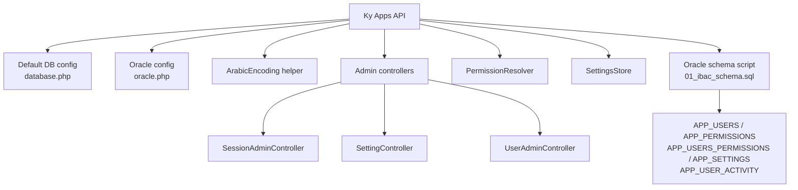
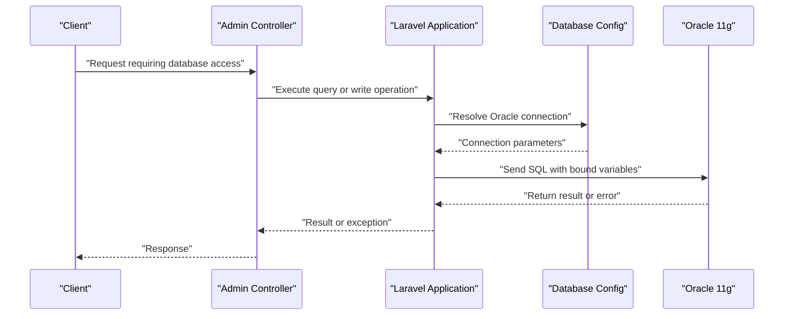
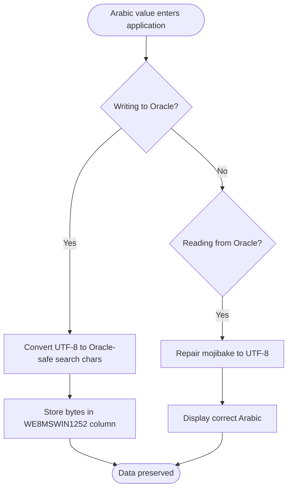
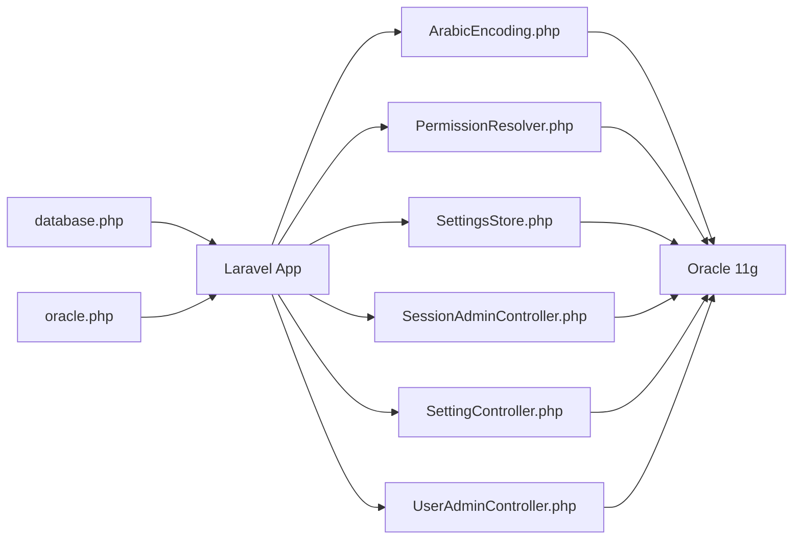

# Database Problems

<cite>
**Referenced Files in This Document**
- [database.php](file://kyApp_API/config/database.php)
- [oracle.php](file://kyApp_API/config/oracle.php)
- [ArabicEncoding.php](file://kyApp_API/app/Support/ArabicEncoding.php)
- [PermissionResolver.php](file://kyApp_API/app/support/PermissionResolver.php)
- [SettingsStore.php](file://kyApp_API/app/support/SettingsStore.php)
- [SessionAdminController.php](file://kyApp_API/app/Http/Controllers/SessionAdminController.php)
- [SettingController.php](file://kyApp_API/app/Http/Controllers/SettingController.php)
- [UserAdminController.php](file://kyApp_API/app/Http/Controllers/UserAdminController.php)
- [01_ibac_schema.sql](file://kyApp_API/database/oracle/01_ibac_schema.sql)
- [DBdevloping_history.md](file://DBdevloping_history.md)
- [db_commends.md](file://db_commends.md)
- [ArabicReadPathTest.php](file://kyApp_API/tests/Unit/ArabicReadPathTest.php)
- [ArabicWritePathTest.php](file://kyApp_API/tests/Unit/ArabicWritePathTest.php)
</cite>

## Table of Contents
1. [Introduction](#introduction)
2. [Project Structure](#project-structure)
3. [Core Components](#core-components)
4. [Architecture Overview](#architecture-overview)
5. [Detailed Component Analysis](#detailed-component-analysis)
6. [Dependency Analysis](#dependency-analysis)
7. [Performance Considerations](#performance-considerations)
8. [Troubleshooting Guide](#troubleshooting-guide)
9. [Conclusion](#conclusion)

## Introduction
This document provides comprehensive troubleshooting guidance for database-related issues in Ky Apps, focusing on Oracle connectivity, query performance, data integrity, storage and memory constraints, and diagnostic workflows. It is written for both technical operators and support staff who need to identify bottlenecks, interpret errors, and apply safe fixes without breaking the legacy Oracle 11g environment used by the application.

Ky Apps connects to an Oracle database through Laravel’s configuration layer. The application also maintains a dedicated Oracle-specific configuration file and uses a custom Arabic encoding helper because the client connection character set differs from the legacy database character set. Several controllers and support classes contain documented Oracle error behaviors, including bind-variable limits, reserved-word restrictions, and pagination constraints.

## Project Structure
The database-related code relevant to this guide lives primarily in:
- Configuration files that define the default and Oracle connections.
- Support classes that handle Arabic text conversion and caching behavior around Oracle limitations.
- Controllers that perform session, settings, and user administration operations against Oracle tables.
- Oracle schema scripts that create or modify business tables, sequences, triggers, and indexes.
- Development history and comments that record known Oracle constraints and operational decisions.

**Diagram sources**
- [database.php:116-127](file://kyApp_API/config/database.php#L116-L127)
- [oracle.php:3-28](file://kyApp_API/config/oracle.php#L3-L28)
- [ArabicEncoding.php:5-193](file://kyApp_API/app/Support/ArabicEncoding.php#L5-L193)
- [SessionAdminController.php:298-299](file://kyApp_API/app/Http/Controllers/SessionAdminController.php#L298-L299)
- [SettingController.php:43-45](file://kyApp_API/app/Http/Controllers/SettingController.php#L43-L45)
- [UserAdminController.php:531-532](file://kyApp_API/app/Http/Controllers/UserAdminController.php#L531-L532)
- [PermissionResolver.php:35-43](file://kyApp_API/app/support/PermissionResolver.php#L35-L43)
- [SettingsStore.php:21-25](file://kyApp_API/app/support/SettingsStore.php#L21-L25)
- [01_ibac_schema.sql:1-19](file://kyApp_API/database/oracle/01_ibac_schema.sql#L1-L19)

**Section sources**
- [database.php:116-127](file://kyApp_API/config/database.php#L116-L127)
- [oracle.php:3-28](file://kyApp_API/config/oracle.php#L3-L28)
- [01_ibac_schema.sql:1-19](file://kyApp_API/database/oracle/01_ibac_schema.sql#L1-L19)

## Core Components
- Default database configuration defines multiple drivers, including an Oracle connection with host, port, service name, username, password, charset, prefix, and schema prefix.
- Oracle-specific configuration adds TNS, edition, server version, load balancing, maximum identifier length, dynamic options, and NLS session variables.
- Arabic encoding helper converts between UTF-8 and the legacy Windows-1256 byte representation expected by the Oracle database, while protecting correct Arabic text from repeated corruption.
- Permission resolver and settings store implement workarounds for Oracle cache and bind-variable size limits.
- Admin controllers document Oracle-specific bind-variable rules, pagination behavior, and reserved-word restrictions.

**Section sources**
- [database.php:116-127](file://kyApp_API/config/database.php#L116-L127)
- [oracle.php:3-28](file://kyApp_API/config/oracle.php#L3-L28)
- [ArabicEncoding.php:5-193](file://kyApp_API/app/Support/ArabicEncoding.php#L5-L193)
- [PermissionResolver.php:35-43](file://kyApp_API/app/support/PermissionResolver.php#L35-L43)
- [SettingsStore.php:21-25](file://kyApp_API/app/support/SettingsStore.php#L21-L25)
- [SessionAdminController.php:298-299](file://kyApp_API/app/Http/Controllers/SessionAdminController.php#L298-L299)
- [UserAdminController.php:531-532](file://kyApp_API/app/Http/Controllers/UserAdminController.php#L531-L532)

## Architecture Overview
The application uses Laravel as the PHP backend and communicates with Oracle through PDO-based drivers configured in two places. The default connection is selected via environment variables, while the Oracle-specific configuration supplies additional driver-level options such as TNS, edition, and NLS session variables. Business logic interacts with Oracle through controllers and support classes, which must respect Oracle 11g constraints, character-set behavior, and bind-variable limits.

**Diagram sources**
- [database.php:116-127](file://kyApp_API/config/database.php#L116-L127)
- [oracle.php:3-28](file://kyApp_API/config/oracle.php#L3-L28)
- [SessionAdminController.php:298-299](file://kyApp_API/app/Http/Controllers/SessionAdminController.php#L298-L299)
- [SettingController.php:43-45](file://kyApp_API/app/Http/Controllers/SettingController.php#L43-L45)

## Detailed Component Analysis

### Oracle Connection and TNS Configuration
The default Oracle connection is defined in the main database configuration. It includes host, port, database, service name, username, password, charset, prefix, and schema prefix. The separate Oracle configuration adds TNS, edition, server version, load balance, maximum identifier length, dynamic options, and NLS session variables.

Common connection problems include:
- Network connectivity failures when the host or port cannot be reached.
- Credential validation failures when username or password is incorrect.
- TNS resolution errors when `DB_TNS` is empty or misconfigured.
- Service-name mismatches when `DB_SERVICE_NAME` does not match the Oracle listener registration.
- Character-set mismatch when the client charset does not align with the database character set.

Recommended checks:
- Verify `DB_CONNECTION`, `DB_HOST`, `DB_PORT`, `DB_DATABASE`, and `DB_SERVICE_NAME`.
- Confirm the Oracle listener accepts connections on the configured port.
- Validate credentials using a direct Oracle client.
- If using TNS, ensure `DB_TNS` resolves correctly and matches the target service.
- Ensure the application charset and database charset are aligned; the project uses AL32UTF8 for the client and WE8MSWIN1252 for the legacy database.

**Section sources**
- [database.php:116-127](file://kyApp_API/config/database.php#L116-L127)
- [oracle.php:3-28](file://kyApp_API/config/oracle.php#L3-L28)

### Arabic Text Encoding and Data Integrity
The application stores Arabic text in a legacy Oracle database whose character set is Windows-1252/CP1256. The application connects with AL32UTF8, so raw CP1256 bytes would be replaced by replacement characters. To preserve data integrity, the Arabic encoding helper maps CP1256 bytes to Latin-1 characters with the same code point, allowing Oracle to store the original bytes safely. On read, it repairs mojibake back to proper UTF-8 Arabic.

Key integrity considerations:
- Writing Arabic through the helper prevents data corruption.
- Reading Arabic through the helper prevents display corruption.
- Repeated repair is guarded so already-correct UTF-8 Arabic is not damaged again.
- Tests verify both write and read paths, ensuring idempotence and safety.

**Diagram sources**
- [ArabicEncoding.php:122-162](file://kyApp_API/app/Support/ArabicEncoding.php#L122-L162)
- [ArabicEncoding.php:33-120](file://kyApp_API/app/Support/ArabicEncoding.php#L33-L120)
- [ArabicReadPathTest.php:1-40](file://kyApp_API/tests/Unit/ArabicReadPathTest.php#L1-L40)
- [ArabicWritePathTest.php:20-68](file://kyApp_API/tests/Unit/ArabicWritePathTest.php#L20-L68)

**Section sources**
- [ArabicEncoding.php:5-193](file://kyApp_API/app/Support/ArabicEncoding.php#L5-L193)
- [ArabicReadPathTest.php:1-40](file://kyApp_API/tests/Unit/ArabicReadPathTest.php#L1-L40)
- [ArabicWritePathTest.php:20-68](file://kyApp_API/tests/Unit/ArabicWritePathTest.php#L20-L68)

### Query Performance and Execution Plans
The repository includes best-practice guidance for indexing, composite indexes, relationship counting, and query design. In practice, slow queries should be investigated by:
- Identifying frequent `WHERE`, `ORDER BY`, `JOIN`, and `GROUP BY` patterns.
- Adding targeted indexes rather than blanket indexes.
- Verifying index effectiveness with representative data and execution plans.
- Avoiding unnecessary loading of related models when only counts are needed.
- Considering correlated subqueries or separate selective queries when appropriate.

For Oracle 11g, note that modern syntax such as `FETCH FIRST … ROWS ONLY` is not supported; pagination must use `ROWNUM` wrappers. Audit and activity tables grow quickly, so every inspection query should include row limits.

**Section sources**
- [.agents/skills/laravel-best-practices/rules/db-performance.md:102-162](file://kyApp_API/.agents/skills/laravel-best-practices/rules/db-performance.md#L102-L162)
- [.agents/skills/laravel-best-practices/rules/advanced-queries.md:77-107](file://kyApp_API/.agents/skills/laravel-best-practices/rules/advanced-queries.md#L77-L107)
- [db_commends.md:753-757](file://db_commends.md#L753-L757)

### Migration Failures and Constraint Violations
The IBAC schema creates tables, sequences, triggers, and indexes under the `ACCOUNTS` schema. Known migration and constraint issues include:
- Trigger creation failures due to sequence names being interpreted as view columns when prefixed incorrectly.
- Bind-variable naming conflicts with reserved words, causing invalid bind-variable errors.
- Missing identifiers when documentation references wrong column names.
- Foreign-key and unique constraints that must remain consistent with legacy system behavior.

Operational notes:
- Triggers reference sequences without schema prefixes to avoid PL/SQL resolution errors.
- Bind-variable names must avoid Oracle reserved words.
- Documentation must match actual table columns to prevent invalid-identifier errors.

**Section sources**
- [01_ibac_schema.sql:64-75](file://kyApp_API/database/oracle/01_ibac_schema.sql#L64-L75)
- [01_ibac_schema.sql:105-112](file://kyApp_API/database/oracle/01_ibac_schema.sql#L105-L112)
- [DBdevloping_history.md:246-258](file://DBdevloping_history.md#L246-L258)
- [DBdevloping_history.md:283-289](file://DBdevloping_history.md#L283-L289)

### Storage, Memory, and Connection Pool Issues
Several components explicitly address Oracle storage and binding limits:
- Cache payloads exceeding 4000 bytes cause bind-variable errors in Oracle’s MERGE-from-dual path.
- The permission resolver caps cached payload size and falls back to reading from the database when the full catalog exceeds the safe limit.
- Settings store caches only numeric hot keys to avoid oversized cache values.
- Pagination binds may be dropped when unused, preventing “not all variables bound” errors.

These constraints affect memory usage indirectly because large payloads can force database reads instead of cache hits, increasing load on Oracle and the application process.

**Section sources**
- [PermissionResolver.php:35-43](file://kyApp_API/app/support/PermissionResolver.php#L35-L43)
- [SettingsStore.php:21-25](file://kyApp_API/app/support/SettingsStore.php#L21-L25)
- [SettingsStore.php:68-72](file://kyApp_API/app/support/SettingsStore.php#L68-L72)
- [SettingsStore.php:124-126](file://kyApp_API/app/support/SettingsStore.php#L124-L126)
- [SessionAdminController.php:298-299](file://kyApp_API/app/Http/Controllers/SessionAdminController.php#L298-L299)

## Dependency Analysis
The following diagram shows how configuration, support classes, and controllers depend on each other and on the Oracle database.

**Diagram sources**
- [database.php:116-127](file://kyApp_API/config/database.php#L116-L127)
- [oracle.php:3-28](file://kyApp_API/config/oracle.php#L3-L28)
- [ArabicEncoding.php:5-193](file://kyApp_API/app/Support/ArabicEncoding.php#L5-L193)
- [PermissionResolver.php:35-43](file://kyApp_API/app/support/PermissionResolver.php#L35-L43)
- [SettingsStore.php:21-25](file://kyApp_API/app/support/SettingsStore.php#L21-L25)
- [SessionAdminController.php:298-299](file://kyApp_API/app/Http/Controllers/SessionAdminController.php#L298-L299)
- [SettingController.php:43-45](file://kyApp_API/app/Http/Controllers/SettingController.php#L43-L45)
- [UserAdminController.php:531-532](file://kyApp_API/app/Http/Controllers/UserAdminController.php#L531-L532)

**Section sources**
- [database.php:116-127](file://kyApp_API/config/database.php#L116-L127)
- [oracle.php:3-28](file://kyApp_API/config/oracle.php#L3-L28)
- [ArabicEncoding.php:5-193](file://kyApp_API/app/Support/ArabicEncoding.php#L5-L193)
- [PermissionResolver.php:35-43](file://kyApp_API/app/support/PermissionResolver.php#L35-L43)
- [SettingsStore.php:21-25](file://kyApp_API/app/support/SettingsStore.php#L21-L25)
- [SessionAdminController.php:298-299](file://kyApp_API/app/Http/Controllers/SessionAdminController.php#L298-L299)
- [SettingController.php:43-45](file://kyApp_API/app/Http/Controllers/SettingController.php#L43-L45)
- [UserAdminController.php:531-532](file://kyApp_API/app/Http/Controllers/UserAdminController.php#L531-L532)

## Performance Considerations
- Use measured query patterns to justify indexes. Do not add indexes solely because a column appears in `WHERE`, `ORDER BY`, `JOIN`, or `GROUP BY`.
- Prefer composite indexes that match filter and sort order.
- Count relationships with dedicated count queries instead of loading entire related sets.
- For Oracle 11g, avoid unsupported pagination syntax and use `ROWNUM` wrappers.
- Limit audit and activity table scans because these tables grow quickly.
- Keep cache payloads small enough to avoid Oracle bind-variable size limits.

[No sources needed since this section provides general guidance]

## Troubleshooting Guide

### Oracle Connection Problems

#### Network Connectivity Issues
Symptoms:
- Connection timeouts or network unreachable errors.
- Application cannot reach the configured host or port.

Checks:
- Confirm `DB_HOST` and `DB_PORT` are correct.
- Test network reachability from the application server to the Oracle listener.
- Verify firewall rules and Oracle listener status.

**Section sources**
- [database.php:116-127](file://kyApp_API/config/database.php#L116-L127)
- [oracle.php:3-28](file://kyApp_API/config/oracle.php#L3-L28)

#### Credential Validation Failures
Symptoms:
- Authentication errors when connecting to Oracle.
- Login failures despite valid-looking credentials.

Checks:
- Validate `DB_USERNAME` and `DB_PASSWORD`.
- Test credentials directly with an Oracle client.
- Check account lockout or expiration policies.

**Section sources**
- [database.php:116-127](file://kyApp_API/config/database.php#L116-L127)

#### TNS Configuration Errors
Symptoms:
- TNS resolution failures.
- Service-name mismatches.

Checks:
- Inspect `DB_TNS`, `DB_SERVICE_NAME`, and listener configuration.
- Ensure TNS entries resolve to the correct host, port, and service.
- Align service name with Oracle registration.

**Section sources**
- [oracle.php:3-28](file://kyApp_API/config/oracle.php#L3-L28)

### Query Performance Problems

#### Slow Queries
Symptoms:
- High response times for reports or admin screens.
- Increased CPU or I/O on Oracle.

Actions:
- Identify frequent query patterns.
- Add targeted indexes based on filters, sorts, joins, and groupings.
- Verify index usage with execution plans.
- Avoid loading unnecessary related data.

**Section sources**
- [.agents/skills/laravel-best-practices/rules/db-performance.md:102-162](file://kyApp_API/.agents/skills/laravel-best-practices/rules/db-performance.md#L102-L162)
- [.agents/skills/laravel-best-practices/rules/advanced-queries.md:77-107](file://kyApp_API/.agents/skills/laravel-best-practices/rules/advanced-queries.md#L77-L107)

#### Missing Indexes
Symptoms:
- Full table scans on frequently filtered columns.
- Degraded performance after data growth.

Actions:
- Review `WHERE`, `ORDER BY`, `JOIN`, and `GROUP BY` clauses.
- Create composite indexes matching query patterns.
- Confirm effectiveness with production-like data and execution plans.

**Section sources**
- [.agents/skills/laravel-best-practices/rules/db-performance.md:102-162](file://kyApp_API/.agents/skills/laravel-best-practices/rules/db-performance.md#L102-L162)

#### Inefficient Joins
Symptoms:
- Large intermediate result sets.
- Excessive memory or temporary space usage.

Actions:
- Reduce rows before joining.
- Consider correlated subqueries where appropriate.
- Measure alternative query structures against execution plans.

**Section sources**
- [.agents/skills/laravel-best-practices/rules/advanced-queries.md:77-107](file://kyApp_API/.agents/skills/laravel-best-practices/rules/advanced-queries.md#L77-L107)

### Data Integrity Problems

#### Constraint Violations
Symptoms:
- Unique or foreign-key constraint errors.
- Trigger or sequence errors during inserts.

Actions:
- Validate data before insert/update.
- Check trigger definitions and sequence usage.
- Ensure documentation and queries match actual column names.

**Section sources**
- [01_ibac_schema.sql:64-75](file://kyApp_API/database/oracle/01_ibac_schema.sql#L64-L75)
- [DBdevloping_history.md:283-289](file://DBdevloping_history.md#L283-L289)

#### Arabic Text Encoding Issues
Symptoms:
- Arabic displayed as mojibake or replacement characters.
- Search failures for Arabic values.

Actions:
- Write Arabic through the encoding helper.
- Read Arabic through the encoding helper.
- Avoid raw CP1256 writes through AL32UTF8 connections.
- Verify tests pass for both read and write paths.

**Section sources**
- [ArabicEncoding.php:122-162](file://kyApp_API/app/Support/ArabicEncoding.php#L122-L162)
- [ArabicReadPathTest.php:1-40](file://kyApp_API/tests/Unit/ArabicReadPathTest.php#L1-L40)
- [ArabicWritePathTest.php:20-68](file://kyApp_API/tests/Unit/ArabicWritePathTest.php#L20-L68)

#### Migration Failures
Symptoms:
- Invalid bind-variable names.
- Invalid identifiers.
- Trigger compilation failures.

Actions:
- Rename bind variables to avoid reserved words.
- Correct column names in queries and documentation.
- Use unqualified sequence names inside triggers when required.

**Section sources**
- [UserAdminController.php:531-532](file://kyApp_API/app/Http/Controllers/UserAdminController.php#L531-L532)
- [DBdevloping_history.md:246-258](file://DBdevloping_history.md#L246-L258)
- [01_ibac_schema.sql:64-75](file://kyApp_API/database/oracle/01_ibac_schema.sql#L64-L75)

### Storage and Memory Problems

#### Oracle Bind-Variable Size Limits
Symptoms:
- Errors when caching or inserting large text payloads.
- Fallback to database reads when cache payload is too large.

Actions:
- Keep cached payloads below the safe byte limit.
- Cache only necessary fields.
- Fall back to database reads when payloads exceed limits.

**Section sources**
- [PermissionResolver.php:35-43](file://kyApp_API/app/support/PermissionResolver.php#L35-L43)
- [SettingsStore.php:21-25](file://kyApp_API/app/support/SettingsStore.php#L21-L25)
- [SettingsStore.php:68-72](file://kyApp_API/app/support/SettingsStore.php#L68-L72)
- [SettingsStore.php:124-126](file://kyApp_API/app/support/SettingsStore.php#L124-L126)

#### Connection Pool Exhaustion
Symptoms:
- Timeouts under load.
- Increased database connections.

Actions:
- Monitor active connections and long-running queries.
- Optimize slow queries and reduce unnecessary round trips.
- Apply pagination limits to large tables.

**Section sources**
- [db_commends.md:753-757](file://db_commends.md#L753-L757)

### Diagnostic Tools Usage

#### Oracle SQL Developer
Useful for:
- Testing connectivity and credentials.
- Inspecting table structure, indexes, and constraints.
- Running ad-hoc queries against production-like data.
- Validating Arabic text storage and retrieval.

#### AWR Reports
Useful for:
- Identifying top SQL statements by elapsed time and CPU.
- Detecting inefficient joins, missing indexes, and full table scans.
- Understanding wait events and resource contention.

#### Query Execution Plans
Useful for:
- Confirming whether indexes are used.
- Comparing alternative query structures.
- Validating pagination and filtering strategies.

[No sources needed since this section provides general guidance]

### Systematic Approach to Bottleneck Identification
1. Reproduce the issue and capture the exact request or operation.
2. Check application logs for Oracle error codes and stack traces.
3. Validate connection parameters and credentials.
4. Run the failing query directly in Oracle SQL Developer.
5. Generate an execution plan and look for full table scans or expensive operations.
6. Add or adjust indexes only after measuring query patterns.
7. Verify Arabic encoding paths if text corruption is involved.
8. Reduce payload sizes if cache or bind-variable limits are hit.
9. Re-test under realistic data volumes.
10. Document the fix and validate rollback safety.

[No sources needed since this section provides general guidance]

### Common Error Messages and Resolutions

| Error Category | Symptom | Likely Cause | Resolution |
|---|---|---|---|
| Bind variable not bound | Oracle rejects unused bind variables | Pagination or conditional binds included but not referenced | Drop unused binds before executing the statement |
| Bind variable too large | Cache or insert fails for large payloads | Oracle MERGE-from-dual rejects bounds over 4000 bytes | Reduce cached payload size or fall back to database reads |
| Reserved bind variable name | Save or update fails with invalid bind-variable name | Bind name conflicts with Oracle reserved word | Rename bind variables to domain-prefixed names |
| Invalid identifier | Query references wrong column | Documentation or query uses non-existent column name | Align queries and documentation with actual schema |
| Arabic mojibake | Arabic displays incorrectly | Raw CP1256 bytes sent through AL32UTF8 connection | Use encoding helper for write and read paths |
| Unsupported pagination syntax | Modern fetch syntax fails on Oracle 11g | Syntax introduced in later versions | Use `ROWNUM` wrapper pagination |

**Section sources**
- [SessionAdminController.php:298-299](file://kyApp_API/app/Http/Controllers/SessionAdminController.php#L298-L299)
- [PermissionResolver.php:35-43](file://kyApp_API/app/support/PermissionResolver.php#L35-L43)
- [UserAdminController.php:531-532](file://kyApp_API/app/Http/Controllers/UserAdminController.php#L531-L532)
- [DBdevloping_history.md:283-289](file://DBdevloping_history.md#L283-L289)
- [ArabicEncoding.php:122-162](file://kyApp_API/app/Support/ArabicEncoding.php#L122-L162)
- [db_commends.md:753-757](file://db_commends.md#L753-L757)

## Conclusion
Ky Apps operates against a legacy Oracle 11g environment with specific character-set, bind-variable, and syntax constraints. Reliable troubleshooting requires checking connection configuration first, then validating data encoding, then analyzing query performance and storage limits. The Arabic encoding helper, permission resolver, settings store, and admin controllers provide important safeguards and documented workarounds. When diagnosing issues, combine application logs, Oracle diagnostics, execution plans, and careful schema validation to identify root causes and apply safe, reversible fixes.

[No sources needed since this section summarizes without analyzing specific files]