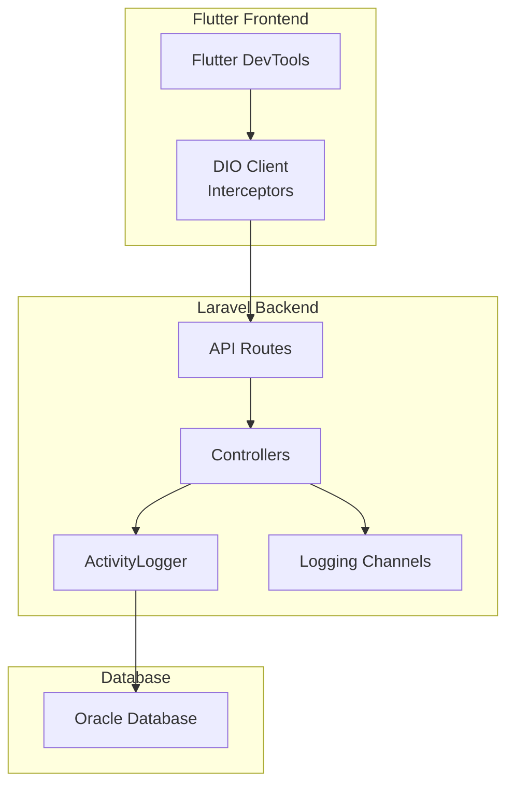
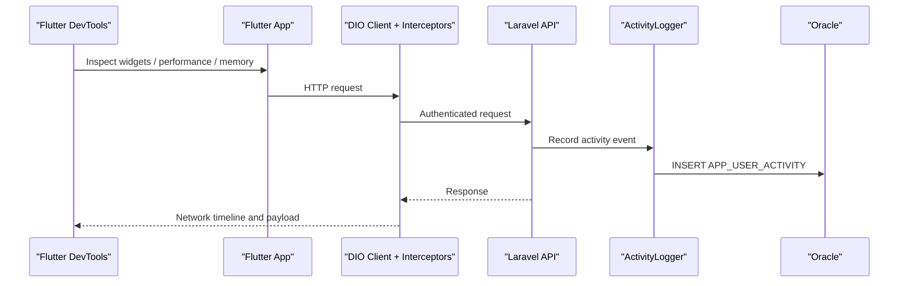
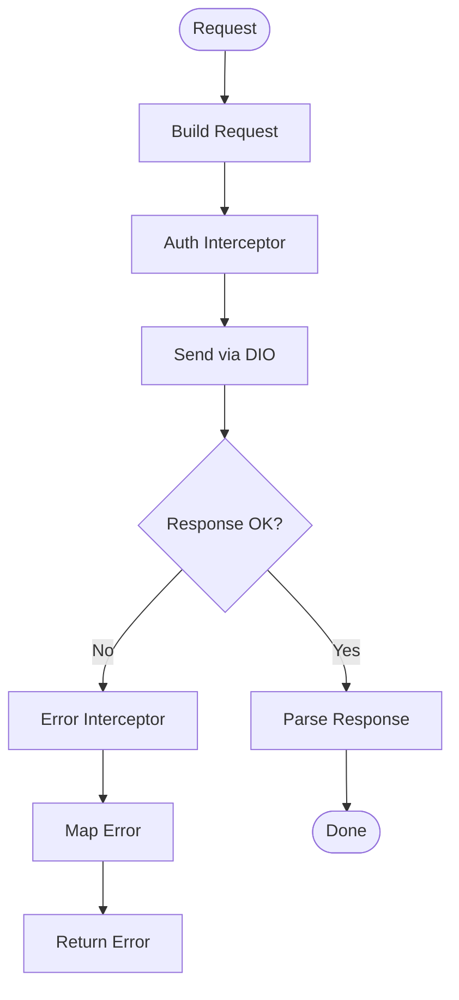
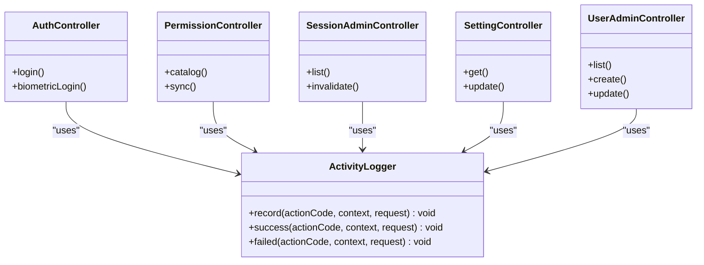
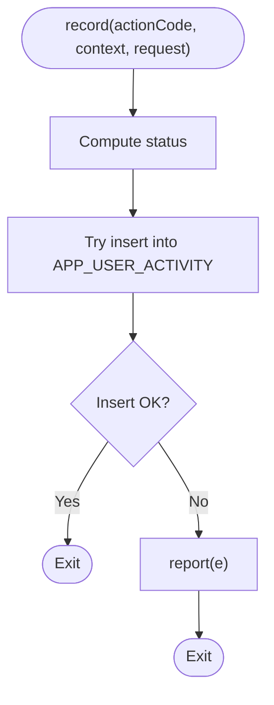
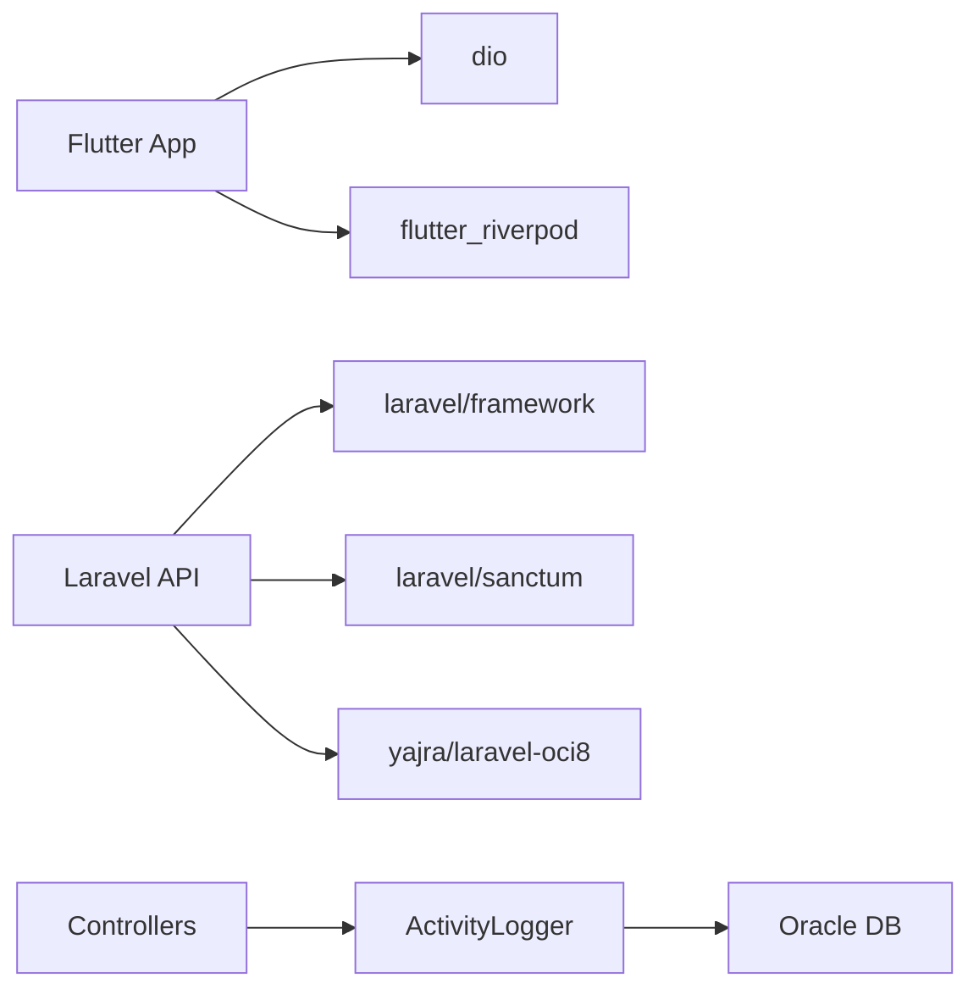

# Debugging Tools

<cite>
**Referenced Files in This Document**   
- [pubspec.yaml](file://pubspec.yaml)
- [devtools_options.yaml](file://devtools_options.yaml)
- [AndroidManifest.xml (profile)](file://android/app/src/profile/AndroidManifest.xml)
- [dio_client.dart](file://lib/core/network/dio_client.dart)
- [auth_interceptor.dart](file://lib/core/network/auth_interceptor.dart)
- [error_interceptor.dart](file://lib/core/network/error_interceptor.dart)
- [api_constants.dart](file://lib/core/constants/api_constants.dart)
- [ActivityLogger.php](file://kyApp_API/app/Support/ActivityLogger.php)
- [AuthController.php](file://kyApp_API/app/Http/Controllers/AuthController.php)
- [PermissionController.php](file://kyApp_API/app/Http/Controllers/PermissionController.php)
- [SessionAdminController.php](file://kyApp_API/app/Http/Controllers/SessionAdminController.php)
- [SettingController.php](file://kyApp_API/app/Http/Controllers/SettingController.php)
- [UserAdminController.php](file://kyApp_API/app/Http/Controllers/UserAdminController.php)
- [AppServiceProvider.php](file://kyApp_API/app/Providers/AppServiceProvider.php)
- [logging.php](file://kyApp_API/config/logging.php)
- [database.php](file://kyApp_API/config/database.php)
- [composer.json](file://kyApp_API/composer.json)
</cite>

## Table of Contents
1. [Introduction](#introduction)
2. [Project Structure](#project-structure)
3. [Core Components](#core-components)
4. [Architecture Overview](#architecture-overview)
5. [Detailed Component Analysis](#detailed-component-analysis)
6. [Dependency Analysis](#dependency-analysis)
7. [Performance Considerations](#performance-considerations)
8. [Troubleshooting Guide](#troubleshooting-guide)
9. [Conclusion](#conclusion)
10. [Appendices](#appendices)

## Introduction
This document explains how to debug Ky Apps across the Flutter frontend, Laravel backend, and Oracle database. It covers:
- Flutter DevTools for widget inspection, performance profiling, memory leak detection, and network monitoring.
- Laravel debugging with query logging, route inspection, and structured logs.
- Oracle SQL Developer usage for schema analysis and query optimization.
- Centralized log analysis using ActivityLogger and Laravel logging channels.
- Strategies for complex multi-component issues, distributed tracing ideas, production-safe debugging, test debugging, mock data creation, and environment setup.

## Project Structure
Ky Apps is a Flutter application backed by a Laravel API that writes audit events into an Oracle database. The most relevant debugging surfaces are:
- Flutter app configuration and networking layer.
- Laravel controllers and support services.
- Laravel logging and database configuration.
- Oracle connection used for audit and business tables.

**Diagram sources**
- [pubspec.yaml:30-44](file://pubspec.yaml#L30-L44)
- [dio_client.dart](file://lib/core/network/dio_client.dart)
- [auth_interceptor.dart](file://lib/core/network/auth_interceptor.dart)
- [error_interceptor.dart](file://lib/core/network/error_interceptor.dart)
- [ActivityLogger.php:18-73](file://kyApp_API/app/Support/ActivityLogger.php#L18-L73)
- [logging.php:53-129](file://kyApp_API/config/logging.php#L53-L129)
- [database.php:116-127](file://kyApp_API/config/database.php#L116-L127)

**Section sources**
- [pubspec.yaml:30-44](file://pubspec.yaml#L30-L44)
- [devtools_options.yaml:1-4](file://devtools_options.yaml#L1-L4)
- [logging.php:53-129](file://kyApp_API/config/logging.php#L53-L129)
- [database.php:116-127](file://kyApp_API/config/database.php#L116-L127)

## Core Components
- Flutter DevTools configuration file enables extension toggles for runtime diagnostics.
- DIO client and interceptors centralize authentication headers and error handling, which is essential for inspecting network requests and failures.
- Laravel controllers inject ActivityLogger to record user actions and security-relevant events.
- ActivityLogger writes audit records to Oracle with safe encoding, truncation, and IP/user-agent extraction.
- Laravel logging configuration defines stack, single, daily, stderr, syslog, and other channels.
- Oracle connection is configured under the oracle driver for audit and business tables.

**Section sources**
- [devtools_options.yaml:1-4](file://devtools_options.yaml#L1-L4)
- [dio_client.dart](file://lib/core/network/dio_client.dart)
- [auth_interceptor.dart](file://lib/core/network/auth_interceptor.dart)
- [error_interceptor.dart](file://lib/core/network/error_interceptor.dart)
- [ActivityLogger.php:18-73](file://kyApp_API/app/Support/ActivityLogger.php#L18-L73)
- [logging.php:53-129](file://kyApp_API/config/logging.php#L53-L129)
- [database.php:116-127](file://kyApp_API/config/database.php#L116-L127)

## Architecture Overview
The debugging architecture spans three layers:
- Flutter DevTools inspects widgets, performance, memory, and network traffic from the running app.
- Laravel provides request-level debugging via logs, query logs, and optional tooling; it also exposes routes through api.php/web.php/console.php.
- Oracle SQL Developer connects to the oracle database connection to analyze schema, triggers, sequences, and slow queries.

**Diagram sources**
- [pubspec.yaml:30-44](file://pubspec.yaml#L30-L44)
- [dio_client.dart](file://lib/core/network/dio_client.dart)
- [auth_interceptor.dart](file://lib/core/network/auth_interceptor.dart)
- [error_interceptor.dart](file://lib/core/network/error_interceptor.dart)
- [ActivityLogger.php:18-73](file://kyApp_API/app/Support/ActivityLogger.php#L18-L73)
- [database.php:116-127](file://kyApp_API/config/database.php#L116-L127)

## Detailed Component Analysis

### Flutter DevTools Usage
- Widget Inspection: Use the widget inspector to traverse the tree, inspect properties, and identify layout or state issues.
- Performance Profiling: Use the performance view to capture timelines, frame budgets, and expensive rebuilds.
- Memory Leak Detection: Use the memory view to take snapshots, compare allocations, and find retained objects.
- Network Monitoring: Observe requests/responses, headers, timing, and errors captured by the DIO client and interceptors.

Setup tips:
- Ensure devtools_options.yaml is present so extensions can be enabled per project.
- For Android, ensure the profile manifest includes internet access if needed for remote debugging flows.

**Section sources**
- [devtools_options.yaml:1-4](file://devtools_options.yaml#L1-L4)
- [AndroidManifest.xml (profile):1-7](file://android/app/src/profile/AndroidManifest.xml#L1-L7)

### Flutter Networking and Interceptors
The DIO client and its interceptors provide a centralized place to:
- Attach authentication tokens.
- Log request/response metadata.
- Handle common errors and map them to user-visible messages.

Debugging approach:
- Use DevTools Network view to correlate failed requests with interceptor behavior.
- Add temporary request/response logging around interceptors to trace token refresh or header injection.
- Validate base URL and endpoints against constants.

**Diagram sources**
- [dio_client.dart](file://lib/core/network/dio_client.dart)
- [auth_interceptor.dart](file://lib/core/network/auth_interceptor.dart)
- [error_interceptor.dart](file://lib/core/network/error_interceptor.dart)

**Section sources**
- [dio_client.dart](file://lib/core/network/dio_client.dart)
- [auth_interceptor.dart](file://lib/core/network/auth_interceptor.dart)
- [error_interceptor.dart](file://lib/core/network/error_interceptor.dart)
- [api_constants.dart:12-21](file://lib/core/constants/api_constants.dart#L12-L21)

### Laravel Controllers and ActivityLogger Integration
Controllers use dependency injection to receive ActivityLogger and record user actions such as login attempts, permission changes, session management, settings updates, and user administration operations.

Key behaviors:
- Successful and failed actions are recorded with context like user identifiers, module codes, entity types, Arabic descriptions, status, IP, user agent, and platform.
- Logging is wrapped to never break successful requests; failures are reported silently to the application log.

**Diagram sources**
- [AuthController.php:6-39](file://kyApp_API/app/Http/Controllers/AuthController.php#L6-L39)
- [PermissionController.php:6-41](file://kyApp_API/app/Http/Controllers/PermissionController.php#L6-L41)
- [SessionAdminController.php:6-82](file://kyApp_API/app/Http/Controllers/SessionAdminController.php#L6-L82)
- [SettingController.php:6-35](file://kyApp_API/app/Http/Controllers/SettingController.php#L6-L35)
- [UserAdminController.php:6-100](file://kyApp_API/app/Http/Controllers/UserAdminController.php#L6-L100)
- [ActivityLogger.php:18-95](file://kyApp_API/app/Support/ActivityLogger.php#L18-L95)

**Section sources**
- [AuthController.php:6-39](file://kyApp_API/app/Http/Controllers/AuthController.php#L6-L39)
- [PermissionController.php:6-41](file://kyApp_API/app/Http/Controllers/PermissionController.php#L6-L41)
- [SessionAdminController.php:6-82](file://kyApp_API/app/Http/Controllers/SessionAdminController.php#L6-L82)
- [SettingController.php:6-35](file://kyApp_API/app/Http/Controllers/SettingController.php#L6-L35)
- [UserAdminController.php:6-100](file://kyApp_API/app/Http/Controllers/UserAdminController.php#L6-L100)
- [ActivityLogger.php:18-95](file://kyApp_API/app/Support/ActivityLogger.php#L18-L95)

### ActivityLogger Implementation Details
ActivityLogger ensures audit logging is resilient and secure:
- Uses bound parameters for all inserts.
- Truncates strings to column limits after encoding.
- Limits Arabic text length before encoding.
- Extracts IP and user agent from request or context safely.
- Wrrites to the oracle connection and reports any failure without breaking the caller.

**Diagram sources**
- [ActivityLogger.php:37-73](file://kyApp_API/app/Support/ActivityLogger.php#L37-L73)

**Section sources**
- [ActivityLogger.php:18-169](file://kyApp_API/app/Support/ActivityLogger.php#L18-L169)

### Laravel Logging Configuration
Laravel logging supports multiple channels:
- Stack channel aggregates one or more channels.
- Single and daily channels write to storage/logs.
- Stderr, syslog, slack, papertrail, and null channels are available.
- Default level and deprecations channel are configurable.

For debugging:
- Use stack or single channels during development.
- Route critical logs to stderr or external systems in production.
- Adjust LOG_LEVEL to control verbosity.

**Section sources**
- [logging.php:21-129](file://kyApp_API/config/logging.php#L21-L129)

### Oracle Database Connection and Schema
The oracle connection is defined for audit and business tables. ActivityLogger writes to ACCOUNTS.APP_USER_ACTIVITY.

Debugging tips:
- Connect via Oracle SQL Developer using the same host, port, service name, username, and charset as configured.
- Inspect triggers, sequences, and indexes on audit and high-volume tables.
- Use execution plans and AWR/ASH-like tools where available to optimize slow queries.

**Section sources**
- [database.php:116-127](file://kyApp_API/config/database.php#L116-L127)
- [ActivityLogger.php:41-67](file://kyApp_API/app/Support/ActivityLogger.php#L41-L67)

## Dependency Analysis
Key dependencies for debugging:
- Flutter side depends on dio for networking and flutter_riverpod for state.
- Laravel side uses laravel/framework, sanctum, and yajra/laravel-oci8 for Oracle connectivity.
- ActivityLogger depends on DB facade and ArabicEncoding utilities.

**Diagram sources**
- [pubspec.yaml:30-44](file://pubspec.yaml#L30-L44)
- [composer.json:11-18](file://kyApp_API/composer.json#L11-L18)
- [ActivityLogger.php:18-73](file://kyApp_API/app/Support/ActivityLogger.php#L18-L73)

**Section sources**
- [pubspec.yaml:30-44](file://pubspec.yaml#L30-L44)
- [composer.json:11-18](file://kyApp_API/composer.json#L11-L18)
- [AppServiceProvider.php:5-34](file://kyApp_API/app/Providers/AppServiceProvider.php#L5-L34)

## Performance Considerations
- Flutter:
  - Profile UI rebuilds and isolate work using DevTools.
  - Monitor memory growth and retain graphs to detect leaks.
  - Keep network payloads small; inspect large responses in DevTools.
- Laravel:
  - Avoid excessive logging in hot paths; use appropriate log levels.
  - Enable query logging only when investigating performance issues.
  - Offload heavy tasks to queues and monitor queue workers.
- Oracle:
  - Limit result sets for large audit tables.
  - Review trigger overhead and sequence usage.
  - Optimize indexes and partitioning for high-volume tables.

[No sources needed since this section provides general guidance]

## Troubleshooting Guide

### Flutter DevTools Issues
- If DevTools cannot connect, verify device/emulator network access and that the app is running in debug mode.
- For Android, ensure the profile manifest allows internet access if required by your debugging workflow.

**Section sources**
- [AndroidManifest.xml (profile):1-7](file://android/app/src/profile/AndroidManifest.xml#L1-L7)

### Network Requests Fail Intermittently
- Inspect the DIO client and interceptors for token expiration or header issues.
- Correlate timestamps between Flutter DevTools and Laravel logs.
- Check error_interceptor mapping to ensure meaningful error messages.

**Section sources**
- [dio_client.dart](file://lib/core/network/dio_client.dart)
- [auth_interceptor.dart](file://lib/core/network/auth_interceptor.dart)
- [error_interceptor.dart](file://lib/core/network/error_interceptor.dart)

### Audit Events Not Appearing
- Verify ActivityLogger is injected and called from controllers.
- Confirm oracle connection settings and permissions.
- Check application logs for silent failures inside ActivityLogger.

**Section sources**
- [ActivityLogger.php:18-73](file://kyApp_API/app/Support/ActivityLogger.php#L18-L73)
- [database.php:116-127](file://kyApp_API/config/database.php#L116-L127)

### Logs Are Missing or Too Verbose
- Adjust LOG_CHANNEL and LOG_LEVEL in environment configuration.
- Use stack channel to aggregate multiple outputs during development.
- In production, prefer stderr or external logging systems.

**Section sources**
- [logging.php:21-129](file://kyApp_API/config/logging.php#L21-L129)

### Test Debugging and Mock Data
- Use Pest and PHPUnit configurations already present in the Laravel project.
- Create factories and seeders for deterministic test data.
- Isolate tests from external services by mocking HTTP clients and database connections.

**Section sources**
- [composer.json:19-29](file://kyApp_API/composer.json#L19-L29)

## Conclusion
Effective debugging in Ky Apps requires coordinated use of Flutter DevTools, Laravel logging and query insights, and Oracle SQL Developer. Centralizing network logic with DIO interceptors and recording auditable actions with ActivityLogger provides strong signals for diagnosing issues across the full stack. Combine these tools with careful environment configuration and disciplined logging to resolve complex, multi-component problems efficiently.

[No sources needed since this section summarizes without analyzing specific files]

## Appendices

### Environment Setup for Effective Debugging
- Flutter:
  - Run with --debug and open DevTools.
  - Keep devtools_options.yaml updated for desired extensions.
- Laravel:
  - Ensure composer dependencies are installed and services are running.
  - Configure LOG_CHANNEL and LOG_LEVEL for local development.
  - Verify oracle connection details match your environment.
- Oracle:
  - Install Oracle SQL Developer and configure a connection using the oracle driver settings.
  - Validate connectivity to the ACCOUNTS schema and audit tables.

**Section sources**
- [devtools_options.yaml:1-4](file://devtools_options.yaml#L1-L4)
- [composer.json:42-77](file://kyApp_API/composer.json#L42-L77)
- [logging.php:21-129](file://kyApp_API/config/logging.php#L21-L129)
- [database.php:116-127](file://kyApp_API/config/database.php#L116-L127)