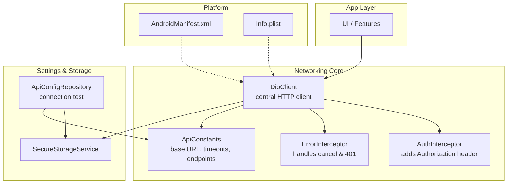
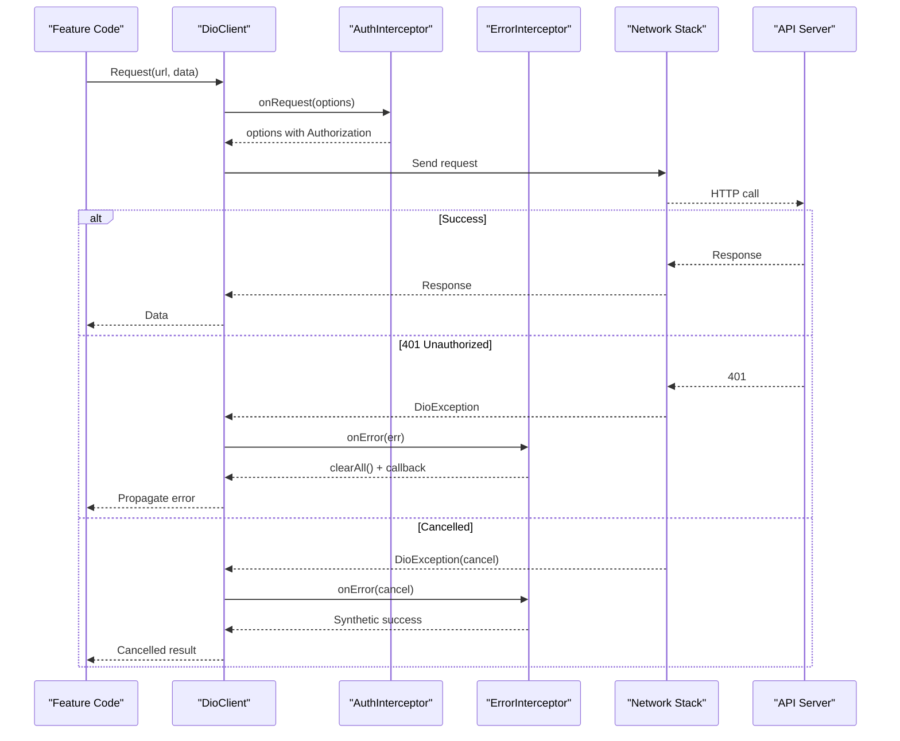
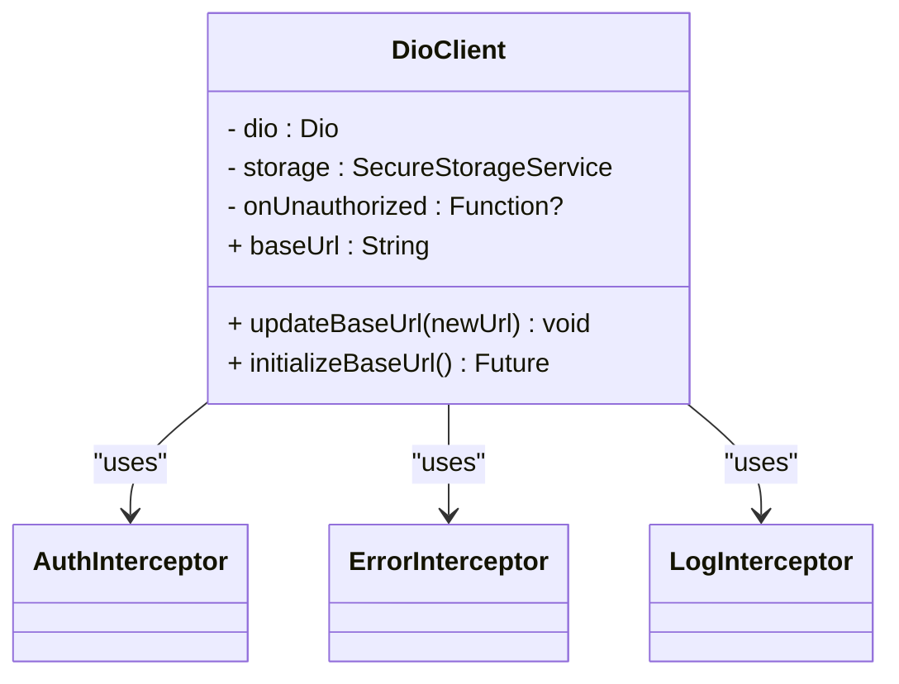
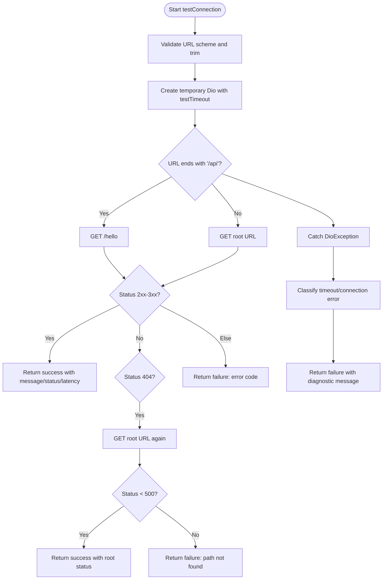
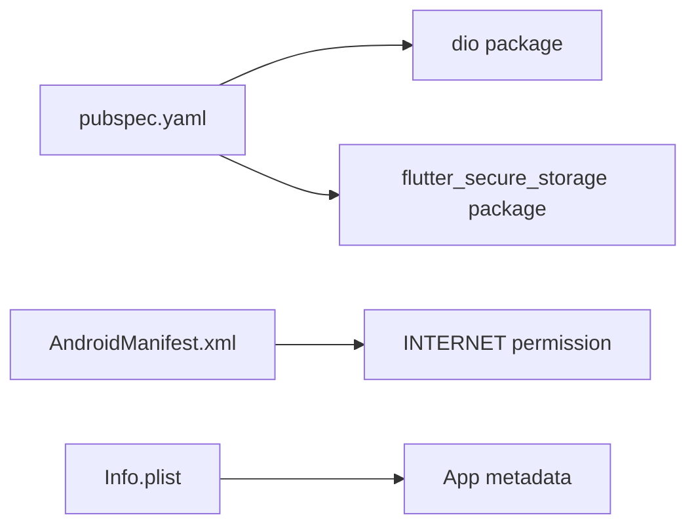

# Network Issues

<cite>
**Referenced Files in This Document**
- [dio_client.dart](file://lib/core/network/dio_client.dart)
- [auth_interceptor.dart](file://lib/core/network/auth_interceptor.dart)
- [error_interceptor.dart](file://lib/core/network/error_interceptor.dart)
- [api_constants.dart](file://lib/core/constants/api_constants.dart)
- [api_config_repository.dart](file://lib/features/settings/data/repositories/api_config_repository.dart)
- [AndroidManifest.xml](file://android/app/src/main/AndroidManifest.xml)
- [profile AndroidManifest.xml](file://android/app/src/profile/AndroidManifest.xml)
- [Info.plist](file://ios/Runner/Info.plist)
- [pubspec.yaml](file://pubspec.yaml)
</cite>

## Table of Contents
1. [Introduction](#introduction)
2. [Project Structure](#project-structure)
3. [Core Components](#core-components)
4. [Architecture Overview](#architecture-overview)
5. [Detailed Component Analysis](#detailed-component-analysis)
6. [Dependency Analysis](#dependency-analysis)
7. [Performance Considerations](#performance-considerations)
8. [Troubleshooting Guide](#troubleshooting-guide)
9. [Conclusion](#conclusion)

## Introduction
This document provides a comprehensive troubleshooting guide for network-related issues in Ky Apps. It focuses on API connectivity problems, timeout behavior, SSL and certificate validation, CORS and proxy considerations, mobile-specific networking constraints, Dio client configuration, interceptor behavior, retry strategies, debugging techniques, caching and offline handling, and platform-specific behaviors on Android and iOS. The guidance is grounded in the actual implementation files of the project.

## Project Structure
Ky Apps uses a centralized Dio client with interceptors for authentication and error handling. API endpoints and timeouts are defined in constants. A settings repository provides connection testing utilities that create a temporary Dio instance to validate server reachability and latency. Platform manifests define permissions and app metadata relevant to networking.

**Diagram sources**
- [dio_client.dart:14-42](file://lib/core/network/dio_client.dart#L14-L42)
- [auth_interceptor.dart:11-22](file://lib/core/network/auth_interceptor.dart#L11-L22)
- [error_interceptor.dart:12-36](file://lib/core/network/error_interceptor.dart#L12-L36)
- [api_constants.dart:3-27](file://lib/core/constants/api_constants.dart#L3-L27)
- [api_config_repository.dart:58-84](file://lib/features/settings/data/repositories/api_config_repository.dart#L58-L84)
- [AndroidManifest.xml:1-49](file://android/app/src/main/AndroidManifest.xml#L1-L49)
- [Info.plist:1-52](file://ios/Runner/Info.plist#L1-L52)

**Section sources**
- [dio_client.dart:1-59](file://lib/core/network/dio_client.dart#L1-L59)
- [api_constants.dart:1-29](file://lib/core/constants/api_constants.dart#L1-L29)
- [api_config_repository.dart:1-168](file://lib/features/settings/data/repositories/api_config_repository.dart#L1-L168)
- [AndroidManifest.xml:1-49](file://android/app/src/main/AndroidManifest.xml#L1-L49)
- [Info.plist:1-52](file://ios/Runner/Info.plist#L1-L52)

## Core Components
- DioClient: Centralized HTTP client configured with base URL, default headers, connect/receive timeouts, and interceptors. It supports runtime base URL updates and initialization from secure storage.
- AuthInterceptor: Automatically attaches Bearer token and Accept header to outgoing requests by reading from secure storage.
- ErrorInterceptor: Normalizes cancellation errors into a synthetic success response and handles 401 Unauthorized by clearing stored credentials and invoking an optional callback.
- ApiConstants: Defines default base URL, endpoint paths, and timeout durations used across the app.
- ApiConfigRepository: Provides methods to read/save/reset active API URL and perform a connection test using a dedicated Dio instance with short timeouts and status validation enabled.

Key responsibilities and failure points:
- Base URL resolution and persistence via SecureStorageService.
- Timeout configuration for normal and test requests.
- Interceptor chain order and behavior under cancellation or auth failures.
- Connection testing logic including fallback behavior when specific endpoints are missing.

**Section sources**
- [dio_client.dart:14-59](file://lib/core/network/dio_client.dart#L14-L59)
- [auth_interceptor.dart:11-22](file://lib/core/network/auth_interceptor.dart#L11-L22)
- [error_interceptor.dart:12-36](file://lib/core/network/error_interceptor.dart#L12-L36)
- [api_constants.dart:3-27](file://lib/core/constants/api_constants.dart#L3-L27)
- [api_config_repository.dart:27-84](file://lib/features/settings/data/repositories/api_config_repository.dart#L27-L84)

## Architecture Overview
The networking architecture centers around a single Dio client with a well-defined interceptor pipeline. Requests flow through authentication injection and error normalization before reaching the network stack. Configuration constants ensure consistent timeouts and endpoints. The settings repository isolates connection diagnostics from application logic.

**Diagram sources**
- [dio_client.dart:31-42](file://lib/core/network/dio_client.dart#L31-L42)
- [auth_interceptor.dart:11-22](file://lib/core/network/auth_interceptor.dart#L11-L22)
- [error_interceptor.dart:12-36](file://lib/core/network/error_interceptor.dart#L12-L36)

## Detailed Component Analysis

### DioClient
Responsibilities:
- Initialize Dio with BaseOptions including baseUrl, connectTimeout, receiveTimeout, and default headers.
- Register interceptors: AuthInterceptor, ErrorInterceptor, LogInterceptor.
- Provide methods to update baseUrl at runtime and initialize baseUrl from secure storage.

Common issues:
- Incorrect base URL leads to unreachable endpoints.
- Timeouts too low cause frequent timeouts; too high degrade UX.
- Missing or misordered interceptors can break auth injection or error handling.

**Diagram sources**
- [dio_client.dart:9-59](file://lib/core/network/dio_client.dart#L9-L59)
- [auth_interceptor.dart:6-22](file://lib/core/network/auth_interceptor.dart#L6-L22)
- [error_interceptor.dart:6-36](file://lib/core/network/error_interceptor.dart#L6-L36)

**Section sources**
- [dio_client.dart:14-59](file://lib/core/network/dio_client.dart#L14-L59)

### AuthInterceptor
Responsibilities:
- Read token from secure storage and attach Authorization header if present.
- Ensure Accept header is set to application/json.

Failure modes:
- Token not found results in unauthenticated requests.
- Incorrect token format causes server-side rejection.

**Section sources**
- [auth_interceptor.dart:11-22](file://lib/core/network/auth_interceptor.dart#L11-L22)

### ErrorInterceptor
Responsibilities:
- Convert cancellation exceptions into a synthetic successful response to avoid bubbling unexpected exceptions.
- Handle 401 Unauthorized by clearing all stored credentials and invoking an optional callback.

Failure modes:
- Misinterpreting cancellations as errors can confuse UI state.
- Not clearing tokens on 401 leaves stale sessions.

**Section sources**
- [error_interceptor.dart:12-36](file://lib/core/network/error_interceptor.dart#L12-L36)

### ApiConstants
Responsibilities:
- Define default base URL and common endpoints.
- Define connectTimeout, receiveTimeout, and testTimeout values.

Configuration pitfalls:
- Hardcoded local IP may not be reachable from device.
- Timeouts inconsistent between normal and test flows.

**Section sources**
- [api_constants.dart:3-27](file://lib/core/constants/api_constants.dart#L3-L27)

### ApiConfigRepository
Responsibilities:
- Manage active API URL (read/save/reset).
- Normalize URLs to remove trailing slashes.
- Perform connection tests using a temporary Dio instance with short timeouts and status validation enabled.
- Provide detailed messages for timeout and connection errors.

Connection test flow:

**Diagram sources**
- [api_config_repository.dart:58-167](file://lib/features/settings/data/repositories/api_config_repository.dart#L58-L167)

**Section sources**
- [api_config_repository.dart:27-167](file://lib/features/settings/data/repositories/api_config_repository.dart#L27-L167)

## Dependency Analysis
External dependencies and their roles:
- Dio: HTTP client library providing request/response lifecycle, interceptors, and error types.
- flutter_secure_storage: Securely stores tokens and API base URL.
- Android manifest declares INTERNET permission required for network access.
- iOS Info.plist contains app metadata; no explicit network permissions are required beyond system defaults.

**Diagram sources**
- [pubspec.yaml:30-44](file://pubspec.yaml#L30-L44)
- [AndroidManifest.xml:1-49](file://android/app/src/main/AndroidManifest.xml#L1-L49)
- [Info.plist:1-52](file://ios/Runner/Info.plist#L1-L52)

**Section sources**
- [pubspec.yaml:30-44](file://pubspec.yaml#L30-L44)
- [AndroidManifest.xml:1-49](file://android/app/src/main/AndroidManifest.xml#L1-L49)
- [Info.plist:1-52](file://ios/Runner/Info.plist#L1-L52)

## Performance Considerations
- Timeouts: Connect and receive timeouts are set to 15 seconds for normal requests and 7 seconds for connection tests. Adjust based on expected network conditions and server performance.
- Logging: LogInterceptor logs request/response bodies but not headers. Excessive logging can impact performance; disable in production builds if needed.
- Cancellation: ErrorInterceptor converts cancellations into synthetic responses to prevent exception noise. Use CancelToken to abort long-running operations gracefully.
- Connection Testing: The repository creates a new Dio instance per test to avoid polluting global state and closes it afterward.

[No sources needed since this section provides general guidance]

## Troubleshooting Guide

### API Connectivity Problems

#### Server Unreachable
Symptoms:
- Connection errors during API calls or connection tests.
- Messages indicating inability to reach the server.

Checks:
- Verify the active API URL is correct and reachable from the device.
- Confirm the server is running and accessible over the network.
- Ensure Android INTERNET permission is declared.

Relevant implementation:
- Connection test catches connection errors and returns diagnostic messages.
- Default base URL is defined in constants.

**Section sources**
- [api_config_repository.dart:136-155](file://lib/features/settings/data/repositories/api_config_repository.dart#L136-L155)
- [api_constants.dart:5-7](file://lib/core/constants/api_constants.dart#L5-L7)
- [AndroidManifest.xml:1-49](file://android/app/src/main/AndroidManifest.xml#L1-L49)

#### Timeout Issues
Symptoms:
- Frequent timeouts on login or data fetches.
- Connection test reports timeout errors.

Checks:
- Review connectTimeout and receiveTimeout values.
- For slow networks, consider increasing timeouts or implementing retry/backoff at the feature layer.
- Ensure the server responds within expected timeframes.

Relevant implementation:
- Timeouts are defined in ApiConstants and applied in DioClient and ApiConfigRepository.

**Section sources**
- [api_constants.dart:25-27](file://lib/core/constants/api_constants.dart#L25-L27)
- [dio_client.dart:19-28](file://lib/core/network/dio_client.dart#L19-L28)
- [api_config_repository.dart:75-84](file://lib/features/settings/data/repositories/api_config_repository.dart#L75-L84)

#### SSL Certificate Validation Failures
Symptoms:
- HTTPS requests fail due to certificate validation errors.
- Self-signed certificates cause failures in production-like environments.

Checks:
- Ensure the server presents a valid certificate chain trusted by the device.
- For development with self-signed certificates, configure the platform appropriately (e.g., allow cleartext or trust custom CA where necessary).
- Avoid disabling TLS globally in production.

Note:
- The current DioClient does not explicitly configure custom security contexts or bypass certificate validation.

**Section sources**
- [dio_client.dart:19-28](file://lib/core/network/dio_client.dart#L19-L28)

### CORS and Proxy Configuration

CORS:
- If accessing the API from web or mixed-origin scenarios, ensure the server allows cross-origin requests with appropriate headers and methods.
- The app sets Accept headers but does not manage CORS preflight responses.

Proxy:
- If behind a corporate proxy, configure Dio’s proxy settings or use platform-level proxy configuration.
- The current DioClient does not set a proxy; add one if required by your environment.

**Section sources**
- [dio_client.dart:24-27](file://lib/core/network/dio_client.dart#L24-L27)

### Mobile-Specific Network Problems

Airplane Mode:
- Requests will fail with connection errors.
- Implement network state monitoring and queue retries when connectivity resumes.

Network Switching:
- Switching between Wi-Fi and cellular can interrupt ongoing requests.
- Use CancelToken to cancel in-flight requests and restart them on stable connections.

Background Request Limitations:
- Background tasks are restricted on both platforms; prefer foreground operations or platform background execution services.
- Ensure critical operations complete before the app moves to background.

**Section sources**
- [api_config_repository.dart:136-155](file://lib/features/settings/data/repositories/api_config_repository.dart#L136-L155)

### Dio Client Configuration Issues

Base URL:
- Verify the active base URL is correctly saved and loaded from secure storage.
- Use updateBaseUrl to switch environments without restarting the app.

Interceptors:
- Ensure interceptor order remains: AuthInterceptor first, then ErrorInterceptor, then LogInterceptor.
- Misordering can lead to missing Authorization headers or incorrect error handling.

Logging:
- LogInterceptor logs request/response bodies; disable in production to reduce overhead.

**Section sources**
- [dio_client.dart:14-59](file://lib/core/network/dio_client.dart#L14-L59)
- [auth_interceptor.dart:11-22](file://lib/core/network/auth_interceptor.dart#L11-L22)
- [error_interceptor.dart:12-36](file://lib/core/network/error_interceptor.dart#L12-L36)

### Interceptor Failures

Authentication:
- If tokens are missing, requests will be unauthenticated.
- Verify SecureStorageService returns a valid token.

Cancellation:
- Cancellations are converted to synthetic successes to avoid exception noise.
- Feature code should handle cancelled responses appropriately.

401 Unauthorized:
- Credentials are cleared and an optional callback is invoked.
- Ensure the app navigates to sign-in or refreshes session state.

**Section sources**
- [auth_interceptor.dart:11-22](file://lib/core/network/auth_interceptor.dart#L11-L22)
- [error_interceptor.dart:12-36](file://lib/core/network/error_interceptor.dart#L12-L36)

### Retry Mechanism Problems

Current State:
- No built-in retry policy in DioClient or interceptors.
- Retry logic should be implemented at the feature/repository layer using exponential backoff and idempotency keys where applicable.

Recommendations:
- Wrap critical requests with retry logic.
- Use CancelToken to manage request lifecycles.
- Avoid retrying non-idempotent mutations without safeguards.

**Section sources**
- [dio_client.dart:31-42](file://lib/core/network/dio_client.dart#L31-L42)

### Debugging Techniques

Flutter DevTools Network Inspector:
- Inspect HTTP requests/responses captured by Flutter DevTools.
- Useful for validating headers, payloads, and status codes.

Postman Testing:
- Reproduce API calls outside the app to isolate client vs server issues.
- Compare Postman results with app behavior to identify configuration differences.

Network Traffic Analysis:
- Use tools like Charles Proxy or mitmproxy to inspect traffic.
- Ensure proper TLS configuration and certificate trust chains.

**Section sources**
- [dio_client.dart:34-40](file://lib/core/network/dio_client.dart#L34-L40)

### Caching and Offline Functionality

Caching:
- The current DioClient does not implement response caching.
- Consider adding a caching layer (e.g., dio_cache_interceptor) for GET requests to improve resilience.

Offline Handling:
- Persist essential data locally and synchronize when online.
- Gracefully handle network errors and provide user feedback.

**Section sources**
- [dio_client.dart:19-42](file://lib/core/network/dio_client.dart#L19-L42)

### Platform-Specific Considerations

Android:
- INTERNET permission is required for network access.
- Cleartext HTTP may be blocked by default; ensure server uses HTTPS or configure cleartext allowance for development.

iOS:
- App metadata is defined in Info.plist; no explicit network permissions are required.
- ATS (App Transport Security) enforces HTTPS by default; configure exceptions only for development.

**Section sources**
- [AndroidManifest.xml:1-49](file://android/app/src/main/AndroidManifest.xml#L1-L49)
- [Info.plist:1-52](file://ios/Runner/Info.plist#L1-L52)

## Conclusion
Ky Apps’ networking layer is centered around a configurable Dio client with clear separation of concerns via interceptors and constants. Most connectivity issues stem from incorrect base URLs, insufficient timeouts, missing permissions, or server-side restrictions such as CORS and TLS. Use the provided connection test utility to validate server reachability and latency, and extend the architecture with robust retry, caching, and offline strategies tailored to your operational environment.