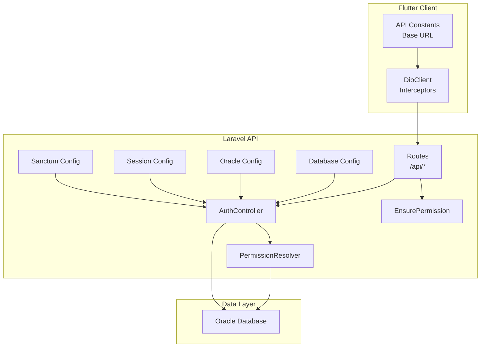
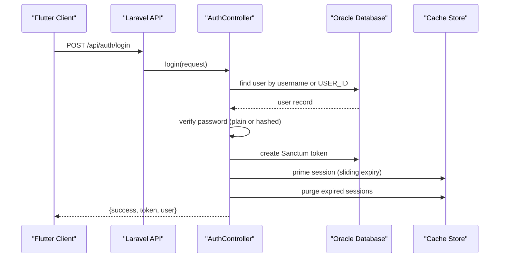
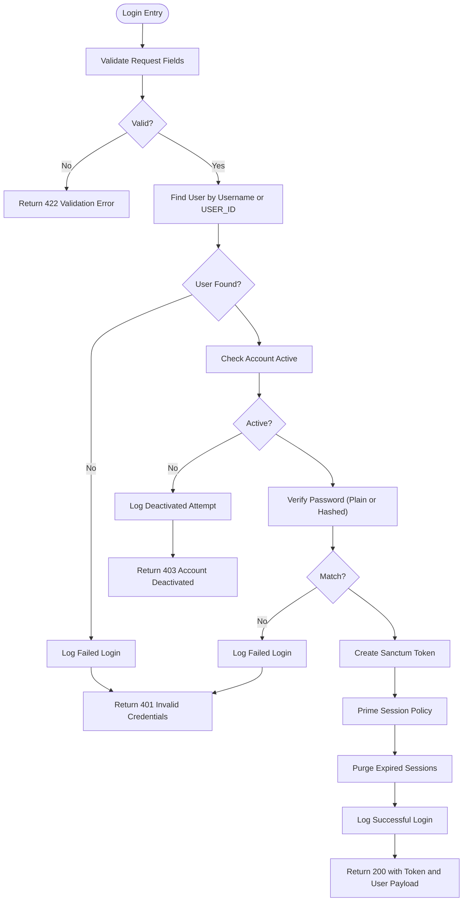
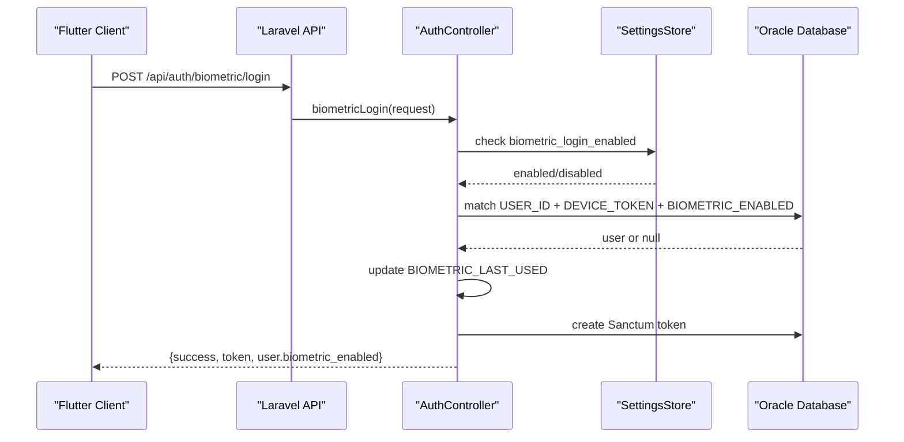
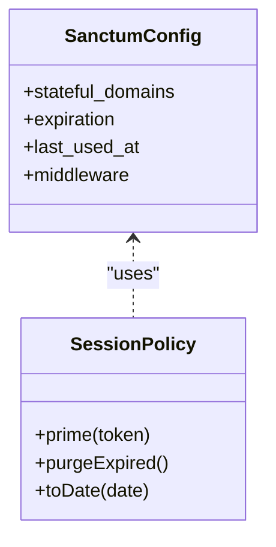
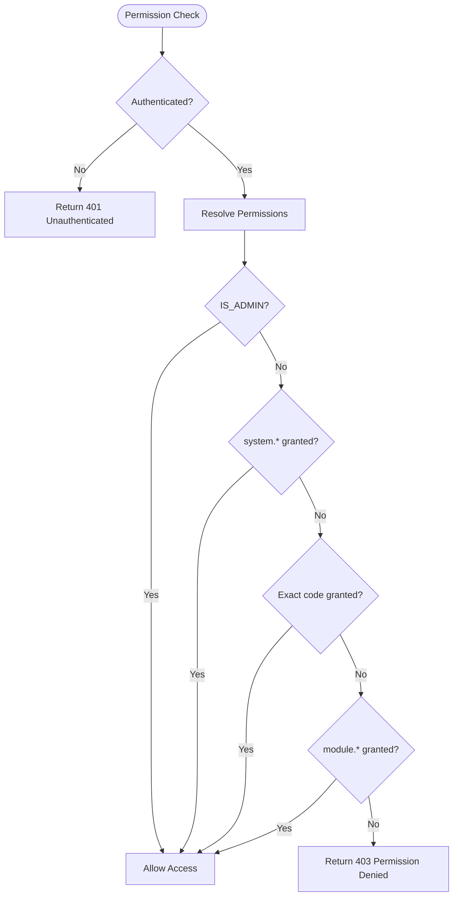
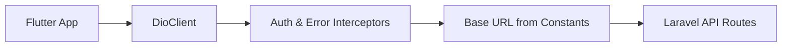
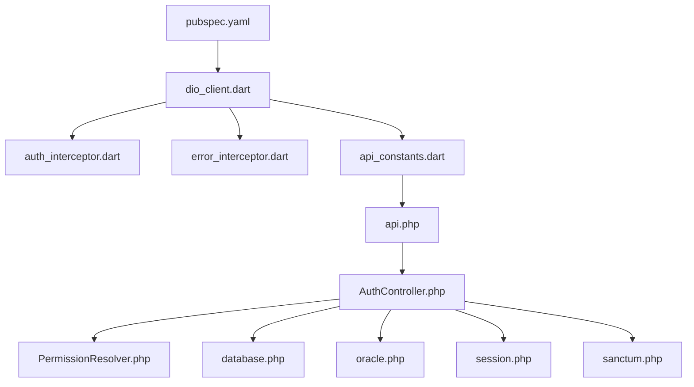

# Troubleshooting Guide

<cite>
**Referenced Files in This Document**
- [AuthController.php](file://kyApp_API/app/Http/Controllers/AuthController.php)
- [EnsurePermission.php](file://kyApp_API/app/Http/Middleware/EnsurePermission.php)
- [PermissionResolver.php](file://kyApp_API/app/Support/PermissionResolver.php)
- [api.php](file://kyApp_API/routes/api.php)
- [database.php](file://kyApp_API/config/database.php)
- [oracle.php](file://kyApp_API/config/oracle.php)
- [session.php](file://kyApp_API/config/session.php)
- [sanctum.php](file://kyApp_API/config/sanctum.php)
- [pubspec.yaml](file://pubspec.yaml)
- [dio_client.dart](file://lib/core/network/dio_client.dart)
- [auth_interceptor.dart](file://lib/core/network/auth_interceptor.dart)
- [error_interceptor.dart](file://lib/core/network/error_interceptor.dart)
- [api_constants.dart](file://lib/core/constants/api_constants.dart)
</cite>

## Table of Contents
1. [Introduction](#introduction)
2. [Project Structure](#project-structure)
3. [Core Components](#core-components)
4. [Architecture Overview](#architecture-overview)
5. [Detailed Component Analysis](#detailed-component-analysis)
6. [Dependency Analysis](#dependency-analysis)
7. [Performance Considerations](#performance-considerations)
8. [Troubleshooting Guide](#troubleshooting-guide)
9. [Conclusion](#conclusion)

## Introduction
This guide provides systematic troubleshooting for the Ky Apps system, covering authentication failures, biometric login issues, session management problems, Oracle database connectivity and performance, permission denied errors, IBAC configuration, network connectivity, timeouts, SSL certificate issues, debugging tools usage, log analysis techniques, and performance profiling methods. It is designed to help both developers and operators diagnose and resolve complex issues quickly.

## Project Structure
Ky Apps consists of:
- A Flutter mobile client that uses Dio for HTTP requests and local_auth for biometrics.
- A Laravel API backend with Sanctum token-based authentication, custom IBAC permissions, and an Oracle database connection.
- Configuration files for database connections, sessions, and Sanctum behavior.

**Diagram sources**
- [dio_client.dart:1-50](file://lib/core/network/dio_client.dart#L1-L50)
- [api_constants.dart:1-10](file://lib/core/constants/api_constants.dart#L1-L10)
- [api.php:17-34](file://kyApp_API/routes/api.php#L17-L34)
- [AuthController.php:47-163](file://kyApp_API/app/Http/Controllers/AuthController.php#L47-L163)
- [PermissionResolver.php:27-132](file://kyApp_API/app/Support/PermissionResolver.php#L27-L132)
- [database.php:116-127](file://kyApp_API/config/database.php#L116-L127)
- [oracle.php:1-29](file://kyApp_API/config/oracle.php#L1-L29)
- [session.php:21-36](file://kyApp_API/config/session.php#L21-L36)
- [sanctum.php:21-63](file://kyApp_API/config/sanctum.php#L21-L63)

**Section sources**
- [pubspec.yaml:30-46](file://pubspec.yaml#L30-L46)
- [dio_client.dart:1-50](file://lib/core/network/dio_client.dart#L1-L50)
- [api_constants.dart:1-10](file://lib/core/constants/api_constants.dart#L1-L10)
- [api.php:17-34](file://kyApp_API/routes/api.php#L17-L34)
- [AuthController.php:47-163](file://kyApp_API/app/Http/Controllers/AuthController.php#L47-L163)
- [PermissionResolver.php:27-132](file://kyApp_API/app/Support/PermissionResolver.php#L27-L132)
- [database.php:116-127](file://kyApp_API/config/database.php#L116-L127)
- [oracle.php:1-29](file://kyApp_API/config/oracle.php#L1-L29)
- [session.php:21-36](file://kyApp_API/config/session.php#L21-L36)
- [sanctum.php:21-63](file://kyApp_API/config/sanctum.php#L21-L63)

## Core Components
- Authentication controller handles password login, biometric login, logout, and user profile endpoints. It integrates Sanctum tokens, session policy, activity logging, and settings checks.
- Permission resolver implements IBAC (Identity-Based Access Control), caching grants, wildcard support, admin bypass, and payload generation for the client.
- Middleware enforces per-route permissions and returns standardized 401/403 responses.
- Routes define protected endpoints grouped by feature modules with explicit permission requirements.
- Database configuration includes Oracle connection details and Redis cache configuration.
- Session configuration controls driver, lifetime, cookies, and persistence.
- Sanctum configuration manages stateful domains, expiration behavior, last-used tracking, and middleware.

**Section sources**
- [AuthController.php:47-163](file://kyApp_API/app/Http/Controllers/AuthController.php#L47-L163)
- [PermissionResolver.php:27-132](file://kyApp_API/app/Support/PermissionResolver.php#L27-L132)
- [EnsurePermission.php:25-53](file://kyApp_API/app/Http/Middleware/EnsurePermission.php#L25-L53)
- [api.php:17-34](file://kyApp_API/routes/api.php#L17-L34)
- [database.php:116-127](file://kyApp_API/config/database.php#L116-L127)
- [session.php:21-36](file://kyApp_API/config/session.php#L21-L36)
- [sanctum.php:21-63](file://kyApp_API/config/sanctum.php#L21-L63)

## Architecture Overview
The authentication flow involves the Flutter client sending credentials to the Laravel API. The API validates input, locates the user, verifies credentials, creates a Sanctum token, primes the session, purges expired sessions, logs the event, and returns a token plus user payload including IBAC permissions.

**Diagram sources**
- [AuthController.php:47-163](file://kyApp_API/app/Http/Controllers/AuthController.php#L47-L163)
- [database.php:116-127](file://kyApp_API/config/database.php#L116-L127)
- [sanctum.php:47-77](file://kyApp_API/config/sanctum.php#L47-L77)

## Detailed Component Analysis

### Authentication Flow and Error Handling
- Input validation ensures required fields are present; missing data returns 422 with localized messages.
- User lookup supports English/Arabic usernames and numeric USER_ID inputs.
- Deactivated accounts return 403 with a clear message.
- Password verification supports legacy plain text and modern hashes; mismatches return 401 without enumerating valid usernames.
- Successful login issues a Sanctum token, primes the session, purges expired entries, logs success, and returns token plus user payload.

**Diagram sources**
- [AuthController.php:47-163](file://kyApp_API/app/Http/Controllers/AuthController.php#L47-L163)

**Section sources**
- [AuthController.php:47-163](file://kyApp_API/app/Http/Controllers/AuthController.php#L47-L163)

### Biometric Authentication Issues
- Biometric login endpoint requires user_id and device_token; it checks platform kill-switch settings before proceeding.
- Device-token binding ensures one device per user; conflicts return 409.
- Successful biometric login updates last-used timestamp, issues a token under the same session policy, and returns a payload indicating biometric enabled.

**Diagram sources**
- [AuthController.php:316-410](file://kyApp_API/app/Http/Controllers/AuthController.php#L316-L410)

**Section sources**
- [AuthController.php:316-410](file://kyApp_API/app/Http/Controllers/AuthController.php#L316-L410)

### Session Management Problems
- Sanctum expiration is intentionally null to avoid hard absolute age; sliding renewal and idle expiry are managed by SessionPolicy via EXPIRES_AT.
- Last-used-at tracking is enabled to reflect real activity on active-screens.
- Session driver defaults to database; ensure SESSION_DRIVER, SESSION_LIFETIME, and related environment variables are correctly set.

**Diagram sources**
- [sanctum.php:47-77](file://kyApp_API/config/sanctum.php#L47-L77)
- [session.php:21-36](file://kyApp_API/config/session.php#L21-L36)

**Section sources**
- [sanctum.php:47-77](file://kyApp_API/config/sanctum.php#L47-L77)
- [session.php:21-36](file://kyApp_API/config/session.php#L21-L36)

### Permission Denied Errors and IBAC Configuration
- EnsurePermission middleware denies access if no authenticated user exists (401) or if the required permission is missing (403).
- PermissionResolver evaluates rules in order: admin bypass, system wildcard, explicit code, module wildcard, then deny.
- Grants are cached with a safe byte limit to avoid Oracle MERGE bound size errors; oversized sets skip cache.

**Diagram sources**
- [EnsurePermission.php:25-53](file://kyApp_API/app/Http/Middleware/EnsurePermission.php#L25-L53)
- [PermissionResolver.php:27-132](file://kyApp_API/app/Support/PermissionResolver.php#L27-L132)

**Section sources**
- [EnsurePermission.php:25-53](file://kyApp_API/app/Http/Middleware/EnsurePermission.php#L25-L53)
- [PermissionResolver.php:27-132](file://kyApp_API/app/Support/PermissionResolver.php#L27-L132)

### Network Connectivity and API Routing
- Flutter client uses Dio with interceptors for auth and error handling; base URL is defined in constants.
- Routes group protected endpoints under Sanctum middleware and require specific permissions per route.

**Diagram sources**
- [dio_client.dart:1-50](file://lib/core/network/dio_client.dart#L1-L50)
- [auth_interceptor.dart:1-20](file://lib/core/network/auth_interceptor.dart#L1-L20)
- [error_interceptor.dart:1-20](file://lib/core/network/error_interceptor.dart#L1-L20)
- [api_constants.dart:1-10](file://lib/core/constants/api_constants.dart#L1-L10)
- [api.php:17-34](file://kyApp_API/routes/api.php#L17-L34)

**Section sources**
- [dio_client.dart:1-50](file://lib/core/network/dio_client.dart#L1-L50)
- [auth_interceptor.dart:1-20](file://lib/core/network/auth_interceptor.dart#L1-L20)
- [error_interceptor.dart:1-20](file://lib/core/network/error_interceptor.dart#L1-L20)
- [api_constants.dart:1-10](file://lib/core/constants/api_constants.dart#L1-L10)
- [api.php:17-34](file://kyApp_API/routes/api.php#L17-L34)

## Dependency Analysis
Key dependencies:
- Flutter client depends on Dio, local_auth, flutter_secure_storage, and go_router.
- Laravel API depends on Sanctum for token management, custom middleware for permissions, and Oracle database for user and permission data.
- Configuration files control database connections, session behavior, and Sanctum behavior.

**Diagram sources**
- [pubspec.yaml:30-46](file://pubspec.yaml#L30-L46)
- [dio_client.dart:1-50](file://lib/core/network/dio_client.dart#L1-L50)
- [auth_interceptor.dart:1-20](file://lib/core/network/auth_interceptor.dart#L1-L20)
- [error_interceptor.dart:1-20](file://lib/core/network/error_interceptor.dart#L1-L20)
- [api_constants.dart:1-10](file://lib/core/constants/api_constants.dart#L1-L10)
- [api.php:17-34](file://kyApp_API/routes/api.php#L17-L34)
- [AuthController.php:47-163](file://kyApp_API/app/Http/Controllers/AuthController.php#L47-L163)
- [PermissionResolver.php:27-132](file://kyApp_API/app/Support/PermissionResolver.php#L27-L132)
- [database.php:116-127](file://kyApp_API/config/database.php#L116-L127)
- [oracle.php:1-29](file://kyApp_API/config/oracle.php#L1-L29)
- [session.php:21-36](file://kyApp_API/config/session.php#L21-L36)
- [sanctum.php:21-63](file://kyApp_API/config/sanctum.php#L21-L63)

**Section sources**
- [pubspec.yaml:30-46](file://pubspec.yaml#L30-L46)
- [dio_client.dart:1-50](file://lib/core/network/dio_client.dart#L1-L50)
- [api.php:17-34](file://kyApp_API/routes/api.php#L17-L34)
- [AuthController.php:47-163](file://kyApp_API/app/Http/Controllers/AuthController.php#L47-L163)
- [PermissionResolver.php:27-132](file://kyApp_API/app/Support/PermissionResolver.php#L27-L132)
- [database.php:116-127](file://kyApp_API/config/database.php#L116-L127)
- [oracle.php:1-29](file://kyApp_API/config/oracle.php#L1-L29)
- [session.php:21-36](file://kyApp_API/config/session.php#L21-L36)
- [sanctum.php:21-63](file://kyApp_API/config/sanctum.php#L21-L63)

## Performance Considerations
- Permission resolver caches grants per user with a safe byte limit to prevent Oracle MERGE bound size errors; oversized sets bypass cache to avoid request failure.
- Session policy manages sliding expiry and idle timeout; ensure cache store is healthy and configured appropriately.
- Database queries for grants use explicit SQL optimized for performance; monitor slow queries and consider indexing strategies in Oracle.

[No sources needed since this section provides general guidance]

## Troubleshooting Guide

### Authentication Problems
Symptoms:
- Login fails with 401 or 422.
- Deactivated account attempts return 403.
- Password mismatch returns generic 401.

Diagnosis steps:
- Inspect request payload for missing fields; validate against expected schema.
- Confirm user existence and correct username format (English/Arabic or numeric USER_ID).
- Check account activation status in the database.
- Verify password storage format (plain vs hashed) and matching logic.

Resolution:
- Correct input fields and encoding.
- Activate the account or restore proper credentials.
- Ensure password migration aligns with supported hash formats.

**Section sources**
- [AuthController.php:47-163](file://kyApp_API/app/Http/Controllers/AuthController.php#L47-L163)

### Biometric Authentication Issues
Symptoms:
- Biometric login disabled globally.
- Device-token conflict (409).
- Biometric login fails due to unregistered device or deactivated account.

Diagnosis steps:
- Check settings flag controlling biometric login enablement.
- Verify device-token uniqueness across users.
- Confirm USER_ID matches DEVICE_TOKEN and BIOMETRIC_ENABLED is set.
- Ensure account is active.

Resolution:
- Enable biometric login in settings if appropriate.
- Re-enroll device for the correct user.
- Reactivate account or re-register biometric enrollment.

**Section sources**
- [AuthController.php:316-410](file://kyApp_API/app/Http/Controllers/AuthController.php#L316-L410)

### Session Management Problems
Symptoms:
- Users unexpectedly logged out.
- Active sessions not reflecting last activity.
- Session cookie not sent or rejected.

Diagnosis steps:
- Verify Sanctum expiration is null to allow sliding renewal.
- Ensure last_used_at tracking is enabled.
- Check SESSION_DRIVER, SESSION_LIFETIME, and cookie settings (secure, http_only, same_site).

Resolution:
- Keep Sanctum expiration null; rely on SessionPolicy for idle expiry.
- Enable last_used_at tracking.
- Align session cookie configuration with deployment environment (HTTPS, domain, path).

**Section sources**
- [sanctum.php:47-77](file://kyApp_API/config/sanctum.php#L47-L77)
- [session.php:21-36](file://kyApp_API/config/session.php#L21-L36)

### Database Connection Issues with Oracle
Symptoms:
- Cannot connect to Oracle.
- Query performance degradation.
- Character set or date formatting issues.

Diagnosis steps:
- Validate host, port, service_name, username, password, charset in database config.
- Check oracle-specific settings like TNS, server version, edition, load balance.
- Monitor query execution plans and indexes for slow queries.
- Ensure NLS session variables are set correctly for date/time formatting.

Resolution:
- Correct connection parameters and network reachability.
- Optimize queries and add indexes where necessary.
- Adjust NLS session variables to match application expectations.

**Section sources**
- [database.php:116-127](file://kyApp_API/config/database.php#L116-L127)
- [oracle.php:1-29](file://kyApp_API/config/oracle.php#L1-L29)

### Permission Denied Errors and IBAC Configuration
Symptoms:
- 401 when accessing protected routes.
- 403 with permission code in response.
- Admin users still blocked unexpectedly.

Diagnosis steps:
- Confirm user is authenticated via Sanctum.
- Check required permission code on the route.
- Validate PermissionResolver evaluation order and grant table state.
- Ensure IS_ADMIN flag is correctly set if admin bypass is expected.

Resolution:
- Authenticate the user and refresh permissions.
- Grant the required permission or module wildcard.
- Correct IS_ADMIN flag if admin access is intended.

**Section sources**
- [EnsurePermission.php:25-53](file://kyApp_API/app/Http/Middleware/EnsurePermission.php#L25-L53)
- [PermissionResolver.php:27-132](file://kyApp_API/app/Support/PermissionResolver.php#L27-L132)

### Network-Related Issues
Symptoms:
- API connectivity failures.
- Timeouts during requests.
- SSL certificate errors.

Diagnosis steps:
- Verify base URL in Flutter constants matches deployed API endpoint.
- Inspect Dio interceptors for auth headers and error handling.
- Check network logs for DNS resolution, TLS handshake, and certificate validity.
- Ensure CORS and proxy configurations allow cross-origin requests if applicable.

Resolution:
- Update base URL to correct host/port.
- Fix certificate trust chain or configure trusted CA.
- Adjust timeouts and retry policies in Dio client.

**Section sources**
- [api_constants.dart:1-10](file://lib/core/constants/api_constants.dart#L1-L10)
- [dio_client.dart:1-50](file://lib/core/network/dio_client.dart#L1-L50)
- [auth_interceptor.dart:1-20](file://lib/core/network/auth_interceptor.dart#L1-L20)
- [error_interceptor.dart:1-20](file://lib/core/network/error_interceptor.dart#L1-L20)

### Debugging Tools Usage
- Flutter DevTools: Use to inspect UI state, network calls, and performance metrics.
- Laravel Debugbar: Enable to trace request lifecycle, queries, and middleware execution.
- Oracle SQL Developer: Connect using configured credentials to inspect tables, run queries, and analyze performance.
- Network request inspection: Use browser devtools or mobile network inspector to capture requests/responses and headers.

[No sources needed since this section provides general guidance]

### Log Analysis Techniques
- Review authentication events (login, biometric login/logout) for patterns and failures.
- Correlate 401/403 responses with permission codes and user roles.
- Track session expiry events and last-used timestamps to identify idle timeouts.
- Analyze database query logs for slow or failing queries tied to permission resolution.

**Section sources**
- [AuthController.php:47-163](file://kyApp_API/app/Http/Controllers/AuthController.php#L47-L163)
- [PermissionResolver.php:27-132](file://kyApp_API/app/Support/PermissionResolver.php#L27-L132)

### Performance Profiling Methods
- Profile permission resolution cache hits/misses and payload sizes to avoid Oracle MERGE bound errors.
- Monitor session policy operations (prime/purge) for overhead.
- Use database profiling tools to identify slow queries and optimize indexes.
- Measure API response times across endpoints to detect bottlenecks.

**Section sources**
- [PermissionResolver.php:27-132](file://kyApp_API/app/Support/PermissionResolver.php#L27-L132)
- [database.php:116-127](file://kyApp_API/config/database.php#L116-L127)

## Conclusion
This guide consolidates common issues and their resolutions across authentication, biometric login, session management, Oracle connectivity, permissions, and networking. By following the diagnostic steps and leveraging the provided diagrams and source references, you can systematically identify root causes and apply targeted fixes to stabilize the Ky Apps system.